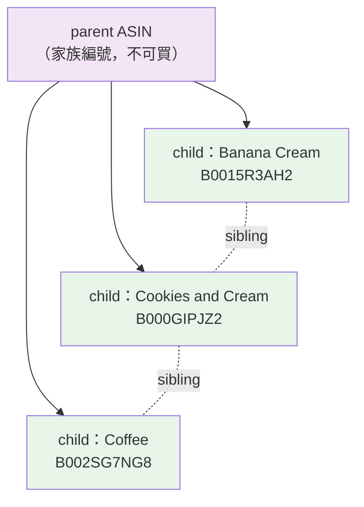
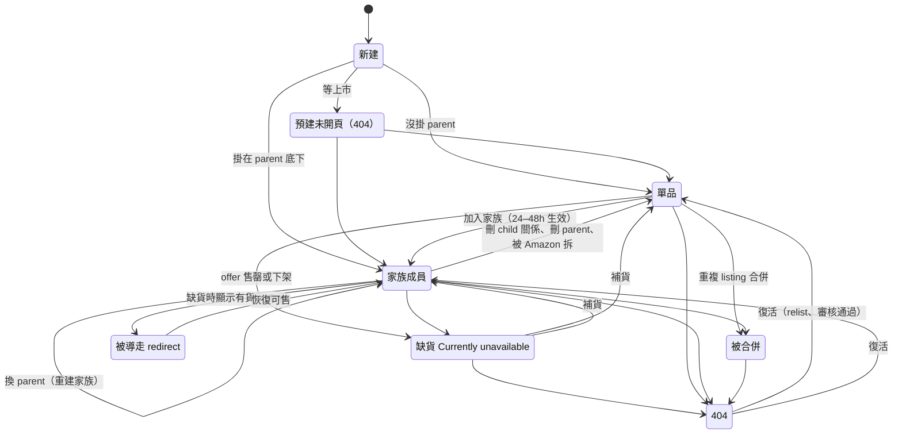

# Amazon ASIN 生命週期：家族、跳轉、404 與 Keepa 能看到什麼

> **文件目的**：把「一顆 ASIN 會經歷什麼」講成一條看得懂的線，讓你抓頁、看 Keepa、讀報表時，遇到「同一顆 ASIN 兩次抓到不同東西」「parent 突然換號」「昨天有頁今天 404」不會以為是資料壞了。
>
> **適用對象**：爬蟲工程師、資料工程師、要讀 Amazon 相關報表的分析與測試人員。讀之前最好先看過 [Amazon & Keepa 基礎概念完全指南](./amazon_concepts_guide.md) 的 ASIN 與 Parent-Child 兩節。
>
> **來源**：2026-10-15～16 的內部調查（ian 與 Brokkr session），對象是我們抓到的 US 約 18 萬顆、GB 約 1.4 萬顆 ASIN 的最新頁面，加上四份 Keepa 快照（10-01、10-09、10-12、10-15）與網路文獻。文中數字都來自這批資料，**不是 Amazon 全站的統計**。
>
> **證據等級標記**（每個結論後面會標）：
> - 【官】Amazon 官方文件、SP-API 公告、論壇上 Amazon 員工回覆
> - 【K官】Keepa 官方 API 文件
> - 【社】賣家論壇、顧問或工具商的說法（二手）
> - 【資】我們自己資料算出來的
> - 【推】推測，還沒有證據證實

---

## 目錄

1. [一句話總結](#1-一句話總結)
2. [先搞懂 parent 與 sibling](#2-先搞懂-parent-與-sibling)
3. [生命週期全貌](#3-生命週期全貌)
4. [打開 A 為什麼看到 B：自動跳轉](#4-打開-a-為什麼看到-b自動跳轉)
5. [賣家能不能換家族：刪掉重建](#5-賣家能不能換家族刪掉重建)
6. [家族多常變、怎麼變](#6-家族多常變怎麼變)
7. [404：N／P 序列、下架與復活](#7-404np-序列下架與復活)
8. [為什麼很多保健品一下就下架](#8-為什麼很多保健品一下就下架)
9. [口味評論新規與 Set name](#9-口味評論新規與-set-name)
10. [容易講錯的幾句話](#10-容易講錯的幾句話)
11. [常見問題](#11-常見問題)
12. [參考資料](#12-參考資料)

---

## 1. 一句話總結

| 問題 | 答案 | 等級 |
|---|---|---|
| parent 和 sibling 是什麼 | parent 是**家族編號**，像資料夾，不能買、前台看不到；sibling 是**同家族的款式**，每個都是可買的 ASIN，就是商品頁那排口味／尺寸按鈕 | 官 |
| 打開 A 會不會自動跳到 B | 會。款式缺貨時 Amazon 顯示有貨的 sibling；開 parent 網址會顯示一個預設款式；重複商品合併後舊 ASIN 導到保留的那顆。Amazon 沒公開跳轉規則 | K官＋資 |
| 跳轉多常見 | US 最新頁 8.4% 被導走，但其中 47.5% 是我們請求了 parent；扣掉後真正的 sibling 跳轉約 **4.4%**，95% 留在同家族 | 資 |
| 會跳到別的家族嗎 | 很少，約 3%。人工看 15 例：12 例是重複 listing 合併、2 例改名改版、1 例同品牌不同配方，**沒有跳到完全不相干的商品** | 資 |
| 賣家能不能換家族 | 能加減款式；**不能直接改既有家族**（換分類主題、合併、搬到別家族）。要「刪舊 parent → 建新 parent → 款式重新掛上」，所以 parent 換新號、款式 ASIN 不變 | 官＋社 |
| 家族多常變 | 每週約 0.5% 的 ASIN 換 parent（每月約 2%）；11 天內 97–98% 的家族成員不變；變動集中在新家族，多半是整族換到全新 parent | 資 |
| Keepa 的家族資料不對嗎 | 多半是**舊了，不是錯了**：抓頁與 Keepa 更新時間差越大，不一致越多（1 天內 0.35%，超過 30 天 2.95%） | 資 |
| 404 是什麼 | 不等於永久死亡。曾 404 的 ASIN 裡 98% 從沒給我們看過頁；看到「有頁 → 404」的下架案例中位數 17 天前就先「Currently unavailable」；也有 404 後幾天開頁的新品 | 資 |
| 為什麼很多一下就下架 | 死掉的 ASIN 裡 44% 上架半年內就死。半年內死的主因：鋪貨型品牌整批消失（約 37%）、賣過一陣子才死（33%）、詐騙漏斗類（12%）、上架沒賣出（11%） | 資 |
| 口味評論怎麼了 | 2026-02～05 起不同口味的款式不再共享評論；有賣家把口味改成「Set name」等分類讓評論併回，代價是重建家族、parent 換號 | 社＋資 |
| Keepa 能追家族變化嗎 | parent 欄可信（與頁面 98% 一致），但要看歷史得靠自己定期存快照比對；`isRedirectASIN` 只有帶 offers 參數才有效、不給目標 ASIN；`product_type=4` 可當下架訊號（要連續兩次） | K官＋資 |

---

## 2. 先搞懂 parent 與 sibling

### 2.1 家族的比喻

Amazon 用 **variation family（變體家族）** 把同一個商品的不同款式放在同一頁。家族有三個東西：

| 名詞 | 白話 | 能不能買 | 前台看得到嗎 |
|---|---|---|---|
| **parent ASIN** | 家族編號。像一個資料夾，只負責把款式綁在一起 | 不能，沒有價格也沒有庫存 | 看不到；開它的網址會被顯示成某個款式 |
| **child ASIN** | 一個可買的款式 | 能 | 看得到，有自己的網址 |
| **sibling** | 同一個 parent 底下的其他 child，彼此互為 sibling | 能 | 就是商品頁上那排口味、尺寸、包數按鈕 |
| **variation theme（分類主題）** | 用什麼屬性區分款式：Flavor、Size、Color、Set name…… | — | 按鈕上方的標籤文字 |

例子：Optimum Nutrition 乳清蛋白的 Banana Cream `B0015R3AH2` 和 Cookies & Cream `B000GIPJZ2` 是 sibling，同屬一個 parent。消費者在同一頁切換口味時，網址會換成對應的 child ASIN。

### 2.2 幾條基本規則【官＋社】

- 一個 child 同一時間只能屬於一個 parent。
- 同家族必須同品牌、同商品類型；不能把不相關的商品拉進來蹭評論（這是 Amazon 的 variation policy，違規會被拆散甚至停權）。
- 家族關係**以站（marketplace）為單位**：US 和 GB 的同一顆 ASIN 可能一邊有家族、一邊是單品，parent 也不一定相同。
- Keepa 把 parent 歸成 `productType = 5`（VARIATION_PARENT），child 的 `parentAsin` 欄位指向它。【K官】

### 2.3 開 parent 的網址會發生什麼

直接開 `/dp/{parent}`，Amazon 不會顯示「這是 parent」，而是**挑一個款式顯示**（通常是預設款式）。這不是真的「跳」，而是前台把 parent 渲染成某個 child。它是第 4 節「被導走」裡最大的一類來源，先記住。【社＋資】

---

## 3. 生命週期全貌

一顆 ASIN 在同一個站裡大致會走過這些狀態：

| 狀態 | 前台看到什麼 | 說明 |
|---|---|---|
| **單品** | 正常頁，沒有款式按鈕 | 頁面上的 parent 欄會寫自己 |
| **家族成員** | 正常頁，有款式按鈕 | 是某個 parent 的 child |
| **缺貨（Currently unavailable）** | 頁還在，沒有價格、沒有加入購物車 | 所有賣家都沒 offer；下架前的常見狀態 |
| **被導走（redirect）** | 開 A 的網址，顯示的是 B 的頁 | 整頁都是 B 的內容，包含家族列表、品牌、評論 |
| **被合併** | 舊 ASIN 導到保留的那顆 | 重複 listing 合併後，評論與歷史併入目標 ASIN【官】；舊網址會導向新頁是賣家與工具商的說法，Amazon 沒有明文【社】 |
| **404（dog page）** | Amazon 的狗狗頁 | 詳情頁不在目錄上。可能是移除、政策下架、也可能只是還沒開頁 |
| **預建未開頁** | 404 | 新 ASIN 已建立，上市前不開放；之後會變成有頁 |

這張圖最重要的一點：**404 不是終點**，「被導走」也不是永久狀態，兩者都會來回。

---

## 4. 打開 A 為什麼看到 B：自動跳轉

### 4.1 三種原因

Amazon 的目標很單純：讓顧客停在**買得到**的頁。所以：

| 原因 | 發生什麼 | 等級 |
|---|---|---|
| **款式缺貨** | 某個 child 不可售，Amazon 把它導到同家族有貨的 sibling。Keepa 對 `isRedirectASIN` 的官方例子就是「黑色缺貨，導到紅色」 | K官 |
| **請求了 parent** | parent 本來就不可買，Amazon 顯示預設款式（見 2.3） | 社＋資 |
| **重複商品合併** | 兩個 listing 其實是同一件商品，合併後舊 ASIN 導到保留的那顆，可能落在另一個家族 | 官（合併）＋社（導向） |

Amazon **沒有公開**跳轉的判斷邏輯。哪些缺貨款式會被導走、哪些會直接顯示 Currently unavailable，我們只能從資料看傾向，不能當規則。【推】

一個會影響所有判讀的結構事實：**被導走時，整頁都是 B 的**。頁面上的家族列表、parent、品牌、標題、評論，都屬於 B，不屬於 A。而且 A 一律不在 B 頁面的款式列表裡（US 14,734 個被導走的頁，0 個例外）。【資】

### 4.2 跳轉有多常見

| 項目 | US | GB |
|---|---|---|
| 最新頁被導走的比例 | 8.4%（15,518 ／ 184,119） | 1.4%（200 ／ 14,428） |
| 其中請求的 A 其實是 parent | **47.5%** | 0 |
| 扣掉 parent 後，真正的 sibling 跳轉 | 約 8,146 顆，**約 4.4%** | 200 顆 |
| 目標在同一個 Keepa 家族 | **95.7%** | 99.5% |
| 被導走者的家族仍有可買款式 | 86% | — |

兩件事要記得：

- **8.4% 這個數字不能直接用**。將近一半是「抓了 parent，Amazon 給預設款式」，那不是生命週期事件。GB 的母體沒有收 parent ASIN，所以 GB 的 200 顆都是真跳轉。【資】
- **跳轉不是穩定屬性**。同一顆 ASIN 重抓，會在「導走／不導走」之間翻，也會導到不同的 B（US 有多次抓取的 4,567 顆裡約 3% 變了）。頁面顯示的 B 比較像「**當下**的預設款式」，隨庫存變，不是永久關係。【資】

### 4.3 跨家族跳轉：很少，而且幾乎都是同一件商品

US 被導走的頁裡，目標不在 A 的 Keepa 家族的只有 517 顆（3.3%）。隨機抽 15 例人工看：

| 判斷 | 例數 | 典型 |
|---|---|---|
| 同商品，重複 listing 合併 | 12 | NOW Zinc 50 mg 的兩個舊 ASIN `B0013OWB3G`、`B000NP3CJS` 都導到 `B009K6TN08` |
| 同品牌改名或改版 | 2 | Venture Pal 電解質粉改名 |
| 同品牌不同配方 | 1 | Venture Pal 高鈉款導到一般款 |
| 完全不相干的商品 | **0** | — |

跨家族的 517 顆裡 489 顆品牌相同。所謂「跨 Keepa 家族」多半是 **Keepa 對 A 的紀錄停在「單品、無 parent」**，而 B 已經被收進新家族，是 Keepa 落後，不是真的跨商品。【資】

**NAD+ 的案例**：16 顆 Rossylla／Cuerpo Sano 品牌的 NAD+ 大包裝（Pack of 3～15）全部導到兩顆品牌欄寫 Rhameph 的小包裝。查證後是**同賣家把停售的多入裝併到還在賣的 1／2 入裝**，賣家、店面、標題都沒換，不是被搶。Rhameph 比較像同一個代工或代營運商掛在多個店面品牌上的共用品牌屬性。【資，信心中】

全庫唯一像真的 listing 被劫持的是 `B0045EHZNC`：Sundown 鎂的老頁（2009 年上架），商品概覽表的 Brand 列被 2025 年才出現的 PeakVigor 佔走，而且 Sundown 鐵劑導向它（不同產品）。這顆待人工確認。【資】

---

## 5. 賣家能不能換家族：刪掉重建

### 5.1 能做與不能做

| 動作 | 能不能 | 怎麼做 | 等級 |
|---|---|---|---|
| 新增 child、移除 child | 能 | 編輯 parent 的 Variations、flat file、Add Products 流程（舊的 Variation Wizard 2026-08 底退役） | 官＋社 |
| 把單品加進既有家族 | 能 | 新增 child、把既有 SKU 掛上去，24–48 小時生效 | 社 |
| 改既有家族的分類主題（例如 Flavor → Set name） | **不能直接改** | 刪舊 parent → 建新 parent → child 重新掛上 | 官（員工回覆）＋社 |
| 把 child 搬到另一個家族 | 不能直接搬 | 同上：解除關係，再掛到新 parent | 社 |
| 合併兩個家族 | 沒有獨立的官方流程 | 實務上就是把一家的 child 改掛到另一家的 parent | 社＋推 |

關鍵結論：**Amazon 不讓改既有家族的結構**。任何結構性的改動都是「刪舊 parent、建新 parent、款式重新掛上」。結果是：

- **parent 換新號**（新建的 parent 會拿到全新 ASIN，2026 年 10 月看到的多是 B0HK～B0HM 開頭）
- **款式的 ASIN 不變**（child 是可買商品，評論與歷史跟著 child）
- 重建期間 child 會先變成單品，幾天後再掛回新 parent（看快照時會拍到中間態，見第 6 節）

### 5.2 為什麼會刪掉重建

| 觸發 | 內容 | 等級 |
|---|---|---|
| **2025-09～11 淘汰零銷售的 variation theme** | Amazon 把過去 12 個月零銷售的分類主題從 Listings API 移除，受影響的商品類型超過 1,800 個，保健品的 VITAMIN 在內。官方給的修法就是刪舊 parent、建新 parent、重掛 child。不改的話 child 變成單品（仍可買） | 官 |
| **2026 口味評論新規後改分類** | 口味款式不再共享評論，部分賣家改用 Set name 之類的主題讓評論併回；改主題必須重建家族（第 9 節） | 社＋資 |
| **客服修錯的標準解法** | 家族被系統誤併、child 掛錯，Seller Support 常給的解法也是「刪掉兩個 parent 重建」 | 官（員工回覆） |

### 5.3 Amazon 自己也會動家族

不是只有賣家會改。論壇上 Amazon 員工承認過的系統行為：【官】

- **自動歸併**：分開上傳的幾個家族，幾小時後被併成一個大家族；要賣家舉證「為什麼不該合併」才拆開。
- **強制拆族**：被判定不符該類目的 variation policy，前台拆成單品，但賣家後台仍顯示關係完好。
- **別人的 contribution 勝出**：Amazon Retail（1P）或其他貢獻者建的 parent 把品牌方的 child 拉走，品牌方不一定能改回來。

從前台頁面看不出「誰改的」。能做的是型態推斷：整族同時搬到**全新** parent 比較像賣家重建；部分 child 被併到**既有**（常是別品牌或無品牌）parent 比較像系統歸併。【推】

---

## 6. 家族多常變、怎麼變

### 6.1 頻率【資】

用四份 Keepa 快照（10-01、10-09、10-12、10-15）比對，只算兩份都有而且 Keepa 確實重新觀測過的 ASIN：

| 指標 | US | GB |
|---|---|---|
| parent 狀態改變的比例 | 約 0.46% ／ 週（約 2% ／ 月） | 約 0.65% ／ 週（約 2.8% ／ 月） |
| child 換 parent | 0.36% ／ 週 | 0.63% ／ 週 |
| child 脫離家族變單品 | 0.34% ／ 週 | 0.34% ／ 週 |
| 新家族（parent 為 B0G／B0H 新號）換 parent | 0.92% ／ 週 | 0.90% ／ 週 |
| 舊家族換 parent | 0.12% ／ 週 | 0.34% ／ 週 |
| 11～14 天內家族成員完全不變 | 96.8% | 97.9% |

變化是**單調的，不是抖動**：有變的 ASIN 幾乎都只變一次，來回變的極少。而且變化與其他欄位一致（脫離家族時 `variants_count` 同時歸零），是真的拆併，不是欄位掉值。

### 6.2 主要型態：整族換號

child 從 P 搬到 Q 的 359 對（US）裡，**200 對是整個家族一起搬**，而且 Q 多半是 10 月才建立的全新 parent。也就是「家族組成大致不變，parent ID 換新」，正是第 5 節說的刪掉重建。child 在兩個既有家族之間遷移反而是少數。

### 6.3 一個完整的例子：Vitarevive 氫水錠

| 時間 | 舊 parent `B0GVPBRXHQ` | 新 parent `B0HM7V1PC7` |
|---|---|---|
| 10-01 | 13 個 child | 不存在 |
| 10-09 | 被 Keepa 標成 INVALID（`product_type = 4`） | 開始出現 |
| 10-12 | — | 收齊 12 個 child，全部來自舊家族 |

這是**重建，不是整併**：整併是多個家族併入一個既有編號；重建是同一批款式換到全新編號。「child 分兩批掛上」可能只是 Keepa 分兩次觀測到。【資】

### 6.4 拆開後沒連回去的那些

10-01 有 parent、10-12 變成 null 的 US 580 顆、GB 55 顆，後來怎麼了？

| 結局 | US | GB |
|---|---|---|
| Keepa 還沒再觀測到（未知） | 約 80% | 約 45% |
| 再觀測後仍是單品 | 約 19% | 約 36% |
| 掛上全新 parent（重建完成） | 0.3% | 16% |
| 回到原 parent（暫時性脫離） | 1% | 2% |

看得到結局的那批裡，約四分之一本身已經 INVALID 或被導走，這是商品死掉順帶失去 parent，不是家族重組。其餘「仍是單品」的，可能是賣家故意拆、Amazon 強制拆、重建失敗或還沒完成（掛回新 parent 約需 8～10 天），**資料分不出是誰的決定**。GB 有明確看到「同一舊家族，一部分 child 直接換到新 parent，一部分先 null、約一週後跟上，頁面比 Keepa 先看到重建完成」。【資】

---

## 7. 404：N／P 序列、下架與復活

### 7.1 先定義

每次抓取，一顆 ASIN 的結果不是有頁就是 404。把時間序寫成字串：**N ＝ 404、P ＝ 有頁**。

| 序列 | 意思 | US 顆數 |
|---|---|---|
| `N`、`NN`、`NNN`…… | 從來沒給我們看過頁 | 28,269（曾 404 者的 98%） |
| `PN`（含 `PNN`…） | 有頁，之後 404：**觀察到的下架** | 337 |
| `NP`（含 `NNP`…） | 先 404，之後有頁：**復活** | 246 |

曾 404 的 ASIN US 共 28,852 顆、GB 291 顆。【資】

### 7.2 下架長什麼樣

337 顆 `PN` 的「最後一頁」：**71% 是無價＋ Currently unavailable**，另有 15% 還 In Stock 有價、9% 是被導走的頁。從最後一頁到 404 的間隔中位數 **17 天**。所以下架的主路徑是「先沒 offer（Currently unavailable）→ 一段時間後從目錄消失（404）」。下架者以新 ASIN 為主（B0HB／B0HC 前綴居多）。【資】

最後一頁還 In Stock 就直接 404 的那些，不是自然賣完，是被移除（Amazon 或賣家主動），資料分不出是誰。【推】

### 7.3 復活：一次 404 不等於死

246 顆 `NP` 多是 B0H 開頭的新品，先連續 404 幾次，之後才有頁。例子 `B0H2WC5NH9` 兩天內 404 四次，第五次出現。這是 **ASIN 預建、等上市才開頁**，不是被下架又救回來。【資】

從 404 到有頁要幾天？論壇與客服說新商品前台最多 24 小時可見【社】；我們看到的中位數是 **8.6 天**，有的數週。差距較可能來自等上市日、保健品第三方檢驗（TIC 驗證約 2～4 週）、或類目審核。【推】

另外，同一輪抓取裡（幾小時內）有 19 顆既有頁又 404，說明 404 本身有暫時性成分。這也是為什麼「連續兩輪 404 才列入跳過清單」有必要。【資】

### 7.4 404 與跳轉怎麼分工

| 比較 | 404 | 被導走 |
|---|---|---|
| 有 Keepa 家族的比例 | 34% | 96% |
| 家族裡有可買 sibling 時，發生的機率 | 29% | **71%** |
| 家族裡沒有可買 sibling 時 | 60% | 40% |

方向很清楚：**沒家族的 ASIN 失效時沒有地方可導，只能 404；有家族、而且有可買 sibling 的傾向被導走。** 但這是傾向不是規則，同一個 parent 底下同時有被導走和 404 的 child 的家族有 520 個。404 與否是 Amazon 在 child 層級個別決定的。【資】

### 7.5 Keepa 怎麼看 404

Keepa 的 `productType = 4`（INVALID）涵蓋我們 404 ASIN 的 **95%**，而頁面還活著的 ASIN 只有 0.9% 是 4。Keepa 官方對 4 的註解是「invalid or deprecated ASIN, or other issues. **Might be temporary.**」所以它可以當下架訊號，但要**連續兩次**觀測到 4 才算。Keepa 不會把 404 的 ASIN 刪掉（89% 仍在），只是不太刷新它們。【K官＋資】

---

## 8. 為什麼很多保健品一下就下架

### 8.1 死者的年齡分布【資】

US 被請求過的 212,388 顆裡，死掉（一直 404 或有頁後 404）的有 28,606 顆。以「誕生到第一次 404」分：

| 年齡 | 顆數 | 佔死者 |
|---|---|---|
| ≤ 90 天 | 7,649 | 26.7% |
| 91～180 天 | 4,970 | 17.4% |
| 181～365 天 | 1,894 | 6.6% |
| > 1 年 | 13,502 | 47.2% |

**半年內就死的佔 44%，活超過一年的老商品佔 47%**，兩頭都大。2026 年誕生、被我們請求過的 ASIN 有 37.7% 已經死了，2025 年的是 10%，更早的 6～8%。快下架是 2026 年新品特別明顯的現象。

誕生日的估法：Keepa 的 `listedSince` 只有來源標為 observed 的可信，其餘多半是 Keepa 開始追蹤的日子；調查改用 ASIN 前綴（B0 後面的字母數字是依序發號的）推估，與可信的 `listedSince` 對照，差距中位數 0 天。

### 8.2 半年內死掉的，是哪幾種

| 白話原因 | 佔半年內死者 | 特徵 | 信心 |
|---|---|---|---|
| **1. 鋪貨型品牌整批鋪、整批消失** | **約 37%** | 造字品牌、一個品牌幾百顆、0 評論、有標價但只標一個月、誕生後中位 19 天價格就消失。例：TINDEDLY 964 顆 | 高（特徵非常一致）；但是 Amazon 移除、帳號被停、還是賣家自己刪，分不出來 |
| **2. 賣過一陣子才消失** | 約 33% | 有排名、評論或月銷，個別 ASIN 死；原因混合：賣不好下架、改版換新 ASIN、合規、限制商品、帳號事件 | 「賣過」信心高，細分原因分不出來 |
| **3. 詐騙漏斗類** | 約 12% | 標題像「Official XXX Supplement … Reviews」的 SEO 樣板商品，常同品牌同月整批死 | 高（內部流程判定）；被誰清掉不明 |
| **4. 上架了但從沒賣出** | 約 11% | 標了價、沒人買就消失（測款失敗）；純預建從未上架的很少 | 中 |
| 5. 重複 listing 被合併 | 約 1% | 最終網址換成別的 ASIN | 中（這是下限） |

注意這張表被我們的抽樣放大了：快下架組有八成來自專門抓新品與農場名單的批次。看 Amazon 保健品「自然狀態」的母體批次，比例變成詐騙漏斗約 30%、賣過才死約 54%、鋪貨型加未售約 9%。

> ⚠️ **「鋪貨型品牌」（KeepaBrandFarm）和「詐騙漏斗」（scam_funnel）不是 Keepa 或 Amazon 的分類。** 它們是我們內部 Keepa 處理流程自己判定的標記：鋪貨型大致是「單一品牌 20 顆以上、命名模板化、九成以上無評論、七成以上無排名、品牌年資不到兩年」；詐騙漏斗是標題模式判定。讀報表看到這兩個詞，要知道那是內部標籤，不是 Keepa 官方欄位。

刷評**不是**主因：快下架組 91% 沒有任何評論。

### 8.3 鋪貨型品牌在做什麼【社＋推】

一次上架大量通用商品測市場、搶關鍵字、趁熱門成分（淋巴排毒滴劑、驅蟲清腸之類的 TikTok 爆款）、分散帳號；賣不動就整批刪。網路上**沒有**保健品類 catalog spam 被打擊的一手報導，最接近的官方行為是 Amazon 對「大量 listing 零銷售」的賣家限制建立新 ASIN。

### 8.4 合規收緊：可能很大，但藏在資料裡分不出來

Amazon 保健品的合規要求這幾年一路加嚴：

| 時間 | 要求 | 等級 |
|---|---|---|
| 2024-04 起 | 成分檢驗報告（CoA）必須由 Amazon 合作的第三方檢驗機構（TIC）送出，未確認合規的 listing 可能被移除 | 官（員工公告） |
| 2026-03-31 | 顧問轉述 Amazon 來信：listing 上的萃取物重量必須與 Supplement Facts 一致，不符者停用 | 社（非官方原文） |

老商品那一群有個大事件：**hawaii pharm 2026-05 一次 1,291 顆下架**（品牌共 2,649 顆，2016 年起上架，100% 有排名、88% 有評論），同期還有 terravita、herbal terra 各數百顆。這三家都是「單一植物萃取、酊劑、一種植物一顆 ASIN」的大目錄，死亡時間落在 2026-03-31 期限後 1～3 個月，商品型態也正好踩到「萃取重量要與標示一致」。**時間與型態吻合，但沒有任何外部報導證實**，是推測。【推】

### 8.5 從抓取的角度看

- 第一次請求時 ASIN 年齡 0～30 天，404 率 16%；31～60 天 47%；61～90 天 51%。**上架後 1～3 個月是死亡高峰**，新品要早抓。
- 已經 404 過的 ASIN 再請求，99% 還是 404。重送已知 404 是最大的浪費。
- 「Currently unavailable」就是下架前的狀態，重抓多半只會換到 404。

---

## 9. 口味評論新規與 Set name

### 9.1 發生了什麼

2026 年 1 月公告、2 月 12 日起分批上線、5 月底完成：**只差口味（Flavor）的款式不再共享評論**；只差尺寸、顏色這類「非功能差異」的仍共享。這個描述來自工具商整理，**不是 Amazon 官方原文**。【社】

### 9.2 在我們資料裡看得到嗎：看得很清楚【資】

| 兩顆 sibling 的差異 | 評論數相同的比例（US，2026-09 後抓） |
|---|---|
| 只差口味 | **0.8%** |
| 只差尺寸／包數 | **90.3%** |
| 口味和尺寸都差 | 0.6% |

Keepa 的月序列更能看出轉折：同家族只差口味的 sibling，評論數相等的比例 2025 年全年在 42～59% 之間，2026-02 還有 44%，**2026-03 掉到 8.7%**，之後一路到 1% 以下；尺寸那一欄完全不動。家族層級看，US 1,224 個口味家族裡 653 個在 3 月拆開，個別大牌 2 月就拆（Optimum Nutrition 2026-02）。

頁面上的直接證據是每則評論下方的灰字 format strip（`Flavor Name: Orange | Size: …`）：口味頁的前幾則評論 98.8% 都是同口味，尺寸頁只有 43%。

### 9.3 賣家的對策：把 Flavor 改成 Set name

一小撮賣家（約佔口味家族頁的 1.3%）把分類主題從 Flavor 改成 **Set name**、Scent、Color 之類，評論就又併回一池：

| 家族 | 選擇器標籤 | 2026-02～07 | 2026-08 起 |
|---|---|---|---|
| Truvani 植物蛋白 `B0HGN1C4H2` | Set name | 各口味 68～2,973 | 全族約 8,100～8,300 |
| Evogen Isoject 乳清 `B0HGHH3PHR` | Set name | 各口味 4～149 | 全族 860～925 |
| Javvy 咖啡 `B0DK45C5Z3` | Set name | — | 評論併回 |
| Javvy Clear Protein | Scent | — | 評論併回 |

因為改主題必須重建家族（第 5 節），這些家族的 parent 都換成了 B0H 開頭的新號。它是家族變動的新來源之一，與第 6 節的「整族換號」是同一個機制。

也有 Amazon 自己「拆完又併、又拆」的例子（EarthChimp 蛋白粉），Amazon 是否會回收賣家改主題的做法，還不清楚。【推】

### 9.4 對分析的影響

- 2026-03 以前的口味家族評論數是全族合併值，之後是單一口味值。**跨這個時間點比較口味家族的評論數會看到假的斷崖**（例：Liquid I.V. Guava 從 283,180 變 121）。
- 用 parent 去重評論池會把九成以上的口味錯當複本；用「parent ＋ 評論數」當鍵會自動跟著 Amazon 拆池，是對的。

---

## 10. 容易講錯的幾句話

| 常聽到的說法 | 比較準確的說法 |
|---|---|
| 「US 有 8.4% 的頁會自動跳轉」 | 8.4% 裡將近一半是我們請求了 parent。真正的 sibling 跳轉約 4.4%。 |
| 「Keepa 判斷不了 ASIN 死活」 | `productType = 4` 可用，涵蓋 404 的 95%，但要連續兩次。 |
| 「Keepa 的家族資料是錯的」 | 多半是舊的。parent 欄與頁面 98.5% 一致，不一致隨時間差線性上升。 |
| 「品牌農場、詐騙漏斗是 Keepa 標的」 | 是我們內部 Keepa 處理流程自己判定的標記，不是 Keepa 或 Amazon 的分類。 |
| 「Amazon 公告口味評論不再共享」 | 這個描述來自工具商整理，不是 Amazon 官方原文。資料上看得到轉折在 2026-03。 |
| 「404 就是下架了」 | 曾 404 的 98% 從沒給我們看過頁；新品上市前會先 404；一次 404 不等於永久死亡。 |
| 「Vitarevive 家族被整併了」 | 是重建（同一批款式換到全新 parent），不是整併（多個家族併入既有編號）。 |
| 「NAD+ 那批是 listing 被搶」 | 查證後是同賣家把停售多入裝併到小包裝，品牌欄的 Rhameph 比較像共用品牌屬性。 |
| 「hawaii pharm 是因為合規新規被下架」 | 時間與型態吻合，但沒有任何外部報導證實，是推測。 |

---

## 11. 常見問題

**Q：同一顆 ASIN 今天抓到 A 的頁、明天抓到 B 的頁，資料壞了嗎？**
A：多半沒壞。被導走是依庫存變的動態行為，同一顆會在導走／不導走之間翻，也會導到不同的 sibling。記下請求的 ASIN 與最終網址的 ASIN 兩個欄位，就能分辨。

**Q：Keepa 說它的 parent 是 X，頁面說是 Y，信誰？**
A：先看誰比較新。不一致的案例裡 88% 是 Keepa 較新，因為我們抓頁常比 Keepa 更新早幾週。X 和 Y 如果一個是 B0G／B0H 新號、一個是舊號，幾乎就是重建換號。要「現在」的家族，以最近抓的頁面為準。

**Q：怎麼知道一個家族是被整併還是重建？**
A：看新 parent 在舊家族變化前存不存在。新 parent 原本不存在、收進來的 child 全來自同一個舊家族 ＝ 重建；新 parent 原本就有別的 child ＝ 整併或遷移。

**Q：為什麼有些缺貨款式會被導走、有些直接顯示 Currently unavailable？**
A：Amazon 沒公開規則。資料上看，家族裡有可買 sibling 時被導走的機率約七成，沒有時約四成，但同一家族裡兩種都會同時出現。

**Q：賣家刪掉 parent，款式會消失嗎？**
A：不會。parent 本來就不可買，刪掉只是解除關係，child 變成單品、仍可買。幾天後掛到新 parent 就是重建完成。

**Q：404 的 ASIN 會不會被拿去給別的商品用？**
A：沒有任何證據顯示 Amazon 會回收 ASIN 重新指派。但「同一個 ASIN 的內容被改成別的品牌或商品」（劫持、目錄污染）有案例，效果上像被重新指派，這種情況請求的 ASIN 不變、頁面不會導走。

**Q：新品抓到 404，要隔多久再試？**
A：復活的中位數是 8.6 天，而且集中在剛上架那幾天。已經 404 過的 ASIN 再請求 99% 還是 404，重試間隔拉長、或等 Keepa 出現價格再抓比較划算。

---

## 12. 參考資料

### Keepa 官方
- [Keepa Product Object](https://keepa.com/api-docs/product-object.html)：`productType`、`parentAsin`、`parentAsinHistory`、`variations`、`historicalVariations`、`isRedirectASIN` 的定義
- [Keepa Product Request](https://keepa.com/api-docs/product.html)：`offers`、`history`、`historical-variations`、`update` 參數
- [keepacom/api_backend Product.java](https://github.com/keepacom/api_backend/blob/master/src/main/java/com/keepa/api/backend/structs/Product.java)

### Amazon 官方
- [SP-API changelog：Upcoming removal of unused variation themes](https://developer-docs.amazon/sp-api/changelog/upcoming-removal-of-unused-variation-themes-in-the-listings-items-api)（2025-09～11 淘汰零銷售 variation theme 與官方修法）
- [SP-API Catalog Items：relationships 以 marketplace 分組](https://developer-docs.amazon/sp-api/docs/catalog-items-api-v2022-04-01-use-case-guide)
- Seller Central help：About parent-child relationships（8841）、Potential duplicates and split variations（G202105450）、Merge duplicate product pages（G201950590）。這些頁面需登入，調查時只讀到存檔或摘要。

### 賣家論壇（Amazon 員工回覆）
- [Deleting and creating a new parent ASIN](https://sellercentral-europe.amazon.com/seller-forums/discussions/t/84897c71-6e5c-48b9-8d61-721be5226ef9)：刪 parent 不刪 child，child 先變單品
- [Amazon Merging My Parent SKUs/ASINs](https://sellercentral-europe.amazon.com/seller-forums/discussions/t/088f3228-c45a-45de-a39a-eb6eb2024d34)：系統自動歸併
- [Parent-Child Listings Disconnected](https://sellercentral-europe.amazon.com/seller-forums/discussions/t/60179a01-e5b8-4db0-b3cd-f7af9e8b94ea)：前台拆散、後台仍顯示關係
- [Listings Lounge: Dealing With Duplicate ASINs](https://sellercentral.amazon.com/seller-forums/discussions/t/5ffbcec9-0bee-4614-b9cb-8e708e5c2916)：合併後評論與歷史併入目標 ASIN
- [Dietary supplement CoA 政策更新](https://sellercentral.amazon.com/seller-forums/discussions/t/3c89099d-06aa-453f-95a6-a2eea54260ab)：2024-04 起 CoA 須經合作 TIC

### 工具商與顧問（二手）
- [Cahoot：Amazon review sharing across variations](https://www.cahoot.ai/amazon-review-sharing-across-variations/)：2026 口味評論新規整理
- [My Amazon Guy：Deprecated variation themes](https://myamazonguy.com/news/deprecated-amazon-variation-themes/)：受影響類型含 VITAMIN
- [ppc.land：March deadline over inflated supplement claims](https://ppc.land/amazon-sellers-face-march-deadline-over-inflated-supplement-claims/)：2026-03-31 萃取重量須與標示一致
- [Intertek：Amazon dietary supplement compliance FAQ（2026-06）](https://preview.intertek-br.com/contentassets/b6a3f852cc864cacb5932bdfeb97d94c/amazon-dietary-supplement-compliance-faq-june2026.pdf)

### 本專案相關文件
- [Amazon & Keepa 基礎概念完全指南](./amazon_concepts_guide.md)：ASIN、Parent-Child、Buy Box、1P/3P
- [Keepa Product Object 實戰備忘錄](./product_object_reference.md)：欄位總表
- [Keepa API 查詢方法完整參考](./keepa_api_query_methods.md)：參數與 token
- [資料來源與關聯欄位指南](../data-sources-guide.md)：ASIN 與其他識別碼的串接

---

## 版本歷史

| 版本 | 日期 | 作者 | 變更說明 |
|------|------|------|----------|
| 1.0 | 2026-10-16 | Dustin | 初版。整理自 2026-10-15～16 的 ASIN lifecycle 內部調查（ian 與 Brokkr session） |

---

**文件版本**：1.0
**最後更新**：2026-10-16
**維護者**：LuminNexus Team
