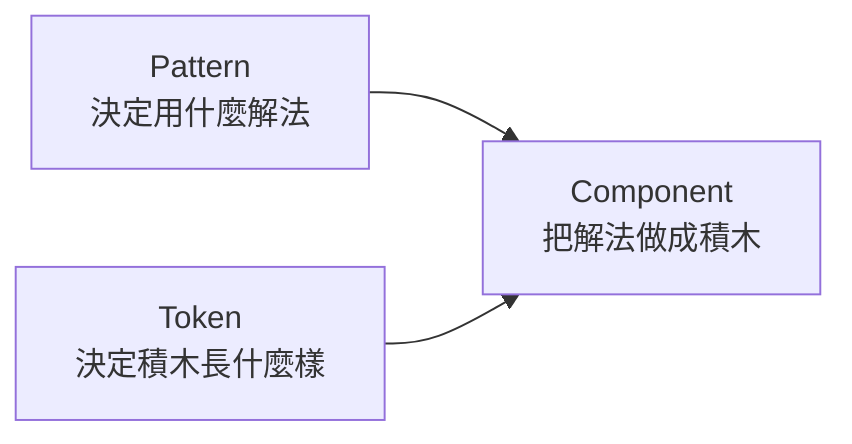
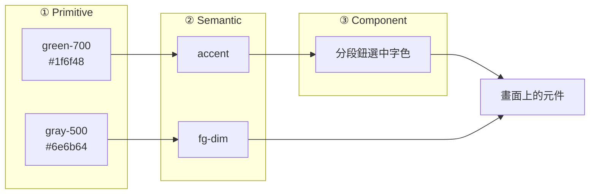
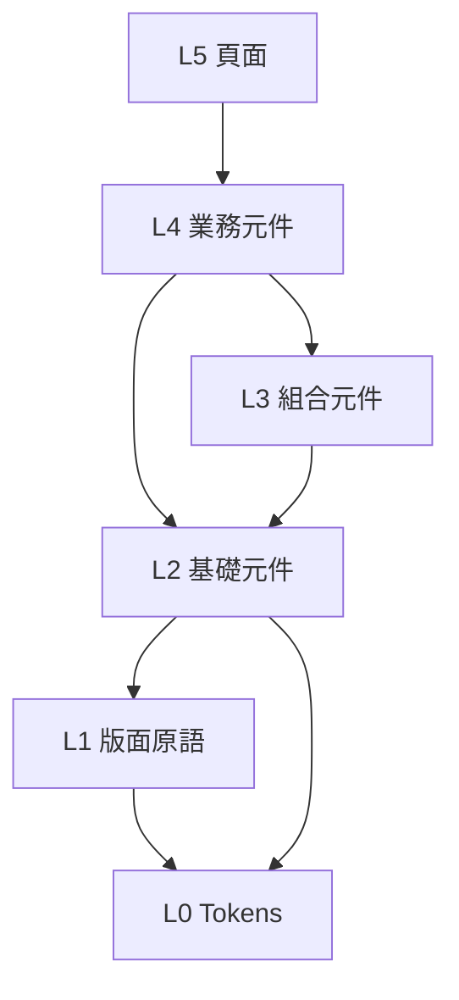
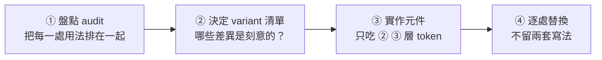
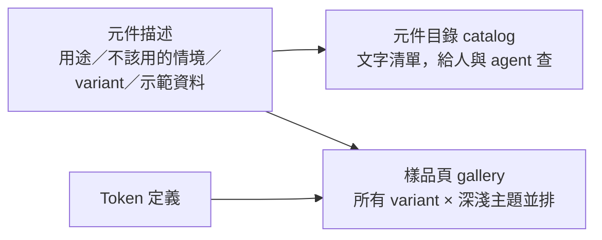

# Design System 的分層思維：Token、元件與 Variant

---

## 📋 文檔目的

**一致**是 UI 品質的基礎。對使用者，同樣的東西長得一樣、用起來一樣，學一次就會，產品也顯得可信；對團隊，設計與開發沿用同一套決定，不必每次重新決定。Design system 就是讓一致成立的做法：把設計決定集中定義、分層管理，讓一致由結構保證，而不是靠人記得。

本文整理 design system 業界通用的分層方式——設計值（token）怎麼分層、元件怎麼分層、哪些差異被允許（variant）——也作為設計、工程、PM、測試討論 UI 時的共同語言。前半（第 1、2、4 節）不需要技術背景，後半（第 3、5、6、7 節）偏實作。

### 你會在什麼場合用到這些

- **寫第一個畫面、定第一批顏色與間距時**：決定 token 怎麼分層、哪些值要有名字
- **做新元件時**：判斷它屬於哪一層、該開放哪些 variant、現在該不該抽成共用
- **評估 UI 時**：發現風格不一致，能判斷是哪一層沒守住（接 [UI/UX 機械檢查](../roles/ui-ux/05_mechanical-checks.md)）
- **跟工程師開會**：聽懂 token、primitive、semantic、variant、headless 在講什麼

---

## 1. 先分清三個常被混用的詞

| 詞 | 回答的問題 | 是什麼 | 例子 |
|---|---|---|---|
| **UI/UX design pattern** | 遇到這種需求，用哪種解法？ | 反覆出現的「問題 → 解法」，**跟程式無關** | 主從式抽屜（master-detail）、篩選 chips（filter chips）、漸進揭露（progressive disclosure）、空狀態引導（empty state） |
| **UI component**（元件） | 這個解法怎麼做出來？ | 可重用的程式積木，有外觀＋行為＋狀態 | 分段切換鈕（segmented control）、資料表格（data table）、按鈕（button） |
| **Design token** | 用什麼顏色、多大、多寬？ | **有名字的設計決策值** | `accent`（主色）、`space-4`（第 4 階間距）、`text-sm`（小字級） |

三者是上下游：

> **別跟程式的 design pattern 搞混**：軟體工程也有 design pattern（如 Singleton、Observer，出自 GoF《Design Patterns》），講的是**程式碼結構**怎麼組織，使用者看不到。本文的 UI/UX design pattern 講的是**使用者看到、操作到的介面解法**。兩者同名、精神相同（反覆出現的問題 → 公認解法），但對象不同。

三層各管一件事，少了哪一層，後果也不同：

| 少了哪一層 | 會發生什麼 |
|---|---|
| Token（值沒有統一出處） | 同一個 pattern 被做成多種長相——這頁圓角、那頁方角，灰字深淺各不相同 |
| Component（沒有可重用的積木） | 每個功能都從零長出來，上一頁做過的表格，新頁面又寫一次 |

---

## 2. Token 的三層

token 的核心想法是：**不要在畫面上直接寫「#1f6f48」，而是寫「主色」**。而「主色是哪個綠」這件事，再往下指到一張色票（palette）。業界最常見的分法是三層：

| 層 | 存什麼 | 例子 | 誰會改它 |
|---|---|---|---|
| ① **Primitive**（原始值） | 原始色票、刻度（scale），**沒有用途語意** | `green-700 = #1f6f48`、`gray-500 = #6e6b64` | 品牌改色 |
| ② **Semantic**（用途角色） | 「這個值拿來做什麼」，指向 ① | `accent → green-700`、`fg-dim（次要文字）→ gray-500` | **換主題（theme，如深色／淺色 dark／light mode）在這層切** |
| ③ **Component**（元件旋鈕） | 某個元件專用的值，指向 ② | `分段鈕選中底色 → accent-soft` | 只想微調某一個元件 |

### 唯一的硬規則

> **元件只能用 ② 或 ③，不准直接用 ① 或寫死色碼。**

理由很直接：換深色主題時，只要把 ② 的指向換掉（`accent` 改指向較亮的綠），全站一起動。只要有一處直接寫了 `#1f6f48`，那一處就會在深色主題裡「漏網」——這正是[機械檢查](../roles/ui-ux/05_mechanical-checks.md)掃風格雜值時抓到的東西。

### 業界命名對照

名字各家不同，結構是同一個：

| 系統 | ① 原始值 | ② 用途角色 | ③ 元件 |
|---|---|---|---|
| Google Material Design 3 | `md.ref.*`（reference） | `md.sys.*`（system） | `md.comp.*`（component） |
| Adobe Spectrum | primitive（舊稱 global） | semantic（又稱 alias） | component-specific |

W3C 的 Design Tokens 社群規格（Design Tokens Community Group，DTCG）（2025.10 首個穩定版）不規定要分幾層，只定義「一個 token 的值可以指向另一個 token」（alias）——分層是用這個指向關係疊出來的。

### 三層不必做滿

三層是**上限，不是規定**：

- **① 可省**：只有一個品牌、不會換色票時，② 直接寫值也不會出問題
- **② 是主力**：換主題、維持一致，幾乎都靠這層
- **③ 只在必要時加**：③ 加太多，會變成「每個元件一包自己的變數」，等於沒有抽象。Spectrum 官方也明說「能用 semantic 就不新增 component token」；Salesforce 的新一代設計系統（SLDS 2）更進一步，把元件層的樣式變數（styling hooks）整個收掉，只留全域（global）一層

**判斷 ③ 該不該長出來**：這個元件在不同主題下，是否真的需要跟 ② 不一樣的值？是才加。

---

## 3. 元件的分層

### Atomic Design：由小組大的心智模型（mental model）

Brad Frost 提出的 Atomic Design 借化學比喻，把元件分五級：

| 層級 | 定義 | 例子 |
|---|---|---|
| Atoms 原子 | 最小、不可再拆的單一元素 | 按鈕、輸入框、標籤 |
| Molecules 分子 | 幾個原子組成，完成**一件小事** | 搜尋框＝輸入框＋按鈕 |
| Organisms 有機體 | 分子＋原子組成的**完整區塊**，可在頁面上獨立存在 | 頂部導覽列＝logo＋選單＋搜尋框 |
| Templates 模板 | 有機體排成的頁面骨架，還沒放真資料 | 「左篩選、右列表」版型 |
| Pages 頁面 | 模板灌入真資料 | 實際上線的那一頁 |

記法：**分子做一件小事，有機體是一整塊有用途的區域。**

它的問題是**邊界模糊**：「可排序的表格」算分子還是有機體？不同人答案不同，而分對了也不會讓程式變好。所以 Atomic Design 適合當「由小組大」的心智模型，不適合拿來決定資料夾怎麼分。

### 實務常用：依「這個元件知道什麼」分層

更好判斷的切法是問：**這個元件知道多少業務？**

| 層 | 知道什麼 | **不知道**什麼 | 例子 |
|---|---|---|---|
| L0 Tokens | 設計值 | 任何 UI | 色彩、間距、字級定義 |
| L1 版面原語（layout primitives） | 排版 | 業務 | 堆疊（Stack）、文字（Text）、底板（Surface）（很多團隊直接用 CSS 工具類 utility classes 取代，可省） |
| L2 基礎元件（UI components） | 互動行為、狀態、無障礙（accessibility，簡寫 a11y） | **資料長什麼樣、業務意義** | 按鈕、分段切換、chip、表格 |
| L3 組合元件（patterns） | 一種常見 UX 解法的骨架 | 具體是哪種資料 | 篩選列、抽屜外殼、可排序表格、空狀態 |
| L4 業務元件（feature components） | 業務資料與規則 | — | 「商品排行表」「本週漲跌榜」 |
| L5 頁面（pages） | 路由（routing）、組頁 | — | 首頁、排行頁 |

**核心規則只有一條：依賴（dependency）只能往下。** 分段切換鈕（L2）不准知道它切的是「價格區間」還是「時間範圍」——那是 L4 灌進去的資料。一旦 L2 知道了業務，它就只能在那一處用，失去重用價值。

### 少了 L2／L3 會怎樣

> **缺 L2／L3，每個 L4 都直接從 L0 長出來。**

沒有共用的分段切換鈕，每個業務元件就各自用 token 拼一個——拼出來的長相還各不相同。所以「長相不一」和「重複寫」常一起出現：缺元件層，token 就沒有被統一使用的管道。

---

## 4. Variant：一致性的來源

L2 元件要真正帶來一致，關鍵在它的介面（API）形狀：**只開放有限的 variant（變體選項），不讓呼叫端（caller）塞任意樣式。**

| | 沒有元件層 | 有元件層 |
|---|---|---|
| 寫法 | 每處各寫一個 class，各自決定內距（padding）、字級（font size）、選中色 | `<SegmentedControl size="sm" />`、`<Button tone="primary" />` |
| 差異從哪來 | 各寫各的，自然長出來，**沒人決定過** | 只能是 variant 清單裡的值 |
| 想要新長相時 | 再寫一個 class | 要嘛收斂到既有 variant，要嘛**正式討論後**加成新 variant |

每個 variant 對應到一組 token（例如 `size="sm"` → 小一階的內距與字級）。所以**一致性不是靠人記得，而是只有這幾種可能**。variant 清單本身，就是「哪些差異是刻意的」的設計決定。

---

## 5. 什麼時候抽元件、怎麼抽

分層不等於一開始就把所有元件都做好——沒人用的元件只是維護成本。節奏是：

- **token 從第一天就守**：任何顏色、間距、字級一律寫成有名字的 token，不寫死。這條成本最低、補救最貴
- **第二次出現才抽元件**：只出現一次的東西直接寫在業務元件裡；同一種東西第二次出現時，就是抽成 L2 的時機
- **抽的時候，先決定 variant 再實作**：

- **第 ② 步就是設計討論本身**：用法排在一起時，「這兩種圓角是故意的嗎？」會被逼出答案。答案是「不是」的，就收斂成同一個
- **一次做透一個**：抽完一個、所有用法都換掉，再抽下一個。同一套流程也適用於收拾已經長出多種寫法的元件

---

## 6. 行為層：自己寫還是借現成的

元件的「行為」（鍵盤操作 keyboard navigation、焦點管理 focus management、螢幕報讀器 screen reader 支援）比外觀難做對。業界有一類 **headless 元件庫**（如 Radix、React Aria）：只提供行為與無障礙，不給任何樣式（headless＝「沒有外觀」），樣式由自己的 token 上。

判準：**按鈕、分段切換、chip、表格這類行為簡單的，自己寫就夠；下拉搜尋框（combobox）、對話框（dialog）的焦點鎖（focus trap）、多層選單（nested menu）這類難做對的，才值得借用。**

---

## 7. 讓一致持續成立：找得到、擋得住

元件做好之後，一致仍可能慢慢流失：新加入的人或 agent 不知道已經有現成元件，於是又做一個；趕時間時寫死一個色碼，也沒人發現。維持一致需要兩件事——**找得到**既有的元件，**偏離時會被提醒**。

### 找得到：一份描述，兩種檢視

每個元件旁放一份**只寫資料**的描述：它做什麼、什麼情境用、什麼情境**不該**用（該改用哪個）、有哪些 variant、示範用的資料。這是唯一手寫的東西，其餘自動生成：

- **元件目錄（catalog）**：一份文字清單。agent 動手做 UI 之前先讀它；需要的元件不存在時，先提出來，而不是自己再做一個
- **樣品頁（gallery）**：把每個元件的所有 variant 在深淺主題下並排畫出來，token 也畫成色票、字級階梯、間距尺。人用它比對長相，也是第 5 節「盤點」時的現成材料。業界最常見的工具是 Storybook；規模小時自己做一頁也夠
- **為什麼要自動生成**：手寫的文件遲早跟程式碼脫節。從同一份描述生成，新增元件時目錄與樣品頁自動出現，不需要另外登記

### 擋得住：有節制的自動檢查

「不准寫死色碼」「基礎元件不准引用業務邏輯」這類規則，可以交給**程式碼檢查器（linter）**自動抓：它只讀程式碼、不執行，幾秒內跑完，規則可以自己寫。前端常用的兩個是 **ESLint**（檢查 JavaScript／JSX，例如在元件層之外直接寫原生按鈕）與 **Stylelint**（檢查 CSS，例如寫死的色碼與字級）。每條規則可以設成 **warn（提醒、不擋）** 或 **error（擋下）**，這就是強制程度的調節鈕。

強制太鬆等於沒有，太緊會綁手綁腳、逼人繞路。校準的原則：

| 原則 | 說明 |
|---|---|
| **沒有替代品就不禁止** | 「不准用原生按鈕」要等 `Button` 元件上線那天才開啟——規則跟元件一起出生 |
| **只查這次改的檔案** | 舊檔的歷史問題不會擋住無關的修改 |
| **硬規則少而明確** | 只有「一定有正解、改起來便宜」的才設 error（如色碼改用 token）；判斷模糊的一律 warn（如寫死的間距，畫圖幾何常有合理例外） |
| **每條規則都有逃生口** | 允許逐行豁免，但必須寫理由，之後可以一起搜出來檢視 |
| **元件內部自由** | 元件層自己不受「不准原生元素」限制；加 variant 改描述即可，不需審批 |
| **warn 只看不升級** | warn 的數量當健康指標定期看，不因為「覺得太多」就改成 error |

**既有違規用棘輪（ratchet）**：規則上線時，舊程式碼通常已經有一堆違規，一次清完不實際，全部豁免又會越積越多。做法是記下現有違規數當基準線，**之後只准變少、不准變多**——像棘輪只能往一個方向轉。不必停下來大掃除，也不會再惡化。

**檢查放在每個人都會經過的地方**：只掛在某個 agent 工具的 hook 裡，換一個工具就失效；放在 git commit 前檢查，不論是人、Claude 還是其他 agent 提交，都會經過。把紀律寫成自動檢查的一般思路，見 [從 Prompt 到 Harness](./prompt-context-harness-engineering.md)。

---

## 📚 相關文檔

- [UI/UX 共同語言](../roles/ui-ux/01_uiux-fundamentals.md)——design system 在 UI/UX 詞彙表中的位置
- [UI/UX 機械檢查](../roles/ui-ux/05_mechanical-checks.md)——從評估端量「風格雜值」，本文是它的建構端
- [分類體系術語](./classification-terminology.md)——alias 與 canonical：同一件事的多個名字
- [從 Prompt 到 Harness](./prompt-context-harness-engineering.md)——把紀律寫成 hook／script 自動執行（第 7 節的一般化）

### 外部參考

- [Material Design 3 — Design tokens](https://m3.material.io/foundations/design-tokens)
- [Adobe Spectrum — Design tokens](https://spectrum.adobe.com/page/design-tokens)
- [W3C Design Tokens Format Module 2025.10](https://www.w3.org/community/reports/design-tokens/CG-FINAL-format-20251028/)
- [Brad Frost — Atomic Design](https://atomicdesign.bradfrost.com/)
- [Storybook](https://storybook.js.org/)、[ESLint](https://eslint.org/)、[Stylelint](https://stylelint.io/)

---

## 📝 文檔維護

### 版本歷史

| 版本 | 日期 | 作者 | 變更說明 |
|------|------|------|----------|
| 1.0 | 2026-11-06 | yijou14 | 初版：從前端分層討論萃取通用部分（三個詞、token 三層、元件依賴分層、variant、抽元件的時機、治理：目錄／樣品頁、有節制的強制與棘輪） |

---

**文檔結束**
