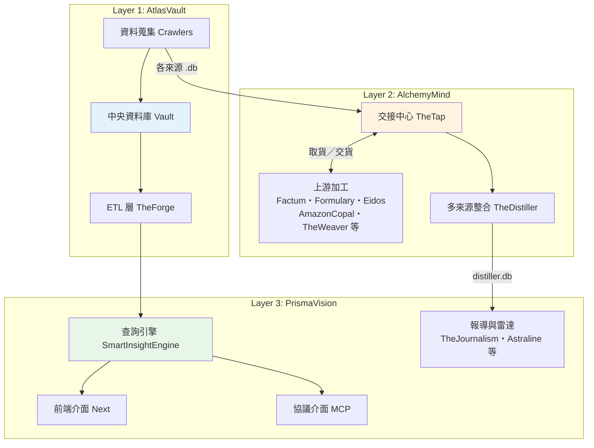

# LuminNexus 系統架構全景

---

## 📋 文檔目的

本文檔提供 LuminNexus 生態系統的**高層級架構概覽**,幫助新成員快速理解:
- 系統整體架構與三層設計
- 各子系統的職責與定位
- 系統間的關係與互動
- 專案文檔的導航指引

> **注意**: 本文檔僅提供概覽。AlchemyMind（Layer 2）的資料交接請參考 [alchemymind/00_overview.md](alchemymind/00_overview.md)。
>
> **AlchemyMind（Layer 2）已改版**：本文的「資料循環架構」一節是 2025-12 的設計。TheRefinery、TheArgus（舊角色）與「分析結果回寫 Vault」的循環都已退場。Layer 2 的現行架構以 [alchemymind/00_overview.md](alchemymind/00_overview.md) 為準。

---

## 🏗️ 三層架構概述

LuminNexus 採用**三層架構設計**,各層職責清晰分離:



---

## 📊 系統分層說明

### Layer 1: AtlasVault - 資料蒐集與 ETL 層

**核心職責**: 資料蒐集、儲存、ETL 處理

**主要元件**:
- **Vault**: 中央資料庫 (Single Source of Truth)
- **Crawlers**: DSLD, iHerb, Keepa 爬蟲
- **TheForge**: ETL 層 (4個 Pure ETL Forges + Unified Forge)

**詳細文檔**: [atlasvault/00_overview.md](atlasvault/00_overview.md)

**資料規模**:
- DSLD: 211,782 products
- iHerb: 50,461 products
- Keepa: 64,661 products

---

### Layer 2: AlchemyMind - 資料處理與分析層

**核心職責**: 把蒐集來的資料加工、整合成下游共用的一份產品資料庫

**主要元件**（2026-10 現況）:
- **上游加工**: Factum（讀標籤）、Formulary（成分表與產品家族）、Eidos（品牌主檔）、AmazonCopal（抄產品頁宣稱句）、TheWeaver（AI 分類，寫進 SpiderWeb）等
- **TheTap**: 資料交接中心，各系統的 `.db` 經它驗貨後上架
- **TheDistiller**: 把十幾個來源整合成 `distiller.db`，給 PrismaVision 各系統使用

**詳細文檔**: [alchemymind/00_overview.md](alchemymind/00_overview.md)

**規模**: TheWeaver 的 AI 分類涵蓋 10 個知識領域（例如健康效果、風味特徵、使用便利性）；最新數字見各系統文件

---

### Layer 3: PrismaVision - 使用者介面與引擎層

**核心職責**: 資料查詢、分析、展示

**主要元件**:
- **SmartInsightEngine**: MDFO 查詢引擎
- **PrismaVision-Next**: 前端介面
- **MCP**: 協議介面

**詳細文檔**: [prismavision/00_overview.md](prismavision/00_overview.md)

**查詢能力**:
- ~130K 產品資料集
- 13 維度支援
- MDFO 查詢語言 (Measure/Dimension/Filter/Options)

---

## 🔄 資料循環架構

> **已退場**：以下是 2025-12 的設計，「TheWeaver 分析結果回寫 Vault」的循環已不存在，TheRefinery 也已退場。現行的資料交接見 [alchemymind/thetap.md](alchemymind/thetap.md)。

LuminNexus 原本採用**循環式資料處理架構** (Cyclical Architecture):

```
Vault (SSoT)
  ↓ [Extract JSON]
TheForge (ETL)
  ↓ [SQLite DB]
TheRefinery (Processing)
  ↓ [Refined DB]
TheWeaver (LLM Analysis)
  ↓ [Analysis JSON]
Vault (Archive) ← 循環完成!
```

**關鍵特性**:
- **Single Source of Truth**: Vault 是唯一的資料真相來源
- **循環更新**: TheWeaver 的分析結果會回寫到 Vault
- **版本控制**: 所有資料以日期為版本 (`YYYYMMDD`)

> **舊版詳細說明**: [01_data-flow.md](01_data-flow.md)（已退場，僅供歷史參考）

---

## 📁 專案文檔導航

### 核心文檔
- [00_architecture-overview.md](00_architecture-overview.md) - **本文檔** (系統全景)
- [01_data-flow.md](01_data-flow.md) - 資料流與循環機制（舊架構，已退場）
- [DOCUMENTATION_POLICY.md](DOCUMENTATION_POLICY.md) - 文檔撰寫規範

### Layer 1: AtlasVault
- [atlasvault/00_overview.md](atlasvault/00_overview.md) - AtlasVault 總覽
- [atlasvault/vault.md](atlasvault/vault.md) - 中央資料庫
- [atlasvault/theforge.md](atlasvault/theforge.md) - ETL 層
- [atlasvault/dsld-crawler.md](atlasvault/dsld-crawler.md) - DSLD 爬蟲
- [atlasvault/iherb-crawler.md](atlasvault/iherb-crawler.md) - iHerb 爬蟲
- [atlasvault/dsldxkeepa.md](atlasvault/dsldxkeepa.md) - DSLD x Keepa 整合

### Layer 2: AlchemyMind
- [alchemymind/00_overview.md](alchemymind/00_overview.md) - AlchemyMind 總覽（入口頁，含全景圖）
- [alchemymind/thetap.md](alchemymind/thetap.md) - 資料交接中心
- [alchemymind/thedistiller.md](alchemymind/thedistiller.md) - 多來源整合（distiller.db）
- 上游各系統：[factum.md](alchemymind/factum.md)、[formulary.md](alchemymind/formulary.md)、[eidos.md](alchemymind/eidos.md)、[amazoncopal.md](alchemymind/amazoncopal.md)、[theweaver.md](alchemymind/theweaver.md)、[spiderweb.md](alchemymind/spiderweb.md)、[carboniferous.md](alchemymind/carboniferous.md)、[seatearth.md](alchemymind/seatearth.md)
- 下游：[thewatershed.md](alchemymind/thewatershed.md) - 市場分割
- 已退場（歷史參考）：[therefinery.md](alchemymind/therefinery.md)、[theargus.md](alchemymind/theargus.md)（舊角色）

### Layer 3: PrismaVision
- [prismavision/00_overview.md](prismavision/00_overview.md) - PrismaVision 總覽
- [prismavision/smart-insight-engine/](prismavision/smart-insight-engine/) - 查詢引擎 (完整學習路徑)
- [prismavision/next.md](prismavision/next.md) - 前端介面
- [prismavision/mcp.md](prismavision/mcp.md) - MCP 協議介面
- [prismavision/thejournalism.md](prismavision/thejournalism.md) - 資料詮釋與報告生成

---

## 🎯 適用角色

本文檔適合以下角色閱讀:

### 必讀角色
- **新進工程師** (所有角色) - 理解系統全貌
- **架構師** - 系統設計與規劃
- **專案經理** - 專案管理與協調

### 選讀角色
- **測試工程師** - 理解系統邊界與介面
- **資料分析師** - 理解資料來源與處理流程

---

## 🔑 關鍵概念速查

### 架構設計原則
- **Single Source of Truth (SSoT)**（2025-12 的舊說法）: Vault 是唯一的資料真相來源；AlchemyMind 現在改經 TheTap 交接 `.db`
- **純 ETL 分離**: TheForge 只做 ETL,不做 enrichment
- **循環架構**（已退場）: 原本 TheWeaver 的輸出會回到 Vault；現在改經 TheTap 交接
- **Config-Driven**: Unified Forge 使用配置驅動,支援多種輸出

### 核心術語
- **Vault**: 中央資料庫,所有原始資料的儲存位置
- **TheForge**: ETL 層,負責將 JSON 轉換為 SQLite
- **TheWeaver**: LLM 分析生成器,產生 10 個知識領域的分析
- **TheRefinery**（已退場）: 舊的資料精煉層
- **TheArgus**（舊角色）: 原本做 DSLD 劑量異常檢測；現在的 Argus 是 distiller.db 的監控下游
- **TheTap**: 資料交接中心，各 `.db` 驗貨後上架
- **TheDistiller**: 多來源整合，產出 `distiller.db`
- **SmartInsightEngine**: MDFO 查詢引擎
- **Knowledge Realm**: 知識領域,TheWeaver 的分析維度 (共 10 個)
- **MDFO**: Measure/Dimension/Filter/Options 查詢語言

---

## 📚 延伸閱讀

### 理解資料流
1. 先讀本文檔,理解三層架構
2. 再讀 [alchemymind/00_overview.md](alchemymind/00_overview.md),理解 AlchemyMind 的資料如何交接
3. 最後讀各子系統的詳細文檔

### 深入學習特定系統
- **學習 ETL 流程**: [atlasvault/theforge.md](atlasvault/theforge.md)
- **學習 LLM 分析**: [alchemymind/theweaver.md](alchemymind/theweaver.md)
- **學習查詢語言**: [prismavision/smart-insight-engine/](prismavision/smart-insight-engine/)

### 參考外部文檔
- TheForge 詳細架構: `LuminNexus-AtlasVault-TheForge/docs/20251203_architecture_cycle.md`
- 各專案的 README.md 與 CLAUDE.md

---

## 📝 文檔維護

### 版本歷史

| 版本 | 日期 | 作者 | 變更說明 |
|------|------|------|----------|
| 1.0 | 2025-12-09 | Architecture Team | 初版建立 |
| 1.1 | 2026-10-21 | weiling | Layer 2 元件、架構圖與文檔清單改為現況，閱讀順序改指 alchemymind/00_overview；資料循環架構、TheRefinery、TheArgus 舊角色標為已退場 |

### 維護規範
- 本文檔由 Architecture Team 統一維護
- 各子系統的詳細文檔由對應團隊維護
- 文檔撰寫規範請參考 [DOCUMENTATION_POLICY.md](DOCUMENTATION_POLICY.md)

---

## ❓ 常見問題

### Q1: 我是新進工程師,應該從哪裡開始?
**A**: 建議閱讀順序:
1. 本文檔 (理解三層架構)
2. [alchemymind/00_overview.md](alchemymind/00_overview.md) (理解資料交接)
3. 你的角色對應的子系統文檔

### Q2: 為什麼要用循環架構?
**A**: 這是 2025-12 的設計，已經退場。TheWeaver 現在把分類結果寫進 SpiderWeb，各系統的 `.db` 經 TheTap 交接，詳見 [alchemymind/00_overview.md](alchemymind/00_overview.md)。

### Q3: 各層之間如何通訊?
**A**: AlchemyMind 各系統透過 TheTap 交接 `.db`，請參考 [alchemymind/thetap.md](alchemymind/thetap.md)。

### Q4: 如何貢獻文檔?
**A**: 請參考 [DOCUMENTATION_POLICY.md](DOCUMENTATION_POLICY.md) 的撰寫規範。

---

**文檔結束**
