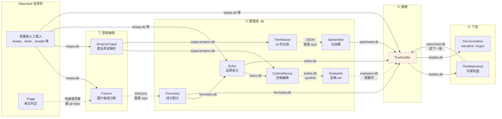

# AlchemyMind - 資料處理與分析層概覽

---

## 📋 這層做什麼

**一句話**：AlchemyMind 把 AtlasVault 收來的原始資料，加工成一份份 `.db`，經 **TheTap**（交接中心）交接，最後由 **TheDistiller** 匯總成一份 `distiller.db` 給下游。

- **`.db`**：一個 SQLite 資料庫檔，可以想成「一整本可以查詢的試算表」。
- **交接**：生產者交出檔案、下游取用。AlchemyMind 裡大部分交接都經過 TheTap，詳見 [TheTap](thetap.md)。

這一頁只回答「有哪些系統、誰交給誰」。每個系統的細節，請點進各篇。

---

## 🗺️ 各 repo 關係全景圖

圖上每個方塊是一個 repo（程式碼倉庫，一個系統一個）。從左到右是資料被加工的順序。

- **實線**：經過 TheTap 交接（為了好讀，圖上省略中間的 TheTap）。
- **虛線**：不經過 TheTap，有四種：寫進對方的 repo、用 symlink（捷徑）讀對方的檔案、直接讀對方的 git repo（Triage → Factum）、規劃中還沒接上（Seatearth → Distiller）。
- **為什麼要分**：經過 TheTap 的交接，上架前有品質檢查，出問題也能退回舊版。讀 git repo、symlink、規劃中這三種沒有這兩層保護；寫進對方 repo 的，最後仍由對方 repo 經 TheTap 發佈，一樣有檢查。

讀圖重點：

1. **兩站不自己發 `.db`**：Factum 寫進 Formulary 的 repo、TheWeaver 寫進 SpiderWeb 的 repo，由 Formulary、SpiderWeb 發 `.db`。
2. **Factum 的待處理清單直接讀 Triage 的 git repo**，不經 TheTap。
3. **AmazonCopal 一份產出餵兩條線**：一條經 TheWeaver → SpiderWeb 進 Distiller；另一條經 Carboniferous → Seatearth 整理成宣稱 set。
4. **TheWatershed 和 Distiller 互為上下游**：讀上一版 `distiller.db` 畫市場地圖，地圖再交給下一版 Distiller。
5. **Seatearth 目前還沒接上 Distiller**。

> 想看「哪份 `.db` 由誰交、誰取、線上是哪一版」，看 [TheTap](thetap.md) 的「📦 現在交接哪些 .db」。

---

## 📦 子系統一覽

### ① 原始抽取

| 系統 | 做什麼 | 交出什麼 → 給誰 |
|------|--------|----------------|
| [Factum](factum.md) | 用 VLM（看得懂圖片的 AI 模型）讀產品標籤圖，抽出 Supplement Facts 成分表 | DSLD 格式 JSON 與產品家族表，**寫進 Formulary repo** |
| [AmazonCopal](amazoncopal.md) | 用 AI 讀 Amazon 產品頁，逐字抄下宣稱句、整理成標準命題 | `copal.amazon.db` → TheWeaver、Carboniferous；`copal.amazon.gb.db`（英國站）→ 只給 TheWeaver |

### ② 整理成 .db

| 系統 | 做什麼 | 交出什麼 → 給誰 |
|------|--------|----------------|
| [Formulary](formulary.md) | 用 git 保存成分標籤，也是 Distiller 的「收錄名單」 | `formulary.db` → TheDistiller、Eidos |
| [Eidos](eidos.md) | 登記品牌、公司、商標、菌株等身分，每筆附證據 | `eidos.db` → TheDistiller、Carboniferous、GoViral |
| [TheWeaver](theweaver.md) | 用 AI 替每個產品判功效與屬性分類（10 個知識領域等） | JSON，**寫進 SpiderWeb repo** |
| [SpiderWeb](spiderweb.md) | 用 git 保存 TheWeaver 的分類結果 | `spiderweb.db` → TheDistiller |
| [Carboniferous](carboniferous.md) | 把宣稱句編成「主詞－述詞－受詞」的結構 | `amber.db` → Seatearth |
| [Seatearth](seatearth.md) | 把編好的宣稱聚合成「一句話講得清楚」的宣稱 set | `coalseam.db` |

### ③ 匯總與交接

| 系統 | 做什麼 | 交出什麼 → 給誰 |
|------|--------|----------------|
| [TheTap](thetap.md) | 交接中心：每晚建置、通過品質檢查才上架，放在 http://maple-msi.local/ | **只轉手不加工** |
| [TheDistiller](thedistiller.md) | 把上面各份 `.db` 與 AtlasVault 的資料匯總成統一的產品資料庫 | `distiller.db` → 下游（[thedistiller.md](thedistiller.md) 部分內容過時，以 TheTap／本篇為準） |

---

## 🧭 TheDistiller 與下游

TheDistiller 是這一層的**匯總點**：大部分上游的產出最後都流進它，下游也幾乎只讀它的 `distiller.db`。

- **從 TheTap 拿的輸入**：必要的有 eidos、formulary、spiderweb、keepa 系列、iherb、trawler（品牌官網的產品資料）、cartulary（另一種格式的 DSLD 官方標籤資料）、rippletide（品牌網站產品的上下架觀察）；選用的有 shopify、watershed。清單以 TheTap 的 `pipeline.yaml`（TheTap 的設定檔，記錄每份 `.db` 由誰產出、讀哪些輸入、怎麼檢查）為準。
- **下游**：

| 下游 | 做什麼 |
|------|--------|
| [TheWatershed](thewatershed.md) | 用 `distiller.db` 與 spiderweb 分類節點切出市場訴求群，`watershed.db` 再交給下一版 Distiller |
| [TheJournalism](../prismavision/thejournalism.md) | 市場分析與報導（PrismaVision 層） |
| Astraline | 讀產品上架時間等生命週期資料（PrismaVision 層） |
| Argus | 監控 `distiller.db` 的資料品質，發現問題開 issue 給 Distiller |

---

## 🪦 已退場的系統

舊文件裡常出現下面這些，**以現行為準**：

- **TheRefinery**：舊架構的「資料精煉」層，產出 `enriched.db` 給 TheWeaver、Eidos、TheDistiller。現在這些系統都改從 TheTap 讀各自需要的 `.db`，不再經過它。
- **TheArgus（舊角色）**：原本在這一層內做 DSLD 成分劑量的異常檢測。現在叫 Argus 的是 Distiller 的監控下游（見上表），不在加工流程中間。
- **循環回饋架構**：舊圖裡「TheWeaver 分析結果回寫 Vault、下一輪再讀」的循環已不存在。現在唯一的回圈是 TheWatershed ⇄ TheDistiller。

[therefinery.md](therefinery.md) 保留作歷史參考；[theargus.md](theargus.md) 寫的是 Argus 的舊角色。

---

## 🐛 常見問題

### Q1: 舊文件說 TheDistiller 讀 `unified.db`、`enriched.db`、`weaver.db`？
那是 TheRefinery 時期的架構。現在 Distiller 從 TheTap 拿各生產者的 `.db`，見上方「🧭 TheDistiller 與下游」。[thedistiller.md](thedistiller.md) 部分內容是舊的，輸入清單以本頁與 [TheTap](thetap.md) 為準。

### Q2: 為什麼 Factum、TheWeaver 不自己發 `.db`？
它們的產出是大量 JSON，先存進 git repo（Formulary、SpiderWeb）方便追版本，再由那個 repo 統一建成 `.db`。

TheTap 每晚從 **GitHub 上的 `main` 分支**（正式版那一條）抓檔案來建置，所以只有推到 `main` 的資料才會進正式版。

---

## 📚 相關文檔

- [../00_architecture-overview.md](../00_architecture-overview.md)：整體架構
- [thetap.md](thetap.md)：交接中心、各 `.db` 的生產者與線上版本
- [thedistiller.md](thedistiller.md)：TheDistiller（部分內容是舊的，見 Q1）
- [thewatershed.md](thewatershed.md)：TheWatershed，也是寫上游各篇的範本
- [../prismavision/thejournalism.md](../prismavision/thejournalism.md)：TheJournalism（PrismaVision 層）

---

## 📝 文檔維護

### 版本歷史

| 版本 | 日期 | 作者 | 變更說明 |
|------|------|------|----------|
| 1.0 | 2025-12-09 | Architecture Team | 初版建立 (待 AlchemyMind Team 補充) |
| 1.1 | 2026-07-20 | Dustin | 補充 Eidos 子系統說明,同步 summary 與架構圖 |
| 1.2 | 2026-07-21 | Dustin | TheJournalism 改列 PrismaVision (Layer 3)，本層僅保留 TheDistiller 的下游出口與連結 |
| 2.0 | 2026-10-19 | weiling | 原文大半過時，重整為入口頁：新增各 repo 關係全景圖與子系統一覽（補 TheTap、Formulary、SpiderWeb、AmazonCopal、Carboniferous、Seatearth、TheWatershed）；TheRefinery、舊 TheArgus、循環回饋架構改列「已退場」；新增 TheDistiller 與下游一節；移除未曾填寫的 Shared 與舊的處理能力、設計原則、關鍵概念各節 |
