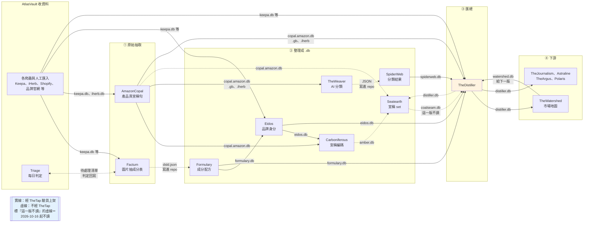

# AlchemyMind - 資料處理與分析層概覽

---

## 📋 這層做什麼

**一句話**：AlchemyMind 把 AtlasVault 收來的原始資料，加工成一份份 `.db`，經 **TheTap**（交接中心）交接，最後由 **TheDistiller** 匯總成一份 `distiller.db` 給下游。

- **`.db`**：一個 SQLite 資料庫檔，可以想成「一整本可以查詢的試算表」。
- **交接**：生產者交出檔案、下游取用。AlchemyMind 裡大部分交接都經過 TheTap 驗貨上架，詳見 [TheTap](thetap.md)。

### 為什麼需要這一層

保健品的資料散在 Amazon、iHerb、品牌官網等地方，每邊格式不同，同一個產品在各處各有一筆。AlchemyMind 把它們整理成一份可以直接回答問題的產品資料庫：

- 市場上有哪些產品、**成分**是什麼、**品牌**是誰
- 產品主打什麼好處、屬於哪個**訴求群**（例如睡眠、關節）
- 價格多少、什麼時候**上架或下架**

使用這些答案的是 PrismaVision 層的系統，例如 [TheJournalism](../prismavision/thejournalism.md) 的市場分析報導、Astraline 的新品雷達。

---

## 🔤 先認識幾個詞

讀全景圖和各篇之前，先認識這幾個常出現的詞：

- **repo**：程式碼倉庫，一個系統一個。圖上每個方塊就是一個 repo。
- **Triage**：AtlasVault-Triage，Amazon 產品的每日判定（哪些是保健品、是不是組合包、是否還在賣）。
- **宣稱句**：AmazonCopal 從產品頁逐字抄下來的原句，例如「支持關節健康」。
- **標準宣稱**：AmazonCopal 把宣稱句整理成統一寫法的一條，同樣意思的句子會變成同一條。
- **宣稱 set**：一句話講得清楚的訴求，例如記憶、專注；每個 set 由人事先定義哪些「述詞＋受詞」組合算進來（宣稱裡的動作＋對象，例如「增加＋體力」），Seatearth 再標出每個產品命中哪些 set，一個產品可以命中好幾個，set 之間也可以重疊或包含。
- **功效分類線**：TheWeaver → SpiderWeb 這條線，產出十個知識領域的 AI 分類。
- **功效分類**：其中健康效果、效能提升、生活品質（HE／PE／QoL）三個領域的結果，是 TheWatershed 用來切訴求群的那部分。
- **訴求群**：TheWatershed 把整個市場切成的一群一群，例如睡眠、關節。一個產品可以屬於好幾群：只要它的功效分類落在某群包含的分類上，就算屬於那一群；這個歸屬由 TheDistiller 計算。
- **Polaris**：PrismaVision 層的儀表板，用 `distiller.db` 呈現訴求群、成分、品牌等統計。

三個「好處」相關的詞差在哪，見下方「🧩 宣稱 set、功效分類、訴求群」。

---

## 🗺️ 各 repo 關係全景圖

從左到右是資料被加工的順序。

- **實線**：經過 TheTap 驗貨上架（為了好讀，圖上省略中間的 TheTap）。出問題時可以退回舊版。
- **虛線**：不經過 TheTap，例如直接寫進對方的 repo，或直接讀對方 repo 裡的檔案。重點是檔案有沒有經過 TheTap 的檢查。

讀圖重點：

1. **最上游的資料從哪來**：除了 Keepa，其餘都是在別處產出後人工匯入 TheTap。

   | 來源 | 誰收集 | 產出 `.db` | 誰用 |
   |------|--------|-----------|------|
   | Amazon 美國站、英國站（經 Keepa，追蹤 Amazon 價格的外部服務） | AtlasVault-Keepa 每日抓取 | `keepa.db`、`keepa.gb.db` | TheDistiller、Eidos、Factum、AmazonCopal |
   | iHerb | AtlasVault-iHerb | `iherb.db` | TheDistiller、Eidos、Factum、AmazonCopal |
   | Shopify 網店 | AtlasVault-Shopify | `shopify.db` | TheDistiller、Eidos、Factum |
   | 品牌官網（Trawler） | AtlasVault-Trawler | `trawler.db` | TheDistiller、Eidos、Factum |
   | 上下架觀察（Rippletide） | AtlasVault-Rippletide | `rippletide.db` | TheDistiller |
   | DSLD（美國 NIH 的保健品標籤資料庫） | CartularyDSLD 整理，含成分表 | `cartulary.db` | TheDistiller（只用來比對 UPC 商品條碼） |
   | DSLD | 另一份匯出 | `dsld.db` | Eidos |

   TheDistiller 目前暫停匯入 DSLD 的產品，所以 DSLD 的產品不會出現在 `distiller.db` 裡。產品頁文字和圖片網址就在 `keepa.db`、`keepa.gb.db`、`iherb.db` 裡；Amazon 產品圖由 Factum、AmazonCopal 依 `keepa.db` 的圖片網址下載到同一個共用資料夾；iHerb 產品圖由 AmazonCopal 自己下載。兩者都不經 TheTap。
2. **兩站不自己發 `.db`**：Factum 寫進 Formulary 的 repo、TheWeaver 寫進 SpiderWeb 的 repo，再由 Formulary、SpiderWeb 經 TheTap 發 `.db`，一樣有檢查。
3. **AmazonCopal 的產出用在三處**：功效分類線（TheWeaver → SpiderWeb）拿來做 AI 分類，再進 Distiller；宣稱線（Carboniferous → Seatearth）整理成宣稱 set；TheDistiller 直接讀，找出產品自己標示矛盾的宣稱。
4. **回圈**：
   - `.db` 之間的回圈只有 TheWatershed ⇄ TheDistiller：讀上一版 `distiller.db` 畫市場地圖，地圖再交給下一版。
   - Factum ⇄ Triage 是工作清單：Triage 給待處理清單，Factum 回寫判定，不是 `.db` 的回圈。
   - AmazonCopal 挑產品時會參考幾份下游 db，只是挑選參考（見下方子系統一覽）。
   - Seatearth 雖然讀 `distiller.db`，但 Distiller 2026-10-16 起不讀 `coalseam.db`，不構成回圈。

> 想看「哪份 `.db` 由誰交、誰取、線上是哪一版」，看 [TheTap](thetap.md)。

---

## 📦 子系統一覽

### ① 原始抽取

| 系統 | 做什麼 | 交出什麼 → 給誰 |
|------|--------|----------------|
| [Factum](factum.md) | 用 VLM（看得懂圖片的 AI 模型）讀產品標籤圖，抽出 Supplement Facts 成分表（美國保健品包裝上的成分標示） | DSLD 格式（美國官方保健品標籤資料庫的格式）的 JSON 與產品家族表，**寫進 Formulary repo**；判定結果回寫 Triage |
| [AmazonCopal](amazoncopal.md) | 用 AI 讀 Amazon、iHerb 的產品頁，逐字抄下宣稱句、整理成標準宣稱。挑產品時參考 `formulary.db`（只挑 Formulary 認得的保健品）、`distiller.db`（避開被判定不該收的產品）、`spiderweb.db`（依主題篩），需要時再用 `eidos.db` 限定品牌；這些只是挑選參考，不是建 .db 的材料 | `copal.amazon.db`（美國站）→ TheWeaver、TheDistiller、Carboniferous、Seatearth；`copal.amazon.gb.db`（英國站）、`copal.iherb.db` → TheWeaver、TheDistiller |

### ② 整理成 .db

| 系統 | 做什麼 | 交出什麼 → 給誰 |
|------|--------|----------------|
| [Formulary](formulary.md) | 用 git 保存成分標籤，也是 Distiller 的「收錄名單」 | `formulary.db` → TheDistiller、Eidos |
| [Eidos](eidos.md) | 登記品牌、公司、商標、菌株等身分，每筆附證據 | `eidos.db` → TheDistiller、Carboniferous、GoViral |
| [TheWeaver](theweaver.md) | 用 AI 替每個產品做十個知識領域的分類，例如健康效果、風味特徵、使用便利性 | JSON，**寫進 SpiderWeb repo** |
| [SpiderWeb](spiderweb.md) | 用 git 保存 TheWeaver 的分類結果 | `spiderweb.db` → TheDistiller |
| [Carboniferous](carboniferous.md) | 把標準宣稱編成「主詞－述詞－受詞」的結構 | `amber.db` → Seatearth |
| [Seatearth](seatearth.md) | 標出每個產品命中哪些宣稱 set。輸入除了 `amber.db`，也直接讀同一台電腦上 TheDistiller、AmazonCopal 各自 repo 建出的 `distiller.db`、`copal.amazon.db`，不是 TheTap 上架的那份 | `coalseam.db` → TheDistiller（2026-10-16 起不讀） |

### ③ 匯總與交接

| 系統 | 做什麼 | 交出什麼 → 給誰 |
|------|--------|----------------|
| [TheTap](thetap.md) | 交接中心：每晚建置、通過品質檢查才上架 | **只轉手不加工** |
| [TheDistiller](thedistiller.md) | 把上面各份 `.db` 與 AtlasVault 的資料合併成統一的產品資料庫，認出不同來源的同一個產品 | `distiller.db` → 下游 |

---

## 🧭 TheDistiller 與下游

TheDistiller 是這一層的**匯總點**：大部分上游的產出最後都流進它，下游也幾乎只讀它的 `distiller.db`。

- **必要輸入**：`keepa.db` 系列（Amazon 美國站、英國站）、iherb、shopify（2026-06 起停止更新，只當後備）、trawler、rippletide、cartulary、formulary、eidos、spiderweb。
- **是否在售**：`distiller.db` 裡的上下架狀態由 TheDistiller 依各來源自己的資料判斷：Amazon 看 `keepa.db` 現在有沒有人在賣，iHerb 看 `iherb.db` 的下架紀錄，品牌官網與 Shopify 看 Rippletide 有沒有確認下架。它不讀 Triage，和 Factum 用的 Triage 在售判定是兩套。
- **Triage 的角色**：Triage 不是 TheDistiller 的輸入。但新的 Amazon 產品要先由 Factum 讀標籤、進 Formulary 才會被收錄，而 Factum 是照 Triage 的判定挑產品，所以 Triage 實際上決定了新的 Amazon 產品能不能進 `distiller.db`。
- **選用輸入**：watershed（訴求群地圖）、copal 三份（找出產品自己標示矛盾的宣稱，給 Astraline 用）、coalseam（2026-10-16 起不讀）。
- 每個輸入提供什麼，見 [TheDistiller](thedistiller.md) 的輸入表。

**下游**：

| 下游 | 讀來做什麼 |
|------|-----------|
| [TheWatershed](thewatershed.md) | 只讀 `distiller.db`，用裡面的功效分類與成分畫出訴求群地圖，`watershed.db` 再交給下一版 Distiller |
| [TheJournalism](../prismavision/thejournalism.md) | 市場分析與報導：品牌排行、成分趨勢、價格帶（PrismaVision 層） |
| Astraline | 新品雷達：讀上架、下架等生命週期，以及訴求群排行（PrismaVision 層） |
| TheArgus | 資料品質監控：抓不合理的數值，發現問題開 issue 給 Distiller |
| Polaris | 儀表板：用訴求群標籤呈現各群的產品、成分、品牌（PrismaVision 層） |
| [Seatearth](seatearth.md) | 比對 `distiller.db` 的產品文字，暫時補上宣稱線還沒覆蓋的產品（讀 TheDistiller repo 自己建出的那份） |

---

## 🧩 宣稱 set、功效分類、訴求群

三個詞都在回答「這個產品主打什麼好處」，差在誰判斷、看什麼證據、切到多細：

| | 宣稱 set | 功效分類 | 訴求群 |
|---|---|---|---|
| **誰做** | Seatearth | TheWeaver（結果存在 SpiderWeb） | TheWatershed |
| **依據** | 產品自己在頁面上說的話，照人工定義比對 | AI 讀宣稱句（新線）或整份產品頁文字（舊線）後的歸類 | 功效分類常一起出現的程度，再用成分驗證、由人命名 |
| **單位** | 事先定義的訴求，一個產品可命中好幾個 set | 每個產品在 HE／PE／QoL 三個領域各有若干分類 | 整個市場切成若干群，一個產品可以屬於好幾群 |

**為什麼有兩條線**：兩條線的材料都來自 AmazonCopal，但讀的不是同一份。宣稱線（AmazonCopal → Carboniferous → Seatearth）讀美國站的標準宣稱，照人工事先定義的 set 比對；功效分類線（TheWeaver → SpiderWeb）裡，只有功效分類（HE／PE／QoL）走新線：讀美國站、英國站、iHerb 三份的宣稱句，讓 AI 自己歸類。其他知識領域大多還是早期舊線的結果，那時 AI 直接讀整份產品頁文字（標題、描述、賣點條列）；部分美國站產品的功效分類也還在用舊線結果。TheDistiller 自 2026-10-16 起不讀 `coalseam.db`（由 maple（AlchemyMind 負責人）決定），所以 `distiller.db` 裡的產品宣稱表（`ProductBenefitClaims`）是空的，屬正常；長期仍希望用宣稱線供 TheWatershed 建群組，目前先用功效分類。

---

## 🔌 新資料從哪裡接進來

以「新增一家電商」為例，資料一般會在這幾個地方接進來：

1. **收資料（AtlasVault）**：為這家電商寫爬蟲或匯入程式，產出自己的 `.db`，先在 TheTap 登記這份新 `.db`，之後每晚才會驗貨上架。iHerb、品牌官網都是這樣進來的。
2. **讀成分（Factum → Formulary）**：Formulary 是 Distiller 的收錄名單，沒進 Formulary 的產品不會進 `distiller.db`。所以 Factum 要為這個新來源寫一套轉換流程，把它的產品讀成 DSLD 格式的成分表。
3. **合併（TheDistiller）**：Distiller 新增這份輸入，把它和其他來源的同一個產品對起來。新增必要輸入前，要先通知 TheTap，否則每晚的建置會失敗。「是否在售」也要有來源，例如品牌官網、Shopify 是靠 Rippletide 觀察上下架。
4. **品牌（Eidos）**：Eidos 也要把這份新 `.db` 加為輸入，才能替新電商的產品對上品牌；Eidos 由 TheTap 建置，所以這個新輸入同樣要讓 TheTap 知道。
5. **宣稱與 AI 分類**：AmazonCopal 抄宣稱句、TheWeaver 做 AI 分類，目前持續處理的是 Amazon 與 iHerb 的產品；Shopify、品牌官網、DSLD 只有早期留下的舊分類結果。新電商要接上這兩條線，AmazonCopal 和 TheWeaver 都得新增這個來源。

---

## 🪦 已退場的系統

舊文件裡常出現下面這些，**以現行為準**：

- **TheRefinery**：舊架構的「資料精煉」層，產出 `enriched.db`。現在各系統都改從 TheTap 讀各自需要的 `.db`，不再經過它。
- **TheArgus 的舊角色**：早期在這一層內做 DSLD 成分劑量的異常檢測。TheArgus 現在是讀 `distiller.db` 的資料品質監控（見上方下游表）。
- **循環回饋架構**：舊圖裡「TheWeaver 分析結果回寫 Vault、下一輪再讀」的循環已不存在。

[therefinery.md](therefinery.md) 保留作歷史參考；[theargus.md](theargus.md) 寫的是 TheArgus 的舊角色。

---

## 🐛 常見問題

### Q1: 舊的架構圖說 TheDistiller 讀 `unified.db`、`enriched.db`、`weaver.db`？
那是 TheRefinery 時期的架構。[整體架構](../00_architecture-overview.md)那篇的架構圖已改成現況，只剩「資料循環架構」一節保留舊設計，並已標為已退場。現在 Distiller 從 TheTap 拿各生產者的 `.db`，見上方「🧭 TheDistiller 與下游」。

### Q2: 為什麼 Factum、TheWeaver 不自己發 `.db`？
它們的產出是大量 JSON，先存進 git repo（Formulary、SpiderWeb）方便追版本，再由那個 repo 統一建成 `.db`。TheTap 每晚從 GitHub 上的正式版抓檔案建置，所以只有推上正式版的資料才會進 `.db`。

---

## 📚 相關文檔

- [../00_architecture-overview.md](../00_architecture-overview.md)：整體架構（三層架構總覽；其中「資料循環架構」一節是已退場的舊設計）
- [thetap.md](thetap.md)：交接中心、各 `.db` 的生產者與線上版本
- [thedistiller.md](thedistiller.md)：TheDistiller，輸入、合併方式與下游
- [thewatershed.md](thewatershed.md)：TheWatershed，訴求群怎麼切
- [../prismavision/thejournalism.md](../prismavision/thejournalism.md)：TheJournalism（PrismaVision 層）

---

## 📝 文檔維護

### 版本歷史

| 版本 | 日期 | 作者 | 變更說明 |
|------|------|------|----------|
| 1.0 | 2025-12-09 | Architecture Team | 初版建立 (待 AlchemyMind Team 補充) |
| 1.1 | 2026-07-20 | Dustin | 補充 Eidos 子系統說明,同步 summary 與架構圖 |
| 1.2 | 2026-07-21 | Dustin | TheJournalism 改列 PrismaVision (Layer 3)，本層僅保留 TheDistiller 的下游出口與連結 |
| 2.0 | 2026-10-20 | weiling | 原文大半過時，重整為入口頁：各 repo 關係全景圖、子系統一覽、TheDistiller 與下游；TheRefinery、TheArgus 舊角色、循環回饋架構改列「已退場」；移除未曾填寫的 Shared |
| 2.1 | 2026-10-21 | weiling | 依 leana review：新增「為什麼需要這一層」「宣稱 set、功效分類、訴求群」「新資料從哪裡接進來」三段；大圖前先解釋名詞，圖內加 TheTap 圖例，補 Triage 雙向線、Seatearth 另讀兩條線、copal 三份 → TheWeaver 與 TheDistiller（與 thetap.md 一致）；名詞照第三輪對照統一；Shopify 改為必要輸入；宣稱線改為「這一版不讀＋長期希望」；回圈說法統一；拿掉 thedistiller.md 過時提醒，改註明整體架構那篇是舊架構；下游照 TheDistiller 那篇補齊；新人視角審閱：宣稱 set 定義更正、補「是否在售」來源、回圈拆條列、「這一版不讀」改寫日期、知識領域舉例照 theweaver.md、整體架構描述更新；最終複查：DSLD 只用來比對 UPC、三詞比較補新舊線與比對單位、功效分類＝HE／PE／QoL、補產品頁與圖片來源、Triage 的角色、新電商段補 Eidos 與 TheTap 登記、產品宣稱表改白話；第二次最終複查：補功效分類線定義、述詞＋受詞白話、訴求群可多群、兩條線讀的材料不同、最上游來源改表格、新電商段補 Factum 轉換流程／在售來源／Eidos 輸入告知 TheTap |
