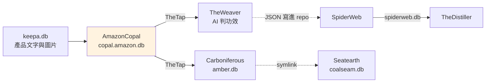
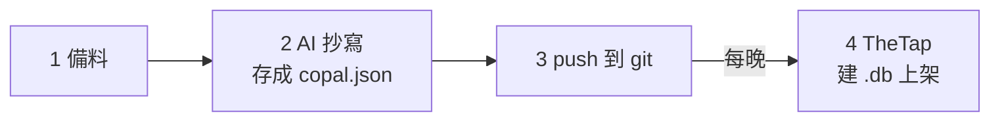

# AmazonCopal - Amazon 產品頁宣稱句抽取

---

## 📋 文檔目的

本文檔介紹 **AmazonCopal**，幫助新人理解：

- 它從 Amazon 產品頁抽出什麼、存成什麼
- 它的產出怎麼經過 TheTap 交給 TheWeaver 和 Carboniferous
- 為什麼它的一手資料「很貴、不重做」

> **完整技術文檔**：[AmazonCopal repo](https://github.com/mapleelpam/LuminNexus-AlchemyMind-AmazonCopal) 的 `CLAUDE.md`、`docs/db_contract.md`

---

## 🎯 系統職責

**AmazonCopal** 把一個 Amazon 補充品的產品頁（PDP，Product Detail Page）「讀」成一份 `{asin}.copal.json`。讀的人是 AI：opus 模型直接看產品頁上的整組圖片（瓶身、Supplement Facts 面板、行銷圖等），不先經過 OCR（把圖片轉成文字的軟體）。

每份 copal.json 有兩部分：

| 部分 | 白話 |
|------|------|
| **statements** | 圖片與產品頁文案上的文字（包含成分表的每一行），**一字不改**抄下來（例如 "Supports healthy immune function*"） |
| **claims** | 把 statements 整理成**統一寫法**的宣稱，方便跨產品比較。例如上面那句整理成 "supports healthy immune function"，標上宣稱類型（例如 FDA 的「結構／功能宣稱」），並記下它出自哪幾條 statements |

| 項目 | 說明 |
|------|------|
| **職責** | 產品頁 → 逐字宣稱句＋統一寫法的宣稱 |
| **輸入** | TheTap 的 `keepa.db` / `keepa.gb.db`（產品文字、圖片清單）、`/opt/vault/images/amazon/` 圖庫 |
| **輸出** | 原始資料：每個 ASIN 一份 copal.json，存在 repo 的 `vault/`，進 git 後不再改；整理成 .db：`copal.amazon.db`、`copal.amazon.gb.db`，經 TheTap 發佈 |
| **下游** | TheWeaver（判功效）、Carboniferous（宣稱編碼） |
| **現況** | 現行規格 v3.5（規格＝AI 抄寫時照的規則版本）；截至 2026-10-18 共 57,648 份，產線仍在運作 |

**它不做的事**：不把宣稱拆成「主詞－述詞－受詞」，也不維護詞彙表。那些是下游 [Carboniferous](carboniferous.md) 的工作。

**和 Factum 的分工**：[Factum](factum.md) 和 AmazonCopal 讀同一批產品圖，但目的不同：Factum 把成分表整理成結構化的成分與劑量（交給 Formulary），AmazonCopal 把圖上和文案的文字逐字抄下、整理成宣稱命題（交給 TheWeaver 等）。

### 命名由來

copal（硬樹脂）是還沒變成化石的樹脂，埋久了才會變成 amber（琥珀）。AmazonCopal 產出新鮮的一手宣稱，下游 Carboniferous 把它「化石化」成 `amber.db`。

---

## 🔄 在管線裡的位置

AmazonCopal 一份產出，餵兩條線：

- **功效線**（上排）：TheWeaver 讀宣稱判斷產品功效，經 SpiderWeb 進 Distiller。
- **宣稱線**（下排）：Carboniferous 編碼 → Seatearth 整理成宣稱 set，這條線還在發展中，見 [Seatearth](seatearth.md)。

---

## ⚙️ 建立流程：從產品頁到 .db

| 步驟 | 做什麼 |
|------|--------|
| **1 備料** | 挑一批約 100 個 ASIN，把 keepa 文字和圖片整理成一包。挑選時會參考 formulary、distiller、spiderweb、eidos，但它們不是建 .db 的材料 |
| **2 AI 抄寫** | opus 讀圖抄 statements、寫 claims，檢查通過才存成 `copal.json` |
| **3 push** | 推上 git 就算交付 |
| **4 建 .db** | TheTap 每晚建出美國站、英國站兩個 .db，通過檢查才上架給下游 |

**為什麼存了就不改**：每份都要 opus 讀圖，重做很貴。規格升版時新舊版本並存，不重跑舊的。

### 例外：iHerb

iHerb 的產品也做 copal.json，前三步相同，差別在：

- **備料**：文字和圖片改從 `iherb.db` 與 iHerb 圖庫 `/opt/vault/images/iherb/` 取。
- **建 .db**：不經過 TheTap，而是用 `copal deploy` 指令直接產生 `copal.iherb.db`。所以沒有上架檢查，也不留舊版。`copal deploy` 會把檔案寫進跑指令那台電腦的 `/opt/tap/`，所以路徑看起來和 TheTap 的一樣，但它不是 TheTap 發佈的；maple-msi.local 上沒有這個檔。
- **下游**：TheWeaver 的 iHerb 線。
- **未知**：由哪台電腦產生、多久更新一次，目前查不到。

---

## 📤 交接方式：copal.amazon.db

### .db 裡有什麼

TheTap 每晚執行 AmazonCopal repo 裡的 `copal forge` 指令，把 vault 裡的 copal.json 整理成 SQLite 資料庫，US（美國站）與 GB（英國站，2026-10-07 加入）各一份。

**先分清楚兩種表**：同一個產品，規格升版後新舊兩份都會留著，所以多數資料都有兩種表：

- 名稱帶 `_all` 的（例如 `products_all`）：存**全部版本**，同一個產品可能有好幾列。
- 名稱不帶 `_all` 的（例如 `products`）：是 view（檢視表，像預先設好的篩選），**每個產品只顯示最新的一份**。

一般用不帶 `_all` 的就好，要比較新舊版本差在哪才用 `_all`。

| 一般用這張（只看最新版） | 全部版本 | 內容 |
|---|---|---|
| `products` | `products_all` | 每份 copal 一列 |
| `statements` | `statements_all` | 逐字抄下的宣稱句 |
| `claims` | `claims_all` | 標準命題；US 用 `fda_claim_type`、GB 用 `gb_claim_type` |
| `claim_evidence`、`conflicts` | `claim_evidence_all`、`conflicts_all` | 命題的出處、矛盾標記 |
| `claim_canonical`、`specs`、`forge_meta` | （同一張，不分版本） | 同義說法對照、版本清單、建置資訊 |

完整規則見 repo 的 `docs/db_contract.md`。

### TheTap 上架檢查與線上現況

TheTap 建好 .db 後要通過檢查才上架，例如：US 的 db 裡不能有 GB 的宣稱類型（防止建錯市場）、筆數不得比上一版掉超過 2%。

2026-10-19 線上快照（`manifest.json`）：

| artifact | 版本 | products_all | claims_all | 規格版本 |
|----------|------|-------------|-----------|------|
| `copal.amazon` | 20261019 | 73,997 | 4,358,666 | v3.1～v3.5 並存 |
| `copal.amazon.gb` | 20261018 | 4,361 | 308,626 | v3.5 |

---

## 🐛 常見問題

### Q1: 全集 57,648 份（2026-10-18 完成記錄），為什麼 products_all 有 7 萬多列（2026-10-19 線上版）？

`products_all` 包含同一 ASIN 的多個規格版本；只看最新版要讀 `products` view。57,648 是 repo 截至 2026-10-18 完成記錄的份數，以 repo 為準。

### Q2: 矛盾的宣稱會被丟掉嗎？

不會。2026-10-05 起改為「只標記、不排除」：同一頁自相矛盾、套用別款模板等情況記在 `conflicts` 表，由下游決定怎麼用。

### Q3: repo 文件說用 `copal deploy` 發佈 .db？

那是 TheTap 接手前的舊做法。現在美國站、英國站只要 push copal.json，TheTap 會自己建。`copal deploy` 只會在**跑指令那台電腦**上做一份 .db，不會送到 maple-msi；也不要在 maple-msi 上跑它，那會蓋掉 TheTap 的版本管理。目前只有 iHerb 那份還靠它產生，見上方「例外：iHerb」。

### Q4: README 寫的內容跟這裡不一樣？

README 還停在早期移植階段，沒寫英國站等新內容。以 `CLAUDE.md` 與 TheTap 的 `pipeline.yaml` 為準。

---

## 📚 相關文檔

### Learning Map 文檔
- [TheTap](thetap.md)：發佈 copal.amazon.db 的交接中心
- [Carboniferous](carboniferous.md)：讀 copal 做宣稱編碼
- [Seatearth](seatearth.md)：宣稱線的最後一站
- [TheWeaver](theweaver.md)、[SpiderWeb](spiderweb.md)：功效線

### AmazonCopal 專案文檔
- `CLAUDE.md`：工作規則、市場（US／GB）、近期裁定
- `docs/db_contract.md`：.db 各表的定義（下游必讀）
- `contracts/copal.schema.json`：copal.json 結構
- `specs/prompts/assay.md`：AI 抄寫時照的規則（現行規格）
- `docs/reports/`：每批抄寫完成後的報告

---

## 📝 文檔維護

### 版本歷史

| 版本 | 日期 | 變更 |
|------|------|------|
| 1.1 | 2026-10-20 | 新人視角修正：tag 改 layer-2、補 claim 例子、解釋規格／OCR、刪 run 編號與 ptype、iHerb 說明集中成一節；宣稱線改中性說法（刪 Seatearth → Distiller 線與「沒接上」）；修正圖片與 statements 範圍說明；選品參考移到步驟 1；份數標註截止日期；補 `copal.iherb.db`（iHerb 線，`copal deploy` 產生、不經 TheTap）；補與 Factum 的分工說明；投影表改為先說明 `_all` 與 view 差別，表格並列兩種表名；建立流程整併為 4 步一張表，`copal deploy` 移到 iHerb 例外與 FAQ |
| 1.0 | 2026-10-19 | 初版，依 AmazonCopal repo 文件、TheTap `pipeline.yaml` 與 maple-msi.local 線上 manifest 撰寫 |

### 系統依賴

**上游**：AtlasVault-Keepa（`keepa.db`、`keepa.gb.db`）、圖庫 `/opt/vault/images/amazon/`

**下游**：TheWeaver、Carboniferous（經 TheTap 讀 `copal.amazon.db`）；iHerb 見「例外：iHerb」

---

**文檔結束**

> **注意**：份數、版本號每天變動，現況以 repo 的完成報告（`docs/reports/`）與 http://maple-msi.local/copal.amazon/daily/manifest.json 為準。
