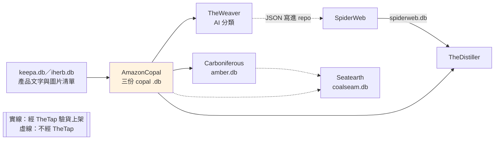
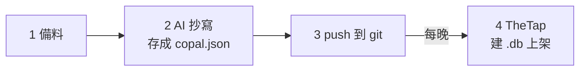

# AmazonCopal - Amazon 產品頁宣稱句抽取

---

## 📋 文檔目的

本文檔介紹 **AmazonCopal**，幫助新人理解：

- 它從產品頁抽出什麼、存成什麼
- 它的產出怎麼經過 TheTap 交給下游
- 為什麼它的一手資料「很貴、不重做」

> **完整技術文檔**：[AmazonCopal repo](https://github.com/mapleelpam/LuminNexus-AlchemyMind-AmazonCopal)

---

## 🎯 系統職責

> **名字裡為什麼有 Amazon**：AmazonCopal 一開始只處理 Amazon 的產品頁，所以這樣命名。2026-10-10 起也處理 iHerb，用的是同一套流程，名字沒有改。

**AmazonCopal** 把一個補充品的產品頁（PDP，Product Detail Page）「讀」成一份 copal.json。讀的人是 AI：會看圖的大型語言模型（LLM，像 ChatGPT 那類 AI）直接看產品頁上的整組圖片（瓶身、Supplement Facts 面板、行銷圖等），不先經過 OCR（把圖片轉成文字的軟體）。

每份 copal.json 有兩部分：

| 部分 | 白話 |
|------|------|
| **宣稱句**（statement） | 從產品頁逐字抄下來的原句：圖片與文案上的文字（包含成分表的每一行），**一字不改**（例如 "Supports healthy immune function*"） |
| **標準宣稱**（claim） | 把宣稱句整理成統一寫法的一條，方便跨產品比較，Carboniferous 讀的就是這個。例如上面那句整理成 "supports healthy immune function"，標上 FDA 宣稱類別與宣稱種類（見下方），並記下它出自哪幾條宣稱句 |

| 項目 | 說明 |
|------|------|
| **職責** | 產品頁 → 宣稱句＋標準宣稱 |
| **輸入** | TheTap 的 `keepa.db`、`keepa.gb.db`（Keepa 是追蹤 Amazon 價格的外部服務，這兩份是 Amazon 美國站、英國站的產品文字與圖片清單）、`iherb.db`，以及產品圖片（Amazon 產品圖依 `keepa.db` 裡的圖片網址下載到和 Factum 共用的資料夾，Factum 和 AmazonCopal 都會下載、讀的是同一批；iHerb 產品圖由 AmazonCopal 自己下載） |
| **輸出** | 原始資料：每個產品一份 copal.json，存在 repo 裡，進 git 後不再改。整理成 .db：`copal.amazon.db`（美國站）、`copal.amazon.gb.db`（英國站）、`copal.iherb.db`，都經 TheTap 發佈 |
| **下游** | TheWeaver（AI 分類）、TheDistiller（產品頁自己矛盾的宣稱）、Carboniferous（宣稱編碼）；Seatearth 也會直接讀美國站那份 |

**標準宣稱身上的兩種標籤**：

- **FDA 宣稱類別**：照美國 FDA 法規的分法，看這句話屬於哪一類。例如「結構／功能宣稱」是說產品支持身體某個功能（上面那句就是），標籤上要加星號附註；「疾病宣稱」是說能治療或預防疾病，補充品不能這樣說。英國站另用英國的分類。
- **宣稱種類（kind）**：看這句話在講什麼，例如功效（benefit）、產品屬性（attribute，例如素食、無麩質）、用法（usage）、警語（warning）、認證（certification）、口味（sensory-flavor）。上面那句是功效。

**它不做的事**：不把宣稱拆成「主詞－述詞－受詞」，也不維護詞彙表。那些是下游 [Carboniferous](carboniferous.md) 的工作。

**和 Factum 的分工**：[Factum](factum.md) 和 AmazonCopal 讀同一批產品圖，但目的不同：Factum 把成分表整理成結構化的成分與劑量（交給 Formulary），AmazonCopal 把圖上和文案的文字逐字抄下、整理成標準宣稱（交給 TheWeaver 等）。

### 命名由來

名字前半的 Amazon 見開頭說明。copal（硬樹脂）是還沒變成化石的樹脂，埋久了才會變成 amber（琥珀）。AmazonCopal 產出新鮮的一手宣稱，下游 Carboniferous 把它「化石化」成 `amber.db`。

---

## 🔄 在管線裡的位置

- **功效分類線**：TheWeaver → SpiderWeb 這條線。TheWeaver 讀宣稱句，產出十個知識領域的 AI 分類（例如健康效果、風味特徵、使用便利性），經 SpiderWeb 進 [TheDistiller](thedistiller.md)。
- **直接進 Distiller**：TheDistiller 也直接讀三份 copal .db，找出「產品頁自己前後矛盾」的宣稱，例如標 vegan、成分表卻有明膠。
- **宣稱線**：Carboniferous 編碼 → Seatearth 依人工事先定義的訴求（宣稱 set，例如記憶、專注）判斷每個產品命中哪些，一個產品可以命中好幾個，見 [Seatearth](seatearth.md)。amber.db、coalseam.db 都不經 TheTap。

---

## ⚙️ 建立流程：從產品頁到 .db

| 步驟 | 做什麼 |
|------|--------|
| **1 備料** | 挑一批約 100 個產品，把產品文字和圖片整理成一包。挑的時候會參考幾份從 TheTap 讀的下游 db：`formulary.db`（只挑 Formulary 認得的保健品）、`distiller.db`（避開 Eidos 判定市場身分有問題的產品，例如詐騙或假冒的品牌；這份排除清單由 TheDistiller 整理進 distiller.db）、`spiderweb.db`（依主題篩），需要時再用 `eidos.db` 限定品牌。這些只是挑選參考，不是建 .db 的材料 |
| **2 AI 抄寫** | AI 讀圖抄宣稱句、整理成標準宣稱，檢查通過才存成 copal.json |
| **3 push** | 推上 git 就算交付 |
| **4 建 .db** | TheTap 每晚從 git 建出美國站、英國站、iHerb 三份 .db，通過檢查才上架給下游 |

**為什麼存了就不改**：每份都要 AI 讀圖，重做很貴。抄寫規則升版時，新舊版本並存，不重跑舊的。

---

## 📤 交接方式：三份 copal .db

TheTap 每晚用 AmazonCopal repo 裡的建置程式，把 git 裡的 copal.json 整理成 SQLite 資料庫，美國站、英國站、iHerb 各一份。英國站 2026-10-07 開始抄寫，10-08 起由 TheTap 發佈；iHerb 2026-10-20 起由 TheTap 發佈。

**.db 裡有什麼**：主要是三類資料：產品、宣稱句、標準宣稱，另外記錄每條標準宣稱的出處，以及產品頁自相矛盾的地方。

**新舊版本**：抄寫規則升版後，同一個產品的新舊兩份都會留著。.db 裡同時保留全部版本，也提供每個產品只看最新一份的表，一般用最新版就好。各表定義見 repo 的契約文件。

**上架檢查**：TheTap 建好後要通過檢查才上架，例如美國站那份不能混進英國站的資料（確認沒有建錯市場）、筆數不能比上一版突然大減。

2026-10-21 線上版（manifest）：

| .db | 產品紀錄（含舊版本） | 標準宣稱 |
|-----|-----|-----|
| `copal.amazon`（美國站） | 75,110 | 4,428,838 |
| `copal.amazon.gb`（英國站） | 4,413 | 311,461 |
| `copal.iherb` | 8,086 | 387,906 |

---

## 🐛 常見問題

### Q1: 矛盾的宣稱會被丟掉嗎？

不會。產品頁自相矛盾、套用別款模板等情況只標記、不排除，由下游決定怎麼用。TheDistiller 就是讀這些標記，整理出「哪些宣稱被產品頁自己推翻或削弱」。

### Q2: 為什麼產品紀錄比實際產品數多？

同一個產品可能有好幾個抄寫規則版本並存，每個版本都算一筆。只看最新版要用「每個產品只看最新一份」的表。

---

## 📚 相關文檔

### Learning Map 文檔
- [TheTap](thetap.md)：發佈三份 copal .db 的交接中心
- [TheWeaver](theweaver.md)、[SpiderWeb](spiderweb.md)：功效分類線
- [TheDistiller](thedistiller.md)：直接讀 copal 的下游
- [Carboniferous](carboniferous.md)、[Seatearth](seatearth.md)：宣稱線
- [Factum](factum.md)：讀同一批產品圖、抄成分表

### AmazonCopal 專案文檔
- [AmazonCopal repo](https://github.com/mapleelpam/LuminNexus-AlchemyMind-AmazonCopal)：工作規則、.db 契約、copal.json 結構、AI 抄寫規則

---

## 📝 文檔維護

### 版本歷史

| 版本 | 日期 | 變更 |
|------|------|------|
| 1.0 | 2026-10-20 | 初版：系統職責、管線位置、建立流程、交接方式 |
| 1.1 | 2026-10-21 | 依 review 修正：iHerb 改為經 TheTap 發佈、下游補 TheDistiller 與 Seatearth；英國站兩個日期分開寫；刪減操作細節、資料表清單、未定事項與 repo 文件過時題；名詞依對照表統一；補名字由來、FDA 宣稱類別與宣稱種類白話、知識領域舉例；不寫模型名、寫明圖庫來源與挑選參考 db 經 TheTap、圖補 AmazonCopal → Seatearth 與圖例；寫明 distiller.db 排除清單是 Eidos 判定、功效分類線定義 |

### 系統依賴

**上游**：AtlasVault-Keepa（`keepa.db`、`keepa.gb.db`）、`iherb.db`（都經 TheTap）、產品圖片（共用資料夾，不經 TheTap）

**下游**：TheWeaver、TheDistiller、Carboniferous（經 TheTap 讀）；Seatearth 直接讀

---

**文檔結束**

> **注意**：筆數每天變動，現況以 http://maple-msi.local/ 各 copal 的 manifest 為準。
