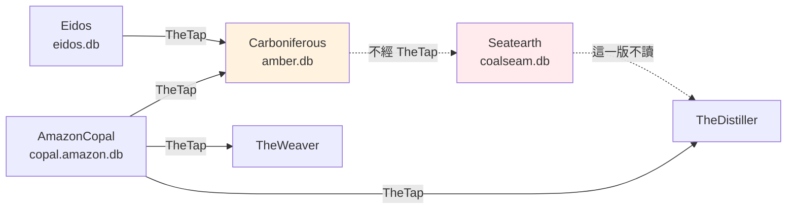

# Carboniferous - 宣稱編碼（amber.db）

---

## 📋 文檔目的

本文檔介紹 **Carboniferous**，幫助新人理解：

- 「宣稱編碼」是什麼，為什麼需要它
- 它的輸入（copal）與輸出（`amber.db`）
- 它怎麼交給 Seatearth，以及這個交接不經過 TheTap

> **完整技術文檔**：[Carboniferous repo](https://github.com/mapleelpam/LuminNexus-AlchemyMind-Carboniferous)

---

## 🎯 系統職責

**Carboniferous**（石炭紀）是宣稱線的**編碼器**：把 [AmazonCopal](amazoncopal.md) 整理好的**標準宣稱**（從產品頁抄下的宣稱句，整理成統一寫法的一條），翻成機器能比對的結構。

例如一句 "supports healthy immune function"，編成（示意）：

```
產品 ──supports──▶ immune-health
主詞     述詞          受詞
```

這種「主詞－述詞－受詞」的結構叫 **S-P-O edge**（edge＝圖上的一條連線）。編成 edge 之後，不同產品、不同措辭的宣稱才能放在一起數。

| 項目 | 說明 |
|------|------|
| **職責** | 標準宣稱 → S-P-O edges；維護述詞（predicate）、受詞類別、詞彙（vocab）三份封閉清單 |
| **輸入** | TheTap 的 `copal.amazon.db`（標準宣稱）、`eidos.db`（品牌原料 → 通用成分的對照，見「為什麼要讀 eidos.db」）；repo 內的字典 |
| **輸出** | `amber.db`（不進 git，可重新產生） |
| **下游** | [Seatearth](seatearth.md) 讀 `amber.db`，再產出 `coalseam.db`；TheDistiller 2026-10-16 起不讀 `coalseam.db`（見「跟 TheDistiller 的關係」） |

### 命名由來

石炭紀是煤層大量形成的地質年代。這一家 repo 都用地質取名：copal（新樹脂）→ amber（琥珀）→ coalseam（煤層，[Seatearth](seatearth.md) 的產出）。

### 跟 TheDistiller 的關係

[TheDistiller](thedistiller.md) 2026-10-16 起不讀 Seatearth 的 `coalseam.db`，這是 maple（AlchemyMind 負責人）的決定。所以 `distiller.db` 裡記錄「每個產品宣稱了哪些訴求」的產品宣稱表（`ProductBenefitClaims`）目前是空的，這是正常的。[TheWatershed](thewatershed.md) 目前改用**功效分類線**（[TheWeaver](theweaver.md) → [SpiderWeb](spiderweb.md) 這條線，產出十個知識領域的 AI 分類）裡的**功效分類**（健康效果、效能提升、生活品質三個領域）建群組；長期仍希望用這條宣稱線供 TheWatershed 建群組。

---

## 🔄 在管線裡的位置



- 實線經過 TheTap。Carboniferous → Seatearth 是虛線，因為 `amber.db` 沒進 TheTap；Seatearth → TheDistiller 是虛線，標「這一版不讀」，指 TheDistiller 2026-10-16 起不讀 `coalseam.db`。
- AmazonCopal 的 copal 也直接交給 TheWeaver（功效分類線）和 TheDistiller，和本篇無關，畫出來是為了看清楚 copal 不只本線在用。

---

## ⚙️ 怎麼編碼：字典

核心設計是**同一句宣稱只編一次**：

1. 每條標準宣稱在 [AmazonCopal](amazoncopal.md) 那一層就已經標好**宣稱種類（kind）**，也就是看這句話在講什麼，共六種：功效（benefit）、產品屬性（attribute）、用法（usage）、警語（warning）、認證（certification）、口味（sensory-flavor）。Carboniferous 直接沿用，不自己改判，連同句子去查字典。
2. 字典查得到 → 直接套用，不再問 AI。
3. 查不到 → 收集起來批次交給 AI 編碼，結果寫回字典。
4. 字典更新後，重新產出 `amber.db`。

目前字典只收了功效、產品屬性、用法、警語四種，認證、口味兩種還沒有字典內容。

好處：同一句宣稱出現在再多產品上，都只需要編一次，結果也一致。字典放在 repo 裡、進 git，每一筆編碼都能逐條檢查。

### 為什麼要讀 eidos.db

宣稱裡常提到品牌原料，例如 KSM-66、Sensoril，兩者都是 ashwagandha（南非醉茄）的品牌萃取，但規格不同。Carboniferous 保留品牌名、不併成通用名，免得丟掉「用的是哪個品牌原料」；再到 [Eidos](eidos.md) 的品牌原料表查出它屬於哪個通用成分。所以 `eidos.db` 是「品牌原料 → 通用成分」的對照來源。

---

## 📤 交接方式：amber.db

`amber.db` 裡主要是每條宣稱編好的 S-P-O edges，另外記下編不了、先隔離起來的宣稱。產出前會先檢查，有錯誤或數字對不上就不發佈。表名與檢查細節見 repo 文件。

| 交接物 | 怎麼交 |
|-------|--------|
| `amber.db` | Seatearth 直接讀本 repo 產出的檔 |
| 清單快照 | Seatearth 把本 repo 的述詞、詞彙清單抄一份存進自己的 repo |

**`amber.db` 不經 TheTap**：TheTap 的線上清單和建置設定裡都沒有它。

---

## 📖 故事：現在為什麼長這樣

| 時間 | 事件 |
|------|------|
| 2026-07-16 | AmazonCopal 從本 repo 分家，承接「讀產品頁」 |
| 2026-07-20 | 讀產品頁正式移到 AmazonCopal，本 repo 只管編碼 |
| 2026-08-04 | 字典依 kind 分區 |
| 2026-08-14 | 宣稱 set 的判斷與聚合切出到 Seatearth |
| 2026-08-31 | benefit 高頻 342 句加入字典 |

---

## 🐛 常見問題

### Q1: 為什麼不直接讓 AI 逐句判斷，要做字典？

AI 每次回答可能不一樣，而且大量標準宣稱逐句問太貴。字典讓同一句永遠得到同一個編碼，結果也能逐條檢查。

### Q2: 跟功效分類線（TheWeaver → SpiderWeb）差在哪？

兩條線的原料都來自 AmazonCopal，但讀的東西和做法都不同：本線讀**標準宣稱**，**以句子為單位**，靠字典與人工規則編碼，再由 Seatearth 歸成**宣稱 set**（產品自己說的訴求），結果固定、能追回原句；功效分類線的 [TheWeaver](theweaver.md) 讀**宣稱句**（產品頁逐字抄下的原句），由 **AI 逐產品**做分類（十個知識領域，例如健康效果、風味特徵、使用便利性），其中健康效果、效能提升、生活品質三個領域的結果就是**功效分類**，是 AI 判的，結果經 [SpiderWeb](spiderweb.md) 交給下游。

---

## 📚 相關文檔

### Learning Map 文檔
- [AmazonCopal](amazoncopal.md)：上游，提供標準宣稱
- [Eidos](eidos.md)：上游，提供品牌原料對照
- [Seatearth](seatearth.md)：下游，讀 amber.db
- [TheDistiller](thedistiller.md)：2026-10-16 起不讀 coalseam.db
- [TheWatershed](thewatershed.md)：長期希望用這條線建群組
- [TheWeaver](theweaver.md)：功效分類線
- [TheTap](thetap.md)：交接中心（本 repo 只從這裡讀，不發佈）
- [分類體系術語](../../general/classification-terminology.md)：封閉清單、詞彙等概念

### Carboniferous 專案文檔
- [Carboniferous repo](https://github.com/mapleelpam/LuminNexus-AlchemyMind-Carboniferous)：工作規則、指令、封閉清單與編碼操作手冊都在 repo 內

---

## 📝 文檔維護

### 版本歷史

| 版本 | 日期 | 變更 |
|------|------|------|
| 1.0 | 2026-10-20 | 初版：系統職責、字典編碼、為什麼讀 eidos.db、交接給 Seatearth、跟 TheWeaver 線的差別 |
| 1.1 | 2026-10-21 | 依 leana review：宣稱線改寫為「TheDistiller 2026-10-16 起不讀、長期仍希望供 TheWatershed 建群組」；刪 README 過時題、版本號與檔案路徑；不再把 symlink 當特別交接；名詞依核定對照統一（標準宣稱、宣稱種類、宣稱 set、功效分類線）；圖補 AmazonCopal → TheDistiller；知識領域舉例改照 theweaver.md（不含劑型）；宣稱種類改寫為 AmazonCopal 標的六種、本 repo 沿用；產品宣稱表改白話；summary 封閉清單數量與正文一致（三份）；功效分類線、maple 第一次出現補白話 |

### 系統依賴

**上游**：AmazonCopal（`copal.amazon.db`）、Eidos（`eidos.db`），都經 TheTap

**下游**：Seatearth（讀 `amber.db`）；TheDistiller 2026-10-16 起不讀 Seatearth 的 `coalseam.db`

---

**文檔結束**

> **注意**：封閉清單與字典內容以 repo 為準。
