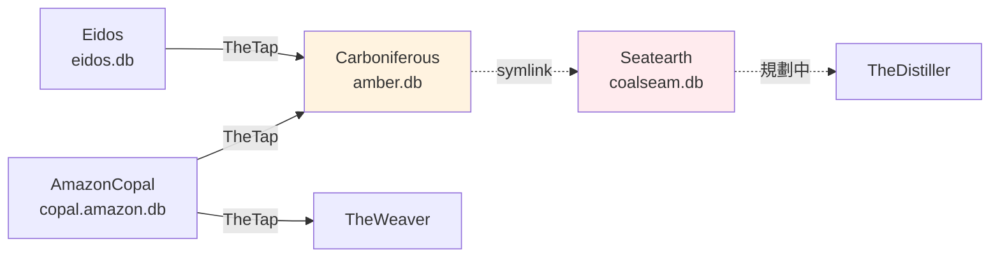

# Carboniferous - 宣稱編碼（amber.db）

---

## 📋 文檔目的

本文檔介紹 **Carboniferous**，幫助新人理解：

- 「宣稱編碼」是什麼，為什麼需要它
- 它的輸入（copal）與輸出（`amber.db`）
- 它怎麼交給 Seatearth，以及這個交接不經過 TheTap

> **完整技術文檔**：[Carboniferous repo](https://github.com/mapleelpam/LuminNexus-AlchemyMind-Carboniferous) 的 `CLAUDE.md`、`specs/cli.md`、`contracts/`

---

## 🎯 系統職責

**Carboniferous**（石炭紀）是宣稱線的**編碼器**：把 [AmazonCopal](amazoncopal.md) 整理好的宣稱命題，翻成機器能比對的結構。

例如一句 "supports healthy immune function"，編成（示意）：

```
產品 ──supports──▶ immune-health
主詞     述詞          受詞
```

這種「主詞－述詞－受詞」的結構叫 **S-P-O edge**（edge＝圖上的一條連線）。編成 edge 之後，不同產品、不同措辭的宣稱才能放在一起數。

| 項目 | 說明 |
|------|------|
| **職責** | claims → S-P-O edges；維護述詞（predicate）、受詞類別、詞彙（vocab）三份封閉清單 |
| **輸入** | TheTap 的 `copal.amazon.db`（宣稱命題）、`eidos.db`（品牌原料 → 通用成分的對照，見「為什麼要讀 eidos.db」）；repo 內的字典 |
| **輸出** | `data/amber/amber.db`（不進 git，可重新產生） |
| **下游** | [Seatearth](seatearth.md)，用 symlink 讀 `amber.db` |
| **現況** | 契約 `predicates.yaml` v0.10.13 |

### 命名由來

石炭紀是煤層大量形成的地質年代。這一家 repo 都用地質取名：copal（新樹脂）→ amber（琥珀）→ coalseam（煤層，[Seatearth](seatearth.md) 的產出）。

### 未來方向

這條宣稱線會繼續發展，規劃經 Seatearth 接上 TheDistiller，供 [TheWatershed](thewatershed.md) 建市場分類的群組。目前 TheWatershed 先用 [TheWeaver](theweaver.md) 那邊的分類樹建群組。

---

## 🔄 在管線裡的位置



- 實線經過 TheTap。Carboniferous → Seatearth 的虛線是 symlink（捷徑）：讀檔方式本身正常，差別在 `amber.db` 沒進 TheTap。Seatearth → TheDistiller 的虛線是規劃中的交接。
- AmazonCopal → TheWeaver 是另一條功效線，和本篇無關，畫出來是為了看清楚 copal 被兩邊用。

---

## ⚙️ 怎麼編碼：字典

核心設計是**同一句宣稱只編一次**：

1. 每條宣稱帶著 copal 標好的 **kind**（宣稱類型，共 benefit、attribute、usage、warning 四種），連同句子去查字典。
2. 字典查得到 → 直接套用，不再問 AI。
3. 查不到 → 收集起來批次交給 AI 編碼，結果寫回字典。
4. 字典更新後，重新產出 `amber.db`。

好處：同一句宣稱出現在再多產品上，都只需要編一次，結果也一致。字典放在 repo 裡、進 git，每一筆編碼都能逐條檢查。

### 為什麼要讀 eidos.db

宣稱裡常提到品牌原料，例如 KSM-66、Sensoril，兩者都是 ashwagandha（南非醉茄）的品牌萃取，但規格不同。Carboniferous 保留品牌名、不併成通用名，免得丟掉「用的是哪個品牌原料」；再到 [Eidos](eidos.md) 的品牌原料表查出它屬於哪個通用成分。所以 `eidos.db` 是「品牌原料 → 通用成分」的對照來源。

---

## 📤 交接方式：amber.db

`amber.db` 裡主要是每條宣稱編好的 S-P-O edges，另外記下編不了、先隔離起來的宣稱。產出前會先檢查，有錯誤或數字對不上就不發佈。表名與檢查細節見 repo 文件。

| 交接物 | 怎麼交 |
|-------|--------|
| `amber.db` | Seatearth 用 symlink 讀本 repo 產出的檔 |
| 清單快照 | Seatearth 把本 repo 的述詞、詞彙清單抄一份存進自己的 repo |

**`amber.db` 不經 TheTap**：線上 http://maple-msi.local/index.json 沒有 amber，TheTap `pipeline.yaml` 也沒有登記。

---

## 📖 故事：現在為什麼長這樣

| 時間 | 事件 |
|------|------|
| 2026-07-16 | AmazonCopal 從本 repo 分家，承接「讀產品頁」 |
| 2026-07-20 | 讀產品頁正式移到 AmazonCopal，本 repo 只管編碼 |
| 2026-08-04 | 字典依 kind 分區 |
| 2026-08-14 | 宣稱 set 的判斷與聚合切出到 Seatearth |
| 2026-08-31 | benefit 高頻 342 句加入字典 |

---

## 🐛 常見問題

### Q1: README 畫著本 repo 產出 coalseam.db？

已過時。產出 coalseam.db 的工作在 2026-08-14 搬到 Seatearth，以 `CLAUDE.md` 與 `specs/cli.md` 為準。

### Q2: 為什麼不直接讓 AI 逐句判斷，要做字典？

AI 每次回答可能不一樣，而且大量 claim 逐句問太貴。字典讓同一句永遠得到同一個編碼，結果也能逐條檢查。

### Q3: 跟 TheWeaver → SpiderWeb 那條線差在哪？

兩條線都吃 AmazonCopal 的宣稱，但做法不同：本線**以句子為單位**，靠字典與人工規則編碼、歸成宣稱 set，結果固定、能追回原句；[TheWeaver](theweaver.md) 是 **AI 逐產品**對分類樹判斷，範圍還包含認證、口味等屬性，結果經 [SpiderWeb](spiderweb.md) 交給下游。

---

## 📚 相關文檔

### Learning Map 文檔
- [AmazonCopal](amazoncopal.md)：上游，提供 claims
- [Eidos](eidos.md)：上游，提供品牌原料對照
- [Seatearth](seatearth.md)：下游，讀 amber.db
- [TheTap](thetap.md)：交接中心（本 repo 只從這裡讀，不發佈）
- [分類體系術語](../../general/classification-terminology.md)：封閉清單、詞彙等概念

### Carboniferous 專案文檔
- `CLAUDE.md`、`AGENTS.md`：工作規則
- `specs/cli.md`：指令與契約快照格式
- `specs/STRATA.md`：各層歸屬
- `contracts/predicates.yaml`、`contracts/object_classes.yaml`、`contracts/vocab/`：封閉清單
- `docs/guides/SMELT_OPERATOR.md`：編碼操作手冊

---

## 📝 文檔維護

### 版本歷史

| 版本 | 日期 | 變更 |
|------|------|------|
| 1.0 | 2026-10-19 | 初版，依 Carboniferous repo 文件、git log 與 TheTap 線上 index 撰寫 |
| 1.1 | 2026-10-20 | 加「未來方向」與「跟 TheWeaver 線差在哪」；圖上 Seatearth → TheDistiller 改標「規劃中」；刪去未接上的提醒與停更說法；kind 改列實際四種、刪去未查證數字 |
| 1.2 | 2026-10-20 | 依新人視角審閱：規劃下游統一為「接上 TheDistiller，供 TheWatershed 建群組」；編碼與交接段精簡術語，只留 kind 與字典；補「為什麼要讀 eidos.db」；故事表刪停更說法 |

### 系統依賴

**上游**：AmazonCopal（`copal.amazon.db`）、Eidos（`eidos.db`），都經 TheTap

**下游**：Seatearth（symlink 讀 `amber.db`）；規劃接上 TheDistiller，供 TheWatershed 建群組

---

**文檔結束**

> **注意**：契約版本與字典內容以 repo 的 `contracts/` 與 `dictionary/` 為準。
