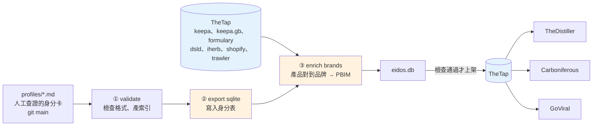

# Eidos - 供應鏈身分系統

---

## 📋 文檔目的

本文檔提供 **Eidos** 的系統導覽，幫助**新人建立對這套系統的整體理解**：

- Eidos 的系統職責與在 AlchemyMind 層的定位（它跟產品層 pipeline 有何不同）
- 它的核心比喻：八種「DogTag 身分卡」
- 輸入 / 輸出：從 TheTap 讀哪些 `.db`、產出的 `eidos.db` 長什麼樣
- 交接：誰在讀 `eidos.db`、讀哪些表、TheTap 上架前檢查什麼
- 一份把系統術語翻成白話的**名詞對照表**（放在「🔑 關鍵概念」）

> **給你的閱讀建議**：先看「🎯 系統職責」與「🪪 八種 DogTag 身分卡」建立直覺，再看「📤 交接方式」了解它和下游的關係；「🔑 關鍵概念」的名詞對照表**只讀標 🔴 的 12 個**即可上手，其餘 🟡 用到再回來查。

> **完整技術文檔**：[Eidos repo](https://github.com/mapleelpam/LuminNexus-AlchemyMind-Eidos) 的 `CLAUDE.md`、`docs/crystallized/guides/EIDOS_DB_BUILD.md`（eidos.db 的建置與給下游的規則）、`specs/DogTag/README.md`
> **操作指南**：`.claude/skills/` 目錄下的專用 skill（清單以 `CLAUDE.md` 的 skill 表為準）

---

## 🎯 系統職責

**Eidos** 是 AlchemyMind 層的**膳食補充品供應鏈身分系統**，把保健食品產業裡的每一個角色 —— 每個品牌、每間公司、每個官網、每個專利成分、每個菌株、每座代工廠 —— 都登記成一張帶有來源證據的**身分卡（DogTag）**。

市面上有幾十萬項保健食品，但「這些產品背後是誰做的、誰擁有誰」常常一團亂 —— 同一個品牌可能被併購、換過名、有好幾個網站。Eidos 的工作就是把這些身分關係**查清楚、記下來，而且每一筆都能追到證據來源**；再把每個產品對到它所屬的品牌，交給下游使用。

### 核心職責

| 項目 | 說明 |
|------|------|
| **職責** | 整理品牌 / 公司 / 網域 / 商標 / 菌株 / 代工廠的持久身分事實（ownership、composition、certification、type），並算出「每個產品屬於哪個品牌」 |
| **輸入** | 人工查證的 `profiles/**/*.md` 身分卡（git），加上 TheTap 上的 7 份產品 `.db`：keepa、keepa.gb、formulary、dsld、iherb、shopify、trawler |
| **輸出** | `eidos.db`：身分表（Brands、Companies、BI/BT/BP…）＋ 產品→品牌對照表 `ProductBrandIdentityMap`（PBIM） |
| **交接** | 每晚由 TheTap 從 `main` 建置、檢查、上架；下游 TheDistiller、GoViral、Carboniferous 讀取 |
| **現況** | 2026-10-19 線上版：schema 1.40.0；Brands 13,838 列、PBIM 1,262,959 列 |

### 核心價值

- **身分即真相**：把雜亂的供應鏈關係萃取成結構化、可查證的身分卡
- **互相指認**：品牌卡寫「屬於哪間公司」、成分卡寫「擁有者是誰、用了哪項技術」，連起來成一張供應鏈關係網

> 支撐這兩點的五條設計原則（含「身分 ≠ 市場表現」與 provenance 的取捨），見本文「💡 設計原則」。

### 命名由來

- **Eidos**（希臘文 εἶδος）意為「形式、本質」。在希臘哲學裡指事物的「本質形態」—— 系統的任務正是從雜亂資料中**萃取每個實體的身分本質**。
- **DogTag** 原意是軍人配戴的「身分辨識牌」。這裡借喻：每個實體都有一張記載其身分事實的檔案卡。

（這延續了 LuminNexus 用命名承載概念的傳統，如 TheArgus 取自百眼巨人 Argus Panoptes，象徵全面監控。）

### 系統定位
- **Layer**: AlchemyMind (Layer 2)
- **範圍**：全球保健品品牌的身分 SSOT，不是只收美國市場（2026-10-05 起）。品牌在哪些市場販售，另以證據欄位記錄（`BrandMarkets`）
- **上游**：TheTap 上的產品 `.db`（其中 `formulary.db` 來自 [Formulary](formulary.md)）
- **下游**：TheDistiller、GoViral、Carboniferous（都讀 `eidos.db`）

---

## 🏗️ 系統架構



**資料流說明**：
1. **身分卡**：人（多半搭配 Claude skill）查證後寫成 `profiles/**/*.md`，commit 到 `main`。這是唯一進 git 的來源真相。
2. **三個建置步驟**（每晚由 TheTap 在建置機上執行）：
   - `eidos validate --write-index`：檢查所有卡片、產生總目錄 `_index.yaml`
   - `eidos export sqlite`：把卡片寫成 `eidos.db` 的身分表
   - `eidos enrich brands --source all`：拿 7 份產品 `.db` 逐筆比對，寫入 PBIM
3. **上架**：TheTap 檢查 `eidos.db`，通過才發新版；下游一律從 TheTap 取用。

> **順序不能顛倒**：第 ③ 步是拿第 ② 步剛寫好的 `Brands` 表去比對產品，不是讀 markdown。若用舊的身分表比對，新加的品牌會**靜默地**一個產品都對不到，而且程式照樣正常結束（Eidos #1176）。

---

## 📥 輸入資料 (Input)

### 1. 身分卡（git）

`profiles/` 底下的 Markdown 身分卡，由 Eidos 自己維護。另有幾份輔助資料也在 repo 裡：黑名單 `profiles/_blacklist/*.csv`、FDA 執法紀錄快照 `profiles/_registers/fda/`（每季手動更新）、名冊 `scripts/data/*.csv`。

### 2. 產品資料庫（從 TheTap 讀）

以 TheTap `pipeline.yaml` 的 `eidos.inputs` 為準，共 7 份：

| 資料庫 | 內容 | 生產者 |
|--------|------|--------|
| `keepa.db` | Amazon 美國站產品目錄 | AtlasVault-Keepa |
| `keepa_gb.db` | Amazon 英國站產品目錄（TheTap 上叫 `keepa.gb.db`） | AtlasVault-Keepa |
| `formulary.db` | 從產品圖片抽出的成分標籤 | [Formulary](formulary.md) |
| `dsld.db` | DSLD（美國 NIH 官方膳食補充品標籤庫） | 人工匯入 |
| `iherb.db` | iHerb 線上零售目錄 | 人工匯入 |
| `shopify.db` | 品牌自營 Shopify 網店產品 | 人工匯入 |
| `trawler.db` | 品牌官網產品 | 人工匯入 |

**怎麼讀**：TheTap 建置時在 `input/` 下自動建 symlink（捷徑）指向 `/opt/tap/` 的對應檔，Eidos 直接用 SQLite 開來查。

> **注意檔名**：英國站在 TheTap 叫 `keepa.gb`，但 Eidos 把來源命名為 `keepa_gb`、找的檔名是 `input/keepa_gb.db`，所以 TheTap 用 `as: keepa_gb.db` 改了捷徑名。US 與 GB 刻意分成兩個來源：同一個 ASIN 可能兩站都有，合在一起會互相蓋掉歸屬。

---

## 📤 輸出資料 (Output)

### 1. DogTag 身分卡（來源真相，SSOT）

**格式**：Markdown（`.md`），一個檔 = 一張身分卡。**位置**：`profiles/**/*.md`，是唯一 commit 進 git 的來源真相。

```
profiles/
├── brands/                 # 品牌身分卡
├── companies/              # 公司身分卡
├── domains/                # 網域身分卡
├── strains/                # 菌株身分卡
├── facilities/             # 代工廠的廠區身分卡
└── marks/                  # 三種商標
    ├── branded_ingredient/     # BI: WHAT — 成分
    ├── branded_technology/     # BT: HOW — 技術
    └── branded_provenance/     # BP: WHO/WHERE — 來源
```

### 2. eidos.db（給下游的產物）

`eidos.db` 裡有兩層資料，由不同步驟寫入：

| 層 | 寫入步驟 | 主要表 |
|----|---------|--------|
| **身分層**（來自身分卡） | `eidos export sqlite` | `Brands`、`BrandLookup`、`BrandMarkets`、`Companies`、`CompanyLookup`、`CompanyGroup`、`Domains`、`BrandedIngredients` / `BrandedTechnologies` / `BrandedProvenances`、`MarkLookup`、`Strains`、`Facilities`、`marketplace_seller`、`_metadata` |
| **對照層**（來自產品 .db） | `eidos enrich brands` | `ProductBrandIdentityMap`（PBIM）：每個產品一列，寫它屬於哪個品牌，或為什麼被排除 |

新人先認得這幾個就好：

- **`Brands`**：品牌。下游要「品牌是誰」就查這張。
- **`ProductBrandIdentityMap`（PBIM）**：產品 → 品牌。`bl_reason` 有值代表這個產品**被排除**（例如詐騙店、白牌代工），下游必須照著排除，不可以自己從原始品牌名再猜一次。
- **`BrandLookup` / `CompanyLookup` / `MarkLookup`**：手上有一個名字、想知道它是哪個品牌 / 公司 / 商標時，查這三張（要注意 `ambiguous`、`excluded` 欄位）。
- **`_metadata`**：版本資訊。`schema_version` 表示表結構的版本，`git_sha` 記錄是從哪個 commit 建出來的。

> 完整的表清單與每個欄位的規則，見 repo 的 `docs/crystallized/guides/EIDOS_DB_BUILD.md`；schema 版本歷史在 `src/dogtag/export_sqlite.py` 的 `SCHEMA_VERSION` 註解區。

### 3. 其他衍生物（不 commit，用再重生）

| 產物 | 產生器 | 說明 |
|------|--------|------|
| `profiles/_index.yaml` | `eidos validate --write-index` | 自動產的總目錄，人不用手改 |
| `dogtag_explorer/` 的資料檔 | `dogtag_explorer/build.py` | 本機瀏覽身分卡的網頁（Explorer） |
| `output/graph/graph.json` 等 JSON | `eidos export graph / brands / …` | 依需要匯出的 JSON，不是對外契約 |

---

## 🔄 交接方式

### 怎麼交給 TheTap

Eidos 不自己上傳檔案。TheTap 每晚 00:30 執行 `thetap run` 時，用機器人帳號 checkout Eidos 的 `main`，依序跑上面三個建置步驟，產出候選檔再檢查。所以**只有 push 到 `main` 的身分卡才會進正式版**。

- **只重建需要的部分**：只有產品 `.db` 變動時，TheTap 從目前的線上版接著做，只重跑 `enrich`（約 35 秒，完整三步約 6 分半）；身分卡有變動才三步全跑。
- **版本**：通過檢查就發新版，版本名 `YYYYMMDD[-N]`，保留 `daily` 與 `last` 兩版可回退。

### TheTap 上架前檢查什麼（gate）

| 檢查 | 標準 |
|------|------|
| 上架前先跑 `eidos validate` | 沒過就不發佈（fail-closed） |
| 資料庫完整 | `PRAGMA quick_check` = ok |
| 必要的表都在 | `Brands`、`ProductBrandIdentityMap`、`marketplace_seller`、`_metadata` |
| 最低筆數 | `Brands` ≥ 10,000、PBIM ≥ 950,000 |
| 不能突然變少 | `Brands` 比上一版少不超過 2%；PBIM **每個來源各自**少不超過 5% |

PBIM 要「每個來源各自」比較，是因為 7 個來源加總很大，其中一個來源整個不見，總數看起來仍然正常。2026-10-19 版各來源列數：formulary 387,460、keepa 339,786、dsld 211,589、trawler 123,063、shopify 105,468、keepa_gb 65,928、iherb 29,665。

### 誰在讀 eidos.db

| 下游 | 怎麼讀 | 讀什麼 |
|------|-------|-------|
| [TheDistiller](thedistiller.md) | TheTap 接到 `input/eidos.db`（v3.56.1 起是**必要輸入**，缺檔就失敗） | Stage 13 用 `Brands` + PBIM 決定每個產品的品牌（含排除）；Stage 15 匯入 BI / BT / BP 與別名 |
| [Carboniferous](carboniferous.md) | 直接唯讀開 `/opt/tap/eidos.db` | `BrandedIngredients`、`BrandedIngredientAliases`、`BIIngredientCategories`，用來對應品牌原料與通用成分（契約 `contracts/crosswalk_eidos.yaml`） |
| GoViral | 直接開 `/opt/tap/eidos.db`（跟著 `daily` 版本） | 品牌、公司、品牌原料，建出 `goviral.db` 的 `brand`、`org` 等表 |

另外 [AmazonCopal](amazoncopal.md) 挑選要處理的產品時也會參考 `eidos.db`。

> **下游要注意的事**：GoViral 讀不到 `eidos.db` 時不會報錯，只是 `brand`、`org` 變空，所以 TheTap 在 GoViral 那邊另設了 `brand` ≥ 320、`org` ≥ 315 的下限來擋。TheDistiller 在 v3.56.1 之前也有同樣的問題：找不到 eidos.db 就跳過，產出 0 個品牌，檢查卻全部通過。

---

## 🪪 八種 DogTag 身分卡

身分卡分三群：**主角**（品牌、公司）、**周邊**（網域、菌株、代工廠）、以及最有特色的**三種商標**（用 WHAT / HOW / WHO 區分）。

| 類型 | 英文 | 白話 | 回答的問句 | 例子 | 數量（截至 2026-08-10） |
|---|---|---|---|---|---|
| **品牌** | Brand | 消費者看到的招牌 | — | Nature's Bounty | 12,006 |
| **公司** | Company | 背後的法人 | — | Nestlé Health Science | 4,213 |
| **網域** | Domain | 官網 / 網站 | — | olly.com | 8,409 |
| **成分商標** | Branded Ingredient (BI) | 有商標的原料成品 | **WHAT** 是什麼成分 | BioPerine® | 854 |
| **技術商標** | Branded Technology (BT) | 有商標的製程 / 技術 | **HOW** 用什麼技術做 | Phytosome® | 62 |
| **來源商標** | Branded Provenance (BP) | 有商標的來源 / 品質保證 | **WHO/WHERE** 來自哪 | Albion® | 80 |
| **菌株** | Strain | 益生菌的特定品系 | — | PS128 | 30 |
| **代工廠** | Facility | 代工廠的一座廠區 | — | — | — |

> 數量是 repo `CLAUDE.md` 記的快照，**截至 2026-08-10**（代工廠卡較新，未列數量），之後已有不少增減；現況請在 repo 跑 `uv run eidos info`。

> **記住三種商標的一句話**：把一顆保健食品拆開 —— **BI = 裡面放什麼、BT = 用什麼手法做、BP = 原料從哪來、品質如何**。

身分卡的價值在於**互相指認**：品牌卡寫「我屬於哪間公司」、成分卡寫「擁有者是誰、用了哪項技術」、廠區卡寫「由哪間公司經營」。連起來就成了一張供應鏈關係網，這就是 Eidos 的核心產出。

---

## 🔧 核心功能與機制

### 1. 一個指令：`eidos`（都用 `uv run`）

2026-08-09 起所有功能合併成同一個 `eidos` 指令（舊的 `dogtag`、`muster`、`census` 指令已停用）：

| 子指令 | 職責 | 白話 |
|------|------|------|
| **eidos validate** | 驗證 + 產索引 | 「點名整隊」：掃過所有卡編總目錄，順便檢查有沒有寫錯 |
| **eidos profile** | 查詢 / 建立卡片 | 查卡查詢機：輸入品牌名就吐出那張卡 |
| **eidos export** | 匯出 | 把卡片匯出成 `eidos.db` 或 JSON |
| **eidos enrich** | 產品對品牌 | 拿產品 `.db` 比對身分卡，寫入 PBIM |
| **eidos review** | 驗收總關卡 | 把散落的檢查收成一個過 / 不過結論 |

> 程式裡有個內部元件叫 `refinery`（`src/refinery/`，負責 `enrich`）。它是 Eidos 自己的程式，**不是**舊文件裡的 TheRefinery 系統。

### 2. Provenance Gate（來源可信度閘門）

每筆資料都記「哪來的、多可信」；閘門規定 **「低可信來源不准覆蓋高可信」**。可信度等級（source tier）由高到低：人工查證 > LLM 判斷 > 內容分類 > 直接探測 > 種子匯入。（為什麼要有這道閘門，見「💡 設計原則 → 3」）

### 3. 品質關卡

| 關卡 | pre-commit | CI | 手動 |
|------|:---:|:---:|:---:|
| `eidos validate`（有 ERROR 就擋） | ✅ | ✅ | — |
| `pytest` | — | ✅ | — |
| `eidos review --scope changed`（訊息分 **BLOCK / WARN / INFO**，一個 BLOCK 就不通過） | — | — | ✅ |

`eidos review` 在 2026-08-21 移出 CI，**改靠改卡的人自己記得跑**。

> **延伸**：provenance / source tier 是 Eidos 特有的機制，故在此自述。資料品質的通用視角可延伸看 [../../roles/testing/](../../roles/testing/)（資料品質三面向）。

---

## 📊 資料格式與 Schema

### 身分卡的結構：frontmatter + 內文

每張 DogTag 是一個 Markdown 檔，最上面用 `---` 夾住的是 **frontmatter**（表頭欄位區，寫法叫 **YAML**），下面才是文字說明。

```markdown
---
schema_version: "0.8"
brand_name: "Nature's Bounty"
parent_company: nbty-inc        # FK：指向公司卡
status: active
draft: false
---

# Nature's Bounty
（身分描述內文…）
```

### 關鍵欄位概念

| 欄位概念 | 說明 |
|---------|------|
| `schema_version` | 「該有哪些欄位」的規格書版本（各類卡片各自有版本，最新版以 repo `src/muster/validator.py` 的 `SCHEMA_FILES` 為準） |
| **FK（外鍵）** | 「這張卡指向另一張卡」的連結（如品牌 → 母公司） |
| **slug / kebab-case** | 卡片檔名代號；公司卡規定小寫 + 連字號（`nature-made`），品牌卡沿用舊的底線寫法 |
| `eidos_scope` | 判定「算不算我們要收的補充品範圍」 |
| `draft` | 卡片還在草稿、未核准的標記；只要已查證資料的下游要自己過濾 |

> 注意：卡片的 `schema_version`（如 `0.8`）和 `eidos.db` 的 `schema_version`（如 `1.40.0`）是兩回事，前者是單張卡的格式，後者是資料庫的表結構。

### 三種商標的 schema

BI / BT / BP 共用一組 Identity Core（由 `eidos validate` 驗證）。三型版本不同：**BI 為 v0.9**，**BT / BP 為 v0.8**。BI 另有選用的 `branded_technology`（BI→BT FK）與 `variant_of`（子款指回母款）。

> **通用概念**：frontmatter / YAML 的基礎見 [../../general/knowledge-management.md](../../general/knowledge-management.md)；schema、主鍵 / 外鍵（FK）等概念見 [../../general/03_data-engineering.md](../../general/03_data-engineering.md)。

---

## 🚀 使用方式

### 查詢身分卡

```bash
uv run eidos profile brand "Nature's Bounty"
uv run eidos profile company "Nestlé"
uv run eidos profile domain "olly.com"
uv run eidos profile ingredient "BioPerine"     # BI
uv run eidos profile strain "PS128"
uv run eidos profile search "organic"
```

### 驗證與產索引

```bash
uv run eidos --profiles-dir ./profiles validate --write-index   # 加卡後重產索引
uv run eidos validate profiles/brands/some_brand.md             # 只驗單一檔
```

### 正確的工作流程

```bash
# 0. 一次性安裝 pre-commit hooks
uv sync --extra dev && uv run pre-commit install
# 1. 編輯源檔 profiles/*.md
# 2. 驗證、重產索引，並手動跑驗收
uv run eidos --profiles-dir ./profiles validate --write-index
uv run eidos review --scope changed
# 3. 只 commit 源檔，push 到 main 後當晚由 TheTap 建成 eidos.db
git add profiles/brands/new_brand.md
git commit -m "feat: Add new brand profile"
```

> 想在本機自己建 `eidos.db`，照 repo 的 `EIDOS_DB_BUILD.md` 跑三步即可；但正式版一律由 TheTap 建置，不要手動覆蓋 `/opt/tap/` 的檔案。

---

## 🔑 關鍵概念

> 把系統術語翻成白話。分兩層：**🔴 必懂**（不懂就看不懂系統，先只記這些）與 **🟡 該懂**（理解運作原理時需要）。

### 🔴 最小必懂集合（先只記這 12 個）

| 名詞 | 白話 |
|---|---|
| **DogTag** | 系統的靈魂比喻：一切都是「身分辨識牌」。 |
| **profile** | 一張 DogTag 身分卡，一個 `.md` 檔=一張卡。 |
| **frontmatter** | 檔案最上面用 `---` 夾住的「表頭欄位區」，像表單的固定欄位；下面才是文字說明。 |
| **eidos validate** | 「點名整隊」：掃過所有卡編總目錄，順便檢查有沒有寫錯。 |
| **eidos profile** | 查卡的查詢機：輸入品牌名就吐出那張卡。 |
| **eidos.db** | 身分卡打包成的 SQLite 資料庫，下游只讀這份。 |
| **PBIM** | `ProductBrandIdentityMap`，產品 → 品牌的對照表；`bl_reason` 有值 = 該產品被排除。 |
| **provenance / provenance gate** | 每筆資料都記「哪來的、多可信」；閘門規定「低可信來源不准覆蓋高可信」，避免程式互改打架。 |
| **SSOT**（唯一真相來源） | 某件事只以一個地方為準。身分以 `profiles/*.md` 為準，`eidos.db` 是從它建出來的。 |
| **pre-commit / hook** | 「送出前的自動檢查關卡」：存進 git 前先跑一輪，沒過就擋下。 |
| **BLOCK / WARN / INFO** | 三級訊息：BLOCK 必須修、WARN 警告可放行、INFO 純提示。 |
| **BI / BT / BP** | 三種商標：成分(WHAT)/ 技術(HOW)/ 來源(WHO)。 |

### 🟡 該懂：資料怎麼組織

| 名詞 | 白話 |
|---|---|
| **YAML / Markdown** | frontmatter 的「欄位: 值」寫法叫 YAML；整張卡的檔案格式叫 Markdown。 |
| **schema / schema_version** | 「該有哪些欄位」的規格書，及它的版本號。 |
| **source tier** | 來源的可信度等級：人工查證 > LLM 判斷 > 內容分類 > 直接探測 > 種子匯入。 |
| **FK（外鍵）** | 「這張卡指向另一張卡」的連結（如品牌 → 母公司）。 |
| **slug / kebab-case** | 卡片檔名代號；公司卡規定小寫 + 連字號（`nature-made`）。 |
| **eidos_scope** | 判定「算不算我們要收的補充品範圍」。 |
| **draft** | 卡片還在草稿、未核准的標記。 |
| **BrandLookup** | 「名字 → 品牌」的查詢表，拿自己蒐集的品牌名來對應時用。 |
| **DSLD** | 美國 NIH 官方的「膳食補充品標籤資料庫」，產品進料之一。 |

### 🟡 該懂：工具與流程

| 名詞 | 白話 |
|---|---|
| **uv / uv run** | 這專案的 Python 執行工具，所有指令前都加 `uv run`。 |
| **export → enrich** | 建 `eidos.db` 的兩階段：先寫身分表，再比對產品；順序不能反。 |
| **refinery（內部元件）** | 負責 `enrich` 的 Eidos 內部程式，和 TheRefinery 系統無關。 |
| **_index.yaml** | `eidos validate --write-index` 自動產的「總目錄檔」，人不用手改。 |
| **eidos review** | 驗收總關卡，2026-08-21 起只能手動跑。 |
| **domain-probe (L0–L3)** | 幫網域填卡的四步：身分 → 建站技術 → 範圍 → 年份 / 地區。 |
| **TheTap** | 交接中心：每晚建置 `eidos.db`、檢查、上架，也是 Eidos 讀產品 `.db` 的地方（見 [thetap.md](thetap.md)）。 |

---

## 📖 故事

只列能解釋「現在為什麼長這樣」的事件：

| 時間 | 事件 |
|------|------|
| 2026-04-22 | 決策：**身分 ≠ 市場表現**。市場覆蓋、定位改由下游計算，Eidos 只收身分事實 |
| 2026-08-06～09 | 移除舊網站；所有指令合併成 `eidos`（CLI 0.3.0） |
| 2026-08-21 | `eidos review` 移出 CI（每次 push 要多花 6–10 分鐘），改手動 |
| 2026-08-26 | `input/*.db` 改成指向 `/opt/tap/` 的捷徑，產品資料一律從 TheTap 拿 |
| 2026-09-04～07 | 加入 Amazon 英國站（`keepa_gb`），但 TheTap 還沒接上這個輸入，eidos 連續三天建置失敗；09-07 補上 `as: keepa_gb.db` 才恢復 |
| 2026-10-05 | 決策：Eidos 改為**全球**品牌 SSOT，品牌在哪些市場販售另以證據欄位記錄 |

> **教訓**：新增一個輸入時，要同時確認 TheTap 的 `pipeline.yaml` 有沒有宣告，以及其他下游是否也需要它。英國站資料接進 Eidos 時，TheDistiller 那邊也漏接了一段時間。

---

## 🐛 常見問題與除錯

### Q1: Eidos 和產品層 pipeline 有什麼差別？

| | 產品層 pipeline（如 TheDistiller） | Eidos 身分層 |
|---|---|---|
| 基本單位 | 產品(SKU) | 實體(品牌/公司/網域/商標/菌株/廠區) |
| 資料形態 | SQLite DB(機器產出) | Markdown 身分卡(人工查證)，再建成 `eidos.db` |
| 真相來源 | 上游 API / 爬蟲快照 | 第一手查證 + provenance |
| 誰算市場數據 | 下游分析層 | 不在 Eidos(身分 ≠ 定位) |

兩者在 PBIM 交會：Eidos 告訴產品層「這個產品是哪個品牌的」。

### Q2: Eidos 和 TheDistiller 都有「品牌數」，為什麼數字差很多？

不同單位。TheDistiller 的品牌數包含沒有身分卡、直接用產品上原始品牌名的品牌；Eidos 的品牌數是「有身分卡的品牌」。另外 `eidos.db` 的 `Brands` 列數也不等於卡片數（裡面有少數系統用的佔位列）。

### Q3: 身分卡改完要 commit 哪些檔？要自己發佈 eidos.db 嗎？

只 commit `profiles/**/*.md` 源檔，push 到 `main`。`_index.yaml`、`eidos.db` 等是衍生物，不進 git；`eidos.db` 由 TheTap 當晚自動建置發佈，不用自己做。

### Q4: 為什麼一直強調 provenance / 可信度？

因為 Eidos 的價值是「可信的身分」——同一個欄位可能被多個程式想寫，沒有來源記錄就無從判斷該信誰。完整理由見「💡 設計原則 → 3. Provenance Over Silence」。

### Q5: `eidos validate` 沒過怎麼辦？

1. 看訊息前綴：`✗` = ERROR（必修）、`⚠` = WARN、`ℹ` = INFO。
2. 常見 ERROR：重複 `company_name`、非 kebab-case 的 company slug、遺漏必要欄位、frontmatter YAML 語法錯。
3. 只驗單檔快速回饋：`uv run eidos validate profiles/brands/xxx.md`。

### Q6: 本機的 `input/xxx.db` 是 0 byte？

那是捷徑壞了，不是空資料。重新連到 `/opt/tap/` 的對應檔即可（英國站要連成 `input/keepa_gb.db`）。曾經因為 `keepa.db` 捷徑壞掉，驗收的一部分檢查默默失效了 35 輪以上。

### Q7: 舊文件說 Eidos 讀 TheRefinery 的 `enriched.db`、`weaver.db`，或要手動 `cp` 到 `/opt/tap`？

以現行為準：輸入是上面列的 7 份 TheTap 產品 `.db`，發佈由 TheTap 負責。repo 內部分文件（如 `CLAUDE.md` 的生態圖）還留著舊說法。

---

## 💡 設計原則

### 1. Identity Is Not Market Performance

Eidos 只收不隨時間變動的持久身分事實

**不收**:
- 市占 / 銷量 / 定價
- 市場覆蓋與定位
- 任何需要重算的數字

### 2. Single Source of Truth

`profiles/**/*.md` 是身分的唯一真相，其餘皆為衍生物

**好處**:
- 改一個地方就好
- 衍生物永遠可重生
- git 歷史即身分變更史

### 3. Provenance Over Silence

每筆值都記來源，低可信來源不得覆蓋高可信

**好處**:
- 每筆值都能回答「哪來的」
- 人工查證不會被機器蓋掉
- 資料不會越改越糟

### 4. Human-Curated, Machine-Verified

身分由人查證撰寫，機器負責驗證與比對

**分工**:
- 人：判斷 ownership、寫入身分事實
- `eidos validate`：檢查格式與參照完整性
- `eidos enrich`：拿身分表比對產品，產出 PBIM

### 5. Quality Gate Before Publish

沒過關卡的卡片進不了 git，沒過檢查的 `eidos.db` 上不了 TheTap

**關卡**:
- pre-commit / CI 跑 `eidos validate`
- 改卡的人手動跑 `eidos review`，一個 BLOCK 就不通過
- TheTap 上架前檢查筆數與每個來源的變化

---

## 📚 相關文檔

### Learning Map 文檔
- [thetap.md](thetap.md) - TheTap（`eidos.db` 的建置、檢查與發佈；產品 `.db` 的來源）
- [formulary.md](formulary.md) - Formulary（輸入之一 `formulary.db`）
- [thedistiller.md](thedistiller.md) - TheDistiller（主要下游）
- [carboniferous.md](carboniferous.md) - Carboniferous（讀品牌原料表）
- [amazoncopal.md](amazoncopal.md) - AmazonCopal（選產品時參考 `eidos.db`）
- [theargus.md](theargus.md) - TheArgus（該篇寫的是舊角色，現行 Argus 是 distiller.db 的監控下游）

### 通用概念（先備知識）
- [../../general/knowledge-management.md](../../general/knowledge-management.md) - Frontmatter 與 PKM（「資料格式與 Schema」的先備知識）
- [../../general/03_data-engineering.md](../../general/03_data-engineering.md) - Schema、主鍵 / 外鍵（FK）、ETL / Enrich 基礎
- [../../general/supplement-industry-terminology.md](../../general/supplement-industry-terminology.md) - BI / BT / BP 三種商標的白話說明，以及成分在配方中的六種角色

### Eidos 專案文檔
- `CLAUDE.md` - 專案索引、skill 清單、品質關卡
- `docs/crystallized/guides/EIDOS_DB_BUILD.md` - eidos.db 建置步驟、各表規則、給下游的契約
- `docs/crystallized/decisions/` - 2026-04-22、2026-10-05 兩份決策紀錄
- `specs/DogTag/README.md`、`specs/DogTag/RUNBOOK.md` - DogTag 使用與維護指南
- `specs/DogTag/FACILITY_QUERIES.md` - 代工廠卡的查詢方式

---

## 📝 文檔維護

### 版本歷史

| 版本 | 日期 | 作者 | 變更說明 |
|------|------|------|----------|
| 1.0 | 2026-07-20 | Dustin | 初版：對齊子系統文檔結構（系統職責 / 架構圖 / 七種 DogTag / 名詞白話對照表）；schema 概念外連 general/，profile 數字與 schema 版本對齊實檔 |
| 1.1 | 2026-07-20 | Dustin | 定位改為新人系統導覽（非「非技術背景」）；關鍵概念砍 ⚪ 進階詞、消除重複定義、五表併兩表；新增「適用角色」；related 補 thedistiller |
| 1.2 | 2026-07-21 | Dustin | 新增「設計原則」五條（對齊 thedistiller.md 模板）；消除跨章節重複——核心功能改名為「核心功能與機制」並刪去 SSOT 小節、核心價值砍為兩點、介面說明刪重複引言、Q4 改為指路。章節分工：核心功能答「怎麼運作」、設計原則答「為什麼這樣定」、關鍵概念答「這個詞什麼意思」 |
| 1.3 | 2026-07-22 | leana | merge 前查證：下游補 TheDistiller（消費 eidos.db） |
| 1.4 | 2026-07-28 | Dustin | 相關文檔加入產業術語文（BI/BT/BP 三商標表的白話版入口） |
| 1.5 | 2026-10-19 | weiling | 依 Eidos repo、TheTap `pipeline.yaml` 與線上 manifest 更新：輸入改為 TheTap 的 7 份產品 .db（移除 TheRefinery／enriched.db／weaver.db）；新增 eidos.db 兩層結構、「🔄 交接方式」（TheTap 建置、gate、下游 TheDistiller／Carboniferous／GoViral）與故事表；指令改為統一的 `eidos`，移除已停用的 census／dogtag／muster；身分卡增為八種（代工廠）；數量更新為 2026-08-10 快照；刪去「介面說明」「配置與參數」兩節（內容併入輸入與交接）；review 後：名詞表去掉舊指令對照、數量註明截至日期、刪去「適用角色」（學習成果清單）、theargus.md 連結註明為舊角色 |

### 維護職責
- **主要維護者**: Dustin
- **審核者**: Architecture Team
- **更新頻率**: 當架構、輸入輸出或下游變更時

### 系統依賴

**上游依賴**：
- TheTap：keepa、keepa.gb、formulary、dsld、iherb、shopify、trawler 共 7 份 `.db`
- 身分卡維護者：`profiles/**/*.md`

**下游依賴**：
- TheDistiller：Stage 13 品牌、Stage 15 BI / BT / BP
- Carboniferous：品牌原料與通用成分的對應
- GoViral：品牌、公司、品牌原料

---

**文檔結束**

> **注意**：卡片數量與 `eidos.db` 列數會隨每天的 commit 改變，現況以 http://maple-msi.local/eidos/daily/manifest.json 為準。
