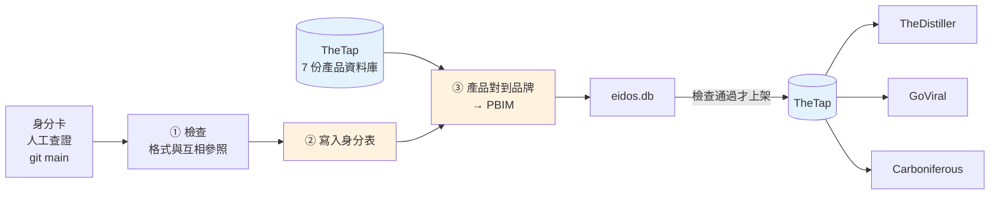

# Eidos - 供應鏈身分系統

---

## 📋 文檔目的

本文檔提供 **Eidos** 的系統導覽，幫助**新人建立對這套系統的整體理解**：

- Eidos 做什麼、在 AlchemyMind 層的位置（它跟產品層 pipeline 有何不同）
- 它的核心比喻：八種「DogTag 身分卡」
- 輸入 / 輸出：讀哪些資料、產出的 `eidos.db` 裡有什麼
- 交接：誰在讀 `eidos.db`、TheTap 上架前檢查什麼

> **給你的閱讀建議**：先看「🎯 系統職責」與「🪪 八種 DogTag 身分卡」建立直覺，再看「🔄 交接方式」了解它和下游的關係；遇到不懂的詞，查「🔑 關鍵概念」。

> **操作細節**（指令、身分卡寫法、各表規則）不在本篇，請看 [Eidos repo](https://github.com/mapleelpam/LuminNexus-AlchemyMind-Eidos) 的說明文件。

---

## 🎯 系統職責

**Eidos** 是 AlchemyMind 層的**膳食補充品供應鏈身分系統**，把保健食品產業裡的每一個角色 —— 每個品牌、每間公司、每個官網、每個專利成分、每個菌株、每座代工廠 —— 都登記成一張帶有來源證據的**身分卡（DogTag）**。

市面上有幾十萬項保健食品，但「這些產品背後是誰做的、誰擁有誰」常常一團亂 —— 同一個品牌可能被併購、換過名、有好幾個網站。Eidos 的工作就是把這些身分關係**查清楚、記下來，而且每一筆都能追到證據來源**；再把每個產品對到它所屬的品牌，交給下游使用。

### 核心職責

| 項目 | 說明 |
|------|------|
| **職責** | 整理品牌 / 公司 / 網域 / 商標 / 菌株 / 代工廠的持久身分事實（誰擁有誰、成分組成、認證、類型），並算出「每個產品屬於哪個品牌」 |
| **輸入** | 人工查證的身分卡（存在 git），加上 TheTap 上的 7 份產品資料庫 |
| **輸出** | `eidos.db`：身分表（品牌、公司、三種商標…）＋ 產品→品牌對照表（PBIM） |
| **交接** | 每晚由 TheTap 建置、檢查、上架；下游 TheDistiller、GoViral、Carboniferous 讀取 |
| **現況** | 2026-10-21 線上版：品牌約 1.4 萬、產品→品牌對照約 126 萬筆 |

### 核心價值

- **身分即真相**：把雜亂的供應鏈關係萃取成結構化、可查證的身分卡
- **互相指認**：品牌卡寫「屬於哪間公司」、成分卡寫「擁有者是誰、用了哪項技術」，連起來成一張供應鏈關係網

### 命名由來

- **Eidos**（希臘文 εἶδος）意為「形式、本質」。在希臘哲學裡指事物的「本質形態」—— 系統的任務正是從雜亂資料中**萃取每個實體的身分本質**。
- **DogTag** 原意是軍人配戴的「身分辨識牌」。這裡借喻：每個實體都有一張記載其身分事實的檔案卡。

（這延續了 LuminNexus 用命名承載概念的傳統，如 TheArgus 取自百眼巨人 Argus Panoptes，象徵全面監控。）

### 系統定位
- **Layer**: AlchemyMind (Layer 2)
- **範圍**：全球保健品品牌的身分 SSOT，不是只收美國市場。品牌在哪些市場販售，另以證據記錄
- **上游**：TheTap 上的產品資料庫（其中 `formulary.db` 來自 [Formulary](formulary.md)）
- **下游**：TheDistiller、GoViral、Carboniferous（都讀 `eidos.db`）

---

## 🏗️ 系統架構

**資料流說明**：
1. **身分卡**：人（多半搭配 Claude）查證後寫成身分卡，commit 到 `main`。這是唯一進 git 的來源真相。
2. **三個建置步驟**（每晚由 TheTap 執行）：先檢查所有卡片，再把卡片寫成 `eidos.db` 的身分表，最後拿 7 份產品資料庫逐筆比對，寫出產品→品牌對照表。
3. **上架**：TheTap 檢查 `eidos.db`，通過才發新版；下游一律從 TheTap 取用。

> **順序不能顛倒**：第 ③ 步是拿第 ② 步剛寫好的品牌主檔去比對產品。若用舊的品牌主檔比對，新加的品牌會**靜默地**一個產品都對不到，而且程式照樣正常結束。

---

## 📥 輸入資料 (Input)

### 1. 身分卡（git）

Markdown 格式的身分卡，由 Eidos 自己維護。repo 裡另有黑名單、美國 FDA 執法紀錄快照等輔助資料。

### 2. 產品資料庫（從 TheTap 讀）

共 7 份，以 TheTap 的設定為準：

| 資料庫 | 內容 | 生產者 |
|--------|------|--------|
| `keepa.db` | Amazon 美國站產品目錄（經由 Keepa，一個追蹤 Amazon 價格的外部服務） | AtlasVault-Keepa |
| `keepa.gb.db` | Amazon 英國站產品目錄 | AtlasVault-Keepa |
| `formulary.db` | 從產品圖片抽出的成分標籤 | [Formulary](formulary.md) |
| `dsld.db` | DSLD（美國 NIH 官方膳食補充品標籤庫） | 人工匯入 |
| `iherb.db` | iHerb 線上零售目錄 | 人工匯入 |
| `shopify.db` | 品牌自營 Shopify 網店產品 | 人工匯入 |
| `trawler.db` | 品牌官網（Trawler）：各品牌自己網站的商品頁 | AtlasVault-Trawler（人工匯入） |

> 美國站和英國站刻意當成兩個來源：同一個 Amazon 產品可能兩站都有，合在一起會互相蓋掉品牌歸屬。

---

## 📤 輸出資料 (Output)

### 1. DogTag 身分卡（來源真相，SSOT）

一個 Markdown 檔 = 一張身分卡，依類型分資料夾存放（品牌、公司、網域、菌株、代工廠、三種商標）。這是唯一 commit 進 git 的來源真相，其他產物都從它建出來。

### 2. eidos.db（給下游的產物）

`eidos.db` 裡有兩層資料：

| 層 | 來自 | 內容 |
|----|------|------|
| **身分層** | 身分卡 | 品牌、公司、網域、三種商標、菌株、代工廠，以及「名字 → 品牌 / 公司 / 商標」的查詢表 |
| **對照層** | 7 份產品資料庫 | 產品→品牌對照表（PBIM）：每個產品一列，寫它屬於哪個品牌，或為什麼被排除 |

新人先認得這幾個就好：

- **品牌主檔**：下游要「品牌是誰」就查這張。
- **產品→品牌對照表（PBIM）**：會標出**被排除**的產品（例如詐騙店、白牌代工），下游必須照著排除，不可以自己從原始品牌名再猜一次。
- **查詢表**：手上有一個名字、想知道它是哪個品牌 / 公司 / 商標時用。有些名字對得到不只一個品牌，或已被排除，查的時候要留意。

> 完整的表清單與每個欄位的規則，見 [Eidos repo](https://github.com/mapleelpam/LuminNexus-AlchemyMind-Eidos)。

---

## 🔄 交接方式

### 怎麼交給 TheTap

Eidos 不自己上傳檔案。TheTap 每晚從 GitHub 拿 Eidos 的 `main`，跑上面三個建置步驟，產出候選檔再檢查。所以**只有 push 到 `main` 的身分卡才會進正式版**。

- **只重建需要的部分**：只有產品資料庫變動時，只重跑第 ③ 步；身分卡有變動才三步全跑。
- **版本**：通過檢查就發新版，並保留上一版可回退。

### TheTap 上架前檢查什麼

| 檢查 | 標準 |
|------|------|
| 身分卡檢查 | 沒過就不發佈 |
| 資料庫完整 | 檔案沒有損壞、必要的表都在 |
| 最低筆數 | 品牌主檔、產品→品牌對照表都要達到下限 |
| 不能突然變少 | 品牌數不能比上一版少太多；對照表**每個來源各自**比較 |

對照表要「每個來源各自」比較，是因為 7 個來源加總很大，其中一個來源整個不見，總數看起來仍然正常。

### 誰在讀 eidos.db

| 下游 | 讀什麼、做什麼 |
|------|---------------|
| [TheDistiller](thedistiller.md) | 必要輸入。依產品→品牌對照表決定每個產品的品牌（含排除），並匯入三種商標（BI / BT / BP） |
| GoViral（蒐集 Instagram、LinkedIn 上保健品社群內容的系統） | 品牌、公司、品牌原料（BI），把貼文裡提到的品牌、公司、原料對到 Eidos 的身分 |
| [Carboniferous](carboniferous.md) | 品牌原料（BI）表，用來對應品牌原料與通用成分 |

另外 [AmazonCopal](amazoncopal.md) 挑選要處理的產品時也會參考 `eidos.db`。

> **下游要注意的事**：GoViral 讀不到 `eidos.db` 時不會報錯，只是品牌、公司變空，所以 TheTap 在 GoViral 那邊另設了筆數下限來擋。TheDistiller 過去也有同樣的問題（找不到 eidos.db 就跳過，產出 0 個品牌），現在已改成缺檔就失敗。

---

## 🪪 八種 DogTag 身分卡

身分卡分三群：**主角**（品牌、公司）、**周邊**（網域、菌株、代工廠）、以及最有特色的**三種商標**（用 WHAT / HOW / WHO/WHERE 區分）。

| 類型 | 英文 | 白話 | 回答的問句 | 例子 | 數量（截至 2026-08-10） |
|---|---|---|---|---|---|
| **品牌** | Brand | 消費者看到的招牌 | — | Nature's Bounty | 12,006 |
| **公司** | Company | 背後的法人 | — | Nestlé Health Science | 4,213 |
| **網域** | Domain | 官網 / 網站 | — | olly.com | 8,409 |
| **品牌原料** | Branded Ingredient (BI) | 有商標的原料成品 | **WHAT** 是什麼成分 | BioPerine® | 854 |
| **品牌化技術** | Branded Technology (BT) | 有商標的製程 / 技術 | **HOW** 用什麼技術做 | Phytosome® | 62 |
| **品牌化產地** | Branded Provenance (BP) | 有商標的來源 / 品質保證 | **WHO/WHERE** 來自哪 | Albion® | 80 |
| **菌株** | Strain | 益生菌的特定品系 | — | PS128 | 30 |
| **代工廠** | Facility | 代工廠的一座廠區 | — | — | — |

> 數量是 repo 記的快照，**截至 2026-08-10**（代工廠卡較新，未列數量），之後已有不少增減。

> **記住三種商標的一句話**：把一顆保健食品拆開 —— **BI = 裡面放什麼、BT = 用什麼手法做、BP = 原料從哪來、品質如何**。

身分卡的價值在於**互相指認**：品牌卡寫「我屬於哪間公司」、成分卡寫「擁有者是誰、用了哪項技術」、廠區卡寫「由哪間公司經營」。連起來就成了一張供應鏈關係網，這就是 Eidos 的核心產出。

每張卡上半部是固定欄位（例如品牌名、母公司），下半部是文字說明；「母公司」這類欄位指向另一張卡，卡片就是這樣互相連起來的。

---

## 🔧 核心機制

### 1. 來源可信度閘門（provenance gate）

每筆資料都記「哪來的、多可信」；閘門規定 **「低可信來源不准覆蓋高可信」**。可信度大致是 **人工 > AI > 程式**：人工查證最可信，其次是 LLM（大型語言模型，也就是 AI）的判斷，最後是程式自動產生的資料（例如自動分類、直接去探測網站、最早批次匯入的名單）。這樣人工查證過的資料不會被程式蓋掉。

### 2. 品質關卡

- **自動**：身分卡存進 git 前、以及 push 後，都會自動檢查格式與互相參照，有錯就擋下。
- **手動**：更完整的驗收（一個嚴重問題就不通過）要改卡的人自己跑，因為放在自動流程裡太慢。
- **上架前**：TheTap 再檢查一次 `eidos.db`（見「🔄 交接方式」）。

> 想自己改身分卡：只 commit 身分卡、push 到 `main`，當晚由 TheTap 建成 `eidos.db`；不要自己發佈或覆蓋線上的檔案。步驟見 [Eidos repo](https://github.com/mapleelpam/LuminNexus-AlchemyMind-Eidos)。

---

## 🔑 關鍵概念

| 名詞 | 白話 |
|---|---|
| **DogTag / 身分卡** | 系統的核心比喻：每個品牌、公司、商標…都有一張「身分辨識牌」，一個 Markdown 檔＝一張卡。 |
| **BI / BT / BP** | 三種商標：品牌原料（WHAT）/ 品牌化技術（HOW）/ 品牌化產地（WHO/WHERE）。「品牌原料」只指 BI。 |
| **eidos.db** | 身分卡打包成的 SQLite 資料庫，下游只讀這份。 |
| **PBIM** | 產品→品牌對照表（ProductBrandIdentityMap），也記錄哪些產品被排除。 |
| **provenance**（來源證據） | 每筆資料都記「哪來的、多可信」。 |
| **SSOT**（唯一真相來源） | 某件事只以一個地方為準。身分以身分卡為準，`eidos.db` 是從它建出來的。 |
| **身分層 vs 產品層** | Eidos 管「誰是誰」，TheDistiller 這類產品層管「每個產品的資料」；兩者在 PBIM 交會。 |
| **FK（外鍵）** | 「這張卡指向另一張卡」的連結（如品牌 → 母公司）。 |
| **DSLD** | 美國 NIH 官方的「膳食補充品標籤資料庫」，產品進料之一。 |
| **TheTap** | 交接中心：每晚建置 `eidos.db`、檢查、上架，也是 Eidos 讀產品資料庫的地方（見 [thetap.md](thetap.md)）。 |

---

## 📖 故事

只列能解釋「現在為什麼長這樣」的事件：

| 時間 | 事件 |
|------|------|
| 2026-04-22 | 決策：**身分 ≠ 市場表現**。市場覆蓋、定位改由下游計算，Eidos 只收身分事實 |
| 2026-08-26 | 產品資料一律改從 TheTap 拿 |
| 2026-09-04～07 | 加入 Amazon 英國站，但 TheTap 還沒接上這個輸入，Eidos 連續三天建置失敗，補上後才恢復 |
| 2026-10-05 | 決策：Eidos 改為**全球**品牌 SSOT，品牌在哪些市場販售另以證據記錄 |

> **教訓**：新增一個輸入時，要同時確認 TheTap 有沒有宣告這個輸入，以及其他下游是否也需要它。英國站資料接進 Eidos 時，TheDistiller 那邊也漏接了一段時間。

---

## 🐛 常見問題

### Q1: Eidos 和產品層 pipeline 有什麼差別？

| | 產品層 pipeline（如 TheDistiller） | Eidos 身分層 |
|---|---|---|
| 基本單位 | 產品(SKU，一個可單獨販售的品項) | 實體(品牌/公司/網域/商標/菌株/廠區) |
| 資料形態 | SQLite DB(機器產出) | Markdown 身分卡(人工查證)，再建成 `eidos.db` |
| 真相來源 | 上游 API / 爬蟲快照 | 第一手查證 + 來源證據 |
| 誰算市場數據 | 下游分析層 | 不在 Eidos(身分 ≠ 定位) |

兩者在 PBIM 交會：Eidos 告訴產品層「這個產品是哪個品牌的」。

### Q2: Eidos 和 TheDistiller 都有「品牌數」，為什麼數字差很多？

不同單位。TheDistiller 的品牌數包含沒有身分卡、直接用產品上原始品牌名的品牌；Eidos 的品牌數是「有身分卡的品牌」。另外 `eidos.db` 的品牌主檔列數也不等於卡片數（裡面有少數系統用的佔位列）。

### Q3: 身分卡改完，要自己發佈 eidos.db 嗎？

不用。只 commit 身分卡、push 到 `main`，`eidos.db` 由 TheTap 當晚自動建置發佈。

---

## 💡 設計原則

1. **身分不是市場表現**：Eidos 只收不隨時間變動的身分事實；市占、銷量、定價、市場定位都不收，交給下游算。
2. **唯一真相來源**：身分卡是唯一真相，其餘都是衍生物——改一個地方就好，衍生物隨時可重建，git 歷史就是身分變更史。
3. **來源優先於沉默**：每筆值都記來源，低可信來源不得覆蓋高可信，人工查證不會被機器蓋掉。
4. **人查證、機器驗證**：身分由人判斷與撰寫；程式負責檢查格式、拿身分表比對產品。
5. **先過關再發佈**：沒過檢查的卡片進不了 git，沒過檢查的 `eidos.db` 上不了 TheTap。

---

## 📚 相關文檔

### Learning Map 文檔
- [thetap.md](thetap.md) - TheTap（`eidos.db` 的建置、檢查與發佈；產品資料庫的來源）
- [formulary.md](formulary.md) - Formulary（輸入之一 `formulary.db`）
- [thedistiller.md](thedistiller.md) - TheDistiller（主要下游）
- [carboniferous.md](carboniferous.md) - Carboniferous（讀品牌原料表）
- [amazoncopal.md](amazoncopal.md) - AmazonCopal（選產品時參考 `eidos.db`）
- [theargus.md](theargus.md) - TheArgus（該篇寫的是舊角色，現行 Argus 是 distiller.db 的監控下游）

### 通用概念（先備知識）
- [../../general/knowledge-management.md](../../general/knowledge-management.md) - Frontmatter 與 PKM（身分卡格式的先備知識）
- [../../general/03_data-engineering.md](../../general/03_data-engineering.md) - Schema、主鍵 / 外鍵（FK）、ETL / Enrich 基礎
- [../../general/supplement-industry-terminology.md](../../general/supplement-industry-terminology.md) - BI / BT / BP 三種商標的白話說明，以及成分在配方中的六種角色

### Eidos 專案
- [Eidos repo](https://github.com/mapleelpam/LuminNexus-AlchemyMind-Eidos)：指令、身分卡寫法、eidos.db 各表規則、決策紀錄

---

## 📝 文檔維護

### 版本歷史

| 版本 | 日期 | 作者 | 變更說明 |
|------|------|------|----------|
| 1.0 | 2026-07-20 | Dustin | 初版：對齊子系統文檔結構（系統職責 / 架構圖 / 七種 DogTag / 名詞白話對照表）；schema 概念外連 general/，profile 數字與 schema 版本對齊實檔 |
| 1.1 | 2026-07-20 | Dustin | 定位改為新人系統導覽（非「非技術背景」）；關鍵概念砍 ⚪ 進階詞、消除重複定義、五表併兩表；新增「適用角色」；related 補 thedistiller |
| 1.2 | 2026-07-21 | Dustin | 新增「設計原則」五條（對齊 thedistiller.md 模板）；消除跨章節重複——核心功能改名為「核心功能與機制」並刪去 SSOT 小節、核心價值砍為兩點、介面說明刪重複引言、Q4 改為指路。章節分工：核心功能答「怎麼運作」、設計原則答「為什麼這樣定」、關鍵概念答「這個詞什麼意思」 |
| 1.3 | 2026-07-22 | leana | merge 前查證：下游補 TheDistiller（消費 eidos.db） |
| 1.4 | 2026-07-28 | Dustin | 相關文檔加入產業術語文（BI/BT/BP 三商標表的白話版入口） |
| 1.5 | 2026-10-19 | weiling | 依 Eidos repo、TheTap 與線上版更新：輸入改為 TheTap 的 7 份產品資料庫；新增 eidos.db 兩層結構、「🔄 交接方式」（TheTap 建置、上架檢查、下游 TheDistiller／GoViral／Carboniferous）與故事表；指令改為統一的 `eidos`；身分卡增為八種（代工廠）；刪去「介面說明」「配置與參數」「適用角色」 |
| 1.6 | 2026-10-21 | weiling | leana review 後精簡：刪去指令操作（「使用方式」整節、指令表、建置指令）、檔案路徑、程式與內部元件名、欄位值、版本號與 stage 編號；關鍵概念收成一張概念表；FAQ 刪去操作題與「repo 文件過時」題；設計原則濃縮；細節改指向 repo；名詞依第三輪對照統一（Keepa、品牌官網（Trawler）、資料檔寫全名）；三種商標中文名對齊產業術語文（品牌原料／品牌化技術／品牌化產地），補 GoViral 白話；LLM、SKU 補白話，故事表刪指令合併一列，BP 統一寫 WHO/WHERE；可信度等級簡化為「人工 > AI > 程式」 |

### 維護職責
- **主要維護者**: Dustin
- **審核者**: Architecture Team
- **更新頻率**: 當架構、輸入輸出或下游變更時

### 系統依賴

**上游依賴**：
- TheTap：`keepa.db`、`keepa.gb.db`、`formulary.db`、`dsld.db`、`iherb.db`、`shopify.db`、`trawler.db` 共 7 份產品資料庫
- 身分卡維護者：身分卡

**下游依賴**：
- TheDistiller：品牌判定（含排除）、三種商標
- GoViral：品牌、公司、品牌原料
- Carboniferous：品牌原料與通用成分的對應

---

**文檔結束**

> **注意**：卡片數量與 `eidos.db` 列數會隨每天的 commit 改變，現況以 http://maple-msi.local/eidos/daily/manifest.json 為準。
