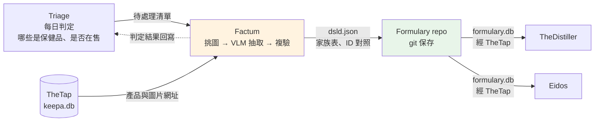
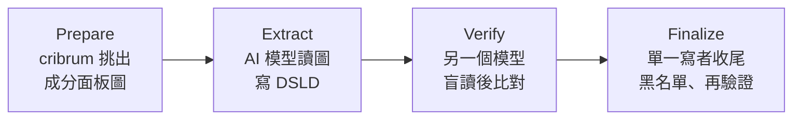

# Factum - 從產品圖片抽出成分表

---

## 📋 文檔目的

本文檔介紹 **Factum**，幫助新人理解：

- 它做什麼：把產品標籤圖上的成分表，變成機器讀得懂的 JSON
- 輸入從哪來（Keepa 圖片、Triage 判定）、輸出寫到哪（Formulary repo）
- 為什麼它**不自己發 `.db`**，以及資料怎麼一路流到 TheDistiller

> **給你的閱讀建議**：先看「🎯 系統職責」與「🔄 在管線裡的位置」；想知道一顆產品實際怎麼被處理，看「⚙️ Amazon 產品怎麼處理」。

> **完整技術文檔**：[Factum repo](https://github.com/mapleelpam/LuminNexus-AlchemyMind-Factum) 的 `CLAUDE.md`（README 是空檔）

---

## 🎯 系統職責

保健品包裝背面都有一塊 **Supplement Facts**（成分標示面板）：每份多少、含哪些成分、各多少劑量。**Factum** 的工作就是把這塊面板「抄」下來，存成統一格式的 JSON。

| 項目 | 說明 |
|------|------|
| **職責** | 從產品標籤圖（及各來源網頁資料）抽出成分表，轉成 DSLD 格式 |
| **輸入** | `keepa.db`（Amazon 產品與圖片網址，從 TheTap 讀）、Triage 的每日判定、iHerb / Shopify / 官網 / DailyMed 等來源資料 |
| **輸出** | 每個產品一個 `*.dsld.json`，寫進 Formulary repo 的 `sources/`；另產生產品家族表（`relationships/`）與 ID 對照表（`redirects/`） |
| **下游** | [Formulary](formulary.md) → `formulary.db` → TheDistiller、Eidos |
| **現況** | 每日運作中；DSLD 格式版本 `dsld-v1.0` |

**DSLD** 是美國 NIH 的保健品標籤資料庫（Dietary Supplement Label Database）。Factum 沿用它的欄位格式，好讓不同來源抄出來的成分表都長得一樣。檔案格式與各來源檔案數，見 [Formulary](formulary.md)。

**Triage**（repo：[LuminNexus-AtlasVault-Triage](https://github.com/mapleelpam/LuminNexus-AtlasVault-Triage)）是 Amazon 產品的每日分類帳：哪些 ASIN 是保健品、是不是組合包、還有沒有在賣。其中 Amazon 的判定由 Keepa 團隊每天更新，Factum 用它決定今天要處理誰。

### 命名由來

**Factum** 是拉丁文的「事實、已完成的事」，也是 Supplement **Facts** 的字根：它負責把標籤上印的事實記錄下來。

### 兩個名詞

- **VLM**（Vision Language Model）：看得懂圖片的 AI 模型。Factum 用它直接「看」標籤圖、讀出成分。
- **cribrum**：挑圖工具。一個商品有很多張圖（正面、背面、情境照），cribrum 負責把候選圖排名，挑出最可能是成分面板的那張。

---

## 🔄 在管線裡的位置

- **Factum 不自己發 `.db`**：它的 `working/dsld/` 是一個 symlink（捷徑），直接指向 Formulary 的 `sources/`。它指向的是 Formulary 的 git repo，所以交接上算「寫進對方 repo」，會跟著 git 進 TheTap 建置。Factum 寫檔，等於直接把檔案放進 Formulary repo；commit 由 Formulary 這邊負責。
- **進正式版要靠 Formulary**：TheTap 每晚從 Formulary 的 `main` 重建 `formulary.db`。只有 push 到 GitHub 上 main 的檔案才會流到 TheDistiller 與 Eidos，細節見 [Formulary](formulary.md) 與 [TheTap](thetap.md)。
- **Factum 也回饋 Triage**：Factum 看過標籤圖後的判定（例如其實是食品、是組合包），會寫回 Triage 的 `factum-us/`、`factum-gb/` 兩個資料夾，讓上游修正分類。Factum 看過標籤圖，判定比 Triage 準。Triage 判錯時，由 Keepa 團隊修正，Factum 不直接改 Triage 的 `keepa/` 判定。

---

## 📥 輸入：從哪裡知道要處理誰

| 輸入 | 用途 | 讀法 |
|------|------|------|
| Triage 的 `keepa/` 判定 | 哪些 ASIN 是保健品（`ds_verdict = DS`）、不是組合包、仍在售（`off_market`） | `scripts/triage_pending_build.py` 讀 Triage repo，產出待處理清單 |
| `keepa.db` / `keepa.gb.db` | 產品資料與圖片網址（美國站 / 英國站） | 從 TheTap 的發佈資料夾 `/opt/tap/` 唯讀 |
| `/opt/vault/images/` | 下載好的產品圖，以圖片 hash 為檔名、自動去重 | 共用資料夾，多人共享 |
| iHerb / Shopify / 官網（trawler）/ DailyMed | 非 Amazon 來源的產品資料 | 各來源的 db，唯讀 |

> **重點**：「是否在售」一定要用 Triage 的每日判定，不要用 keepa 的舊快照自己算。舊快照會落後好幾天，曾經把九成真正在售的新品誤判為下架。

---

## ⚙️ Amazon 產品怎麼處理

現行 Amazon 主流程是 `vlm-to-dsld-workflow`，分四段：

1. **Prepare**：cribrum 從所有圖片裡挑出成分面板。
2. **Extract**：AI 模型（Opus，Anthropic 的 Claude 系列中較強的一款）讀圖，依規則判斷是否屬於範圍內（不是保健品、是組合包就不寫檔），再寫出 DSLD JSON。
3. **Verify**：換另一個 AI 模型（Sonnet，同系列的另一款）**先自己看圖抄一遍，再跟 DSLD 逐欄比對**。同一個模型自己驗自己，會犯同樣的讀錯，所以刻意換人。
4. **Finalize**：由單一流程統一寫入黑名單（`config/asin_blacklist.yaml`），避免多個 worker（同時在跑的處理程序）同時寫檔互相覆蓋。

找不到成分面板的產品記為 **grade-G**。新上架 14 天內的 grade-G 只算暫定，因為賣家常常晚幾天才補上背面標籤圖，之後會再試。

大批次由 **phalanx**（批次分派工具）分給多台機器同時跑。

其他來源（iHerb、Shopify、官網、DailyMed）各有自己的 `*-to-dsld` skill（寫給 AI 照做的操作說明書），從已抓下來的網頁與資料轉換，不經 cribrum。DailyMed 轉出的檔保留在 Formulary，但不進 `formulary.db`，所以不會流到下游。

---

## 📤 輸出與交接

Factum 交給 Formulary 三樣東西，全部是**寫進 Formulary repo 的檔案**：

| 產物 | 位置（Formulary repo） | 說明 |
|------|----------------------|------|
| 成分表 | `sources/{來源}/…/*.dsld.json` | 一個產品一個檔 |
| 產品家族表 | `relationships/{品牌}.yaml` | 哪些產品算「同一個」：同配方、同口味、同劑型 |
| ID 對照表 | `redirects/*.tsv` | 產品被重新編號時，舊 ID 指到新 ID |

- **產品家族表**：由 Factum 的 family judge（家族判定程式：讓 AI 模型一個品牌一個品牌判斷哪些產品算同一家族）產生。2026-10-12 決定不再把家族關係塞在每個 DSLD 檔裡，改成獨立的家族表；**2026-10-13 起由 Formulary commit**。Formulary 轉成 `ProductFamilies` 表，TheDistiller 用它決定哪些包裝算同一個產品。
- **ID 對照表**：例如 Shopify 網店合併 `www` 與不帶 `www` 的網址時，檔案搬到新 ID。Factum 產出搬檔記錄，Formulary 轉成 tsv，和那批檔案**同一輪** commit。
- **寫入共享資料夾的規則**：暫存檔要放在目標檔旁邊再改名，不要放 `/tmp`，否則檔案權限不對、別人讀不到。repo 裡有 hook（自動檢查程式）強制這條規則。

---

## 📖 近期大事

| 時間 | 事件 |
|------|------|
| 2026-01-17 | 第一批 610 個檔匯入 Formulary |
| 2026-09-03 | 新增 Amazon 英國站（`amazon_gb`）；產品身分改為「站別 + ASIN」，因為同一個 ASIN 在不同站可能是不同標籤 |
| 2026-10-12 | 家族關係改為獨立的家族表（不再寫在 DSLD 檔內） |
| 2026-10-13 | 家族表搬進 Formulary，改由 Formulary commit；開始產生 ID 對照表 |
| 2026-10-17 | 移除一支無人值守的舊程式：它在 10-12 之後還一直往 DSLD 檔裡寫家族關係 |
| 2026-10-18 | cribrum 改成常駐服務；找不到 cribrum 時直接報錯，不再默默標成「沒有圖」 |

> **教訓**：2026-10-18 之前，機器連不到 cribrum 時會把產品標成「沒有圖片」而不報錯，一次就有 197 個產品被誤標。**出錯就要大聲出錯**，不要悄悄變成看似正常的結果。

---

## 🐛 常見問題

### Q1: Factum 有自己的 `.db` 嗎？

沒有。`formulary.db` 是 Formulary 那邊建出來的。Factum 只寫 JSON 檔進 Formulary repo。

### Q2: 為什麼某個 Amazon 產品沒有成分表？

常見原因：Triage 判定不是保健品或已下架、在黑名單裡（組合包、非保健品）、找不到成分面板（grade-G）、或檔案還沒 push 到 Formulary 在 GitHub 上的 main。

### Q3: 舊文件寫「OCR + Parser + Haiku」是怎麼回事？

那是 2026 年初的作法，repo 裡還留著 OCR 與 parser 程式。現行 Amazon 主流程以本文「⚙️」一節為準。

---

## 📚 相關文檔

### Learning Map 文檔
- [Formulary](formulary.md)：Factum 的直接下游，保存 JSON、建 `formulary.db`
- [TheTap](thetap.md)：`keepa.db` 與 `formulary.db` 的發佈處
- [TheDistiller](thedistiller.md)：最終讀取成分表與家族表的下游（該篇部分輸入說法過時，以 [TheTap](thetap.md) 為準）

### Factum 專案文檔
- `CLAUDE.md`：目錄、symlink、skill 清單（其中 keepa 路徑寫 `data/keepa.db` 已過時，實為 `/opt/tap/`，以本文為準）
- `docs/amazon_vlm_pipeline_playbook.md`：Amazon 流程的操作手冊與踩雷記錄
- `docs/cribrum_service_backend.md`：cribrum 的兩種接法與失敗模式
- `specs/dsld/brand_relationships.md`：產品家族表規格
- `specs/dsld/marketplace.md`：Amazon 各站別的規則
- `specs/triage/factum_namespace.md`：回寫 Triage 的格式

---

## 📝 文檔維護

### 版本歷史

| 版本 | 日期 | 作者 | 變更說明 |
|------|------|------|----------|
| 1.0 | 2026-01-19 | maple | 初版建立 |
| 1.2 | 2026-10-20 | weiling | 新人視角修正：Triage 回饋分工拆成兩句；Opus／Sonnet、worker、skill、family judge 補白話解釋；註明 DailyMed 不進 formulary.db、CLAUDE.md 的 keepa 路徑過時；說明 symlink 指向 Formulary git repo |
| 1.1 | 2026-10-19 | weiling | 依現行 repo 重整：補輸入／輸出／交接（寫進 Formulary、家族表、ID 對照、Triage），改寫 Amazon 流程，移除過時的 OCR 流程細節與 CLI；補 Triage 說明與回饋分工、下游加 Eidos、註明推到 GitHub main |

### 系統依賴

**上游依賴**：
- Triage：每日的保健品判定與在售狀態
- TheTap：`keepa.db`、`keepa.gb.db`

**下游依賴**：
- Formulary：`sources/`、`relationships/`、`redirects/`
- Triage：Factum 的判定回寫（`factum-us/`、`factum-gb/`）

---

**文檔結束**
