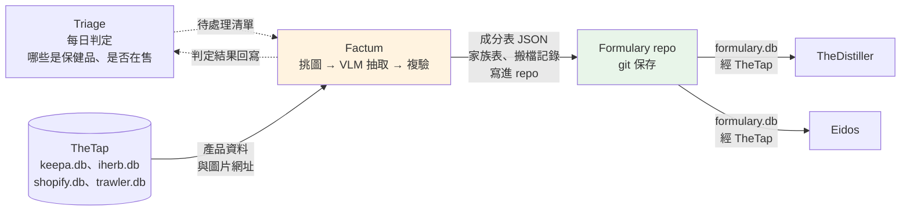
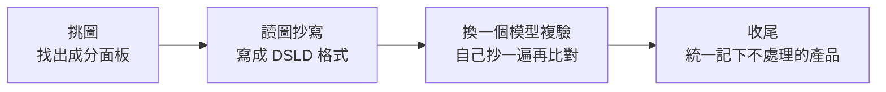

# Factum - 從產品圖片抽出成分表

---

## 📋 文檔目的

本文檔介紹 **Factum**，幫助新人理解：

- 它做什麼：把產品標籤圖上的成分表，變成機器讀得懂的 JSON
- 輸入從哪來（`keepa.db` 的 Amazon 產品圖、Triage 判定）、輸出寫到哪（Formulary repo）
- 為什麼它**不自己發 `.db`**，以及資料怎麼一路流到 TheDistiller

> **給你的閱讀建議**：先看「🎯 系統職責」與「🔄 在管線裡的位置」；想知道一顆產品實際怎麼被處理，看「⚙️ Amazon 產品怎麼處理」。

> **完整技術文檔**：[Factum repo](https://github.com/mapleelpam/LuminNexus-AlchemyMind-Factum)

---

## 🎯 系統職責

保健品包裝背面都有一塊 **Supplement Facts**（成分標示面板）：每份多少、含哪些成分、各多少劑量。**Factum** 的工作就是把這塊面板「抄」下來，存成統一格式的 JSON。

| 項目 | 說明 |
|------|------|
| **職責** | 從產品標籤圖（及各來源網頁資料）抽出成分表，轉成 DSLD 格式 |
| **輸入** | `keepa.db`（Amazon 產品與圖片網址，從 TheTap 讀）、Triage 的每日判定、iHerb / Shopify / 品牌官網（Trawler）的資料庫（也從 TheTap 讀）、DailyMed |
| **輸出** | 每個產品一個 DSLD 格式 JSON，寫進 Formulary 的 repo；另外寫產品家族表，以及搬檔記錄（Formulary 據此做 ID 對照表） |
| **下游** | [Formulary](formulary.md) → `formulary.db` → TheDistiller、Eidos |
| **現況** | 每日運作中 |

**DSLD** 是美國 NIH 的保健品標籤資料庫（Dietary Supplement Label Database）。Factum 沿用它的欄位格式，好讓不同來源抄出來的成分表都長得一樣。檔案格式與各來源檔案數，見 [Formulary](formulary.md)。

**Triage**（[AtlasVault-Triage](https://github.com/mapleelpam/LuminNexus-AtlasVault-Triage)）是 Amazon 產品的每日判定：哪些是保健品、是不是組合包、是否還在賣。判定由 AtlasVault-Keepa 的每日排程更新，Factum 用它決定今天要處理誰。

**品牌官網（Trawler）**指各品牌自己網站的商品頁，由 AtlasVault-Trawler 收集。

### 命名由來

**Factum** 是拉丁文的「事實、已完成的事」，也是 Supplement **Facts** 的字根：它負責把標籤上印的事實記錄下來。

### 一個名詞

- **VLM**（Vision Language Model）：看得懂圖片的 AI 模型。Factum 用它直接「看」標籤圖、讀出成分。

---

## 🔄 在管線裡的位置

- **Factum 不自己發 `.db`**：它把檔案直接寫進 Formulary 的 git repo，commit 由 Formulary 負責。
- **進正式版要靠 Formulary**：TheTap 每晚從 Formulary 在 GitHub 上的 main 重建 `formulary.db`，所以檔案要推上 GitHub main，才會流到 TheDistiller 與 Eidos。細節見 [Formulary](formulary.md) 與 [TheTap](thetap.md)。
- **Factum 也寫一份判定進 Triage**：Triage repo 裡有 Factum 專用的區塊（美國站、英國站各一），存放 Factum 看過標籤圖後的判定，例如「其實是食品」「是組合包」。主要用途是記住已經判過的產品，下次不必再花 AI 的成本重判；AtlasVault-Keepa 的每日排程也能拿它來修正 Triage 本身的判定。Triage 本身的判定由 AtlasVault-Keepa 的每日排程更新，Factum 只寫自己那一區。這條雙向線是工作清單的往返，不是資料庫之間的回圈。

---

## 📥 輸入：從哪裡知道要處理誰

| 輸入 | 用途 | 讀法 |
|------|------|------|
| Triage 的判定 | 哪些 ASIN（Amazon 給每個商品頁的編號）是保健品、不是組合包、仍在售 | 直接讀 Triage 的 git repo，產出待處理清單 |
| `keepa.db` / `keepa.gb.db` | 產品資料與圖片網址（Amazon 美國站 / Amazon 英國站） | 從 TheTap 讀 |
| 產品圖片 | Amazon 產品圖，AmazonCopal 也讀同一批 | Factum 依 `keepa.db` 裡的圖片網址下載到共用資料夾；AmazonCopal 也會下載同一批，做法一致。多人共用、自動去重 |
| `iherb.db` / `shopify.db` / `trawler.db` | iHerb、Shopify 網店、品牌官網的產品資料 | 這三份以人工匯入方式放上 TheTap，Factum 從 TheTap 讀 |
| DailyMed 資料 | 美國藥品標示資料 | 不在 TheTap 上，Factum 自己保存一份；轉出的檔不進 `formulary.db` |

> **重點**：Factum 挑今天要處理哪些產品時，「是否在售」一定要用 Triage 的每日判定，不要用 `keepa.db` 的舊快照自己算。舊快照會落後好幾天，曾經把九成真正在售的新品誤判為下架。這是 Factum 挑工作的規則；`distiller.db` 裡的上下架狀態由 TheDistiller 另外判斷，見 [AlchemyMind 總覽](00_overview.md)。

---

## ⚙️ Amazon 產品怎麼處理

現行 Amazon 主流程分四段：

1. **挑圖**：一個商品有很多張圖（正面、背面、情境照），先挑出最可能是成分面板的那張。
2. **讀圖抄寫**：AI 模型讀圖，先判斷是否屬於範圍內（不是保健品、是組合包就不處理），再把成分表抄成 DSLD 格式。
3. **換一個模型複驗**：由另一個 AI 模型**先自己看圖抄一遍，再跟前一步的結果逐欄比對**。同一個模型自己驗自己，會犯同樣的讀錯，所以刻意換人。
4. **收尾**：不處理的產品（組合包、非保健品等）由單一流程統一記下，避免多個同時在跑的流程寫同一份清單、互相覆蓋。

找不到成分面板的產品會先記下來。新上架 14 天內的只算暫定，因為賣家常常晚幾天才補上背面標籤圖，之後會再試。大批次會分給多台機器同時跑。

其他來源（iHerb、Shopify、品牌官網、DailyMed）各有自己的轉換流程，從已抓下來的網頁與資料轉成 DSLD 格式，不需要挑圖。DailyMed 轉出的檔保留在 Formulary，但不進 `formulary.db`，所以不會流到下游。

---

## 📤 輸出與交接

Factum 交給 Formulary 的東西，全部是**寫進 Formulary repo 的檔案**，commit 由 Formulary 負責：

| 產物 | 說明 |
|------|------|
| 成分表 | 一個產品一個 DSLD 格式 JSON |
| 產品家族表 | 哪些產品算「同一個」：同配方、同口味、同劑型，只差尺寸、包裝數或販售通路 |
| 搬檔記錄 | Factum 搬檔或刪除重複檔時留下的記錄；Formulary 據此做成 ID 對照表 |

- **產品家族表**：由 Factum 讓 AI 模型一個品牌一個品牌判斷哪些產品算同一家族。2026-10-12 起，家族關係不再寫在每個成分表檔裡，改成獨立的家族表，2026-10-13 起由 Formulary commit。TheDistiller 照搬這份家族表，決定哪些包裝算同一個產品。
- **ID 對照表**：例如網店合併帶 `www` 與不帶 `www` 的網址、或刪掉重複檔時，產品會換到新的 ID。Factum 留下搬檔記錄，Formulary 把它轉成 ID 對照表，和那批檔案同一輪 commit，讓下游能把舊 ID 對到新 ID。

---

## 📖 近期大事

| 時間 | 事件 |
|------|------|
| 2026-01-17 | 第一批 610 個檔匯入 Formulary |
| 2026-09-03 | 新增英國站；產品身分改為「站別 + ASIN」，因為同一個 ASIN 在不同站可能是不同標籤 |
| 2026-10-12 | 家族關係改為獨立的家族表（不再寫在 DSLD 檔內） |
| 2026-10-13 | 家族表搬進 Formulary，改由 Formulary commit；開始產生 ID 對照表 |
| 2026-10-18 | 挑圖改成常駐服務；連不上時直接報錯，不再默默標成「沒有圖」 |

> **教訓**：2026-10-18 之前，機器連不到挑圖服務時會把產品標成「沒有圖片」而不報錯，一次就有 197 個產品被誤標。**出錯就要大聲出錯**，不要悄悄變成看似正常的結果。

---

## 🐛 常見問題

### Q1: Factum 有自己的 `.db` 嗎？

沒有。`formulary.db` 是 Formulary 那邊建出來的。Factum 只寫 JSON 檔進 Formulary repo。

### Q2: 為什麼某個 Amazon 產品沒有成分表？

常見原因：Triage 判定不是保健品或已下架、已被記為不處理的產品（組合包、非保健品等，見「⚙️」一節的收尾）、找不到成分面板、或檔案還沒推上 Formulary 在 GitHub 上的 main。

---

## 📚 相關文檔

### Learning Map 文檔
- [Formulary](formulary.md)：Factum 的直接下游，保存 JSON、建 `formulary.db`
- [TheTap](thetap.md)：`keepa.db` 與 `formulary.db` 的發佈處
- [TheDistiller](thedistiller.md)：以 `formulary.db` 決定哪些產品算數，並讀取成分表與家族表
- [Eidos](eidos.md)：也讀 `formulary.db` 的下游

### Factum 專案文檔
- 操作手冊、產品家族表規格、各站別規則等細節，見 [Factum repo](https://github.com/mapleelpam/LuminNexus-AlchemyMind-Factum)

---

## 📝 文檔維護

### 版本歷史

| 版本 | 日期 | 作者 | 變更說明 |
|------|------|------|----------|
| 1.0 | 2026-01-19 | maple | 初版建立 |
| 1.2 | 2026-10-20 | weiling | 依現行 repo 重整：補輸入／輸出／交接（寫進 Formulary、家族表、ID 對照、回饋 Triage），改寫 Amazon 流程，移除已退場的 OCR 流程 |
| 1.3 | 2026-10-21 | weiling | 依合併後 review 修正：ID 對照表說法與 Formulary 對齊；刪減欄位值、路徑、程式檔名、內部工具名；Triage 雙向線依回圈口徑；拿掉 TheDistiller 過時提醒與 repo 文件過時題；名詞依對照表統一（AtlasVault-Keepa 每日排程、品牌官網（Trawler）、Amazon 英國站）；Amazon 流程改白話、不寫模型名與內部工具名；Triage 回寫改寫為 Factum 專用區；第四輪：產品家族定義更正（口味不同算不同家族）、Triage → Factum 改虛線、補 ASIN 白話、寫清非 Amazon 來源從 TheTap 讀（DailyMed 除外）；第五輪：圖與依賴清單補 iherb／shopify／trawler、在售規則限定為 Factum 挑工作用、寫清產品圖由 Factum 下載 |

### 系統依賴

**上游依賴**：
- Triage：每日的保健品判定與在售狀態
- TheTap：`keepa.db`、`keepa.gb.db`、`iherb.db`、`shopify.db`、`trawler.db`

**下游依賴**：
- Formulary：成分表、產品家族表、搬檔記錄
- Triage：Factum 的判定回寫

---

**文檔結束**
