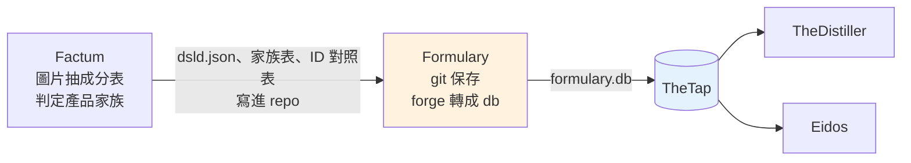

# Formulary - 產品標籤資料庫（成分表的版本倉庫）

---

## 📋 文檔目的

本文檔介紹 **Formulary**，幫助新人理解：

- 它存了什麼：每個產品標籤上的成分表，一個產品一個 JSON 檔
- 資料從哪來（Factum）、交給誰（TheDistiller、Eidos）、怎麼交（`formulary.db` 經 TheTap）
- 為什麼它決定了「哪些產品會出現在 distiller.db」

> **給你的閱讀建議**：先看「🎯 系統職責」與「🔄 在管線裡的位置」；想知道它對下游有多重要，看「🔑 為什麼 Formulary 很關鍵」。

> **完整技術文檔**：[Formulary repo](https://github.com/mapleelpam/LuminNexus-AlchemyMind-Formulary) 的 `CLAUDE.md`（README 部分內容已過時，見 Q3）

---

## 🎯 系統職責

**Formulary** 是產品標籤資料的**版本倉庫**。Factum 從產品圖片讀出成分表後，把結果存成 JSON 檔放進 Formulary；Formulary 用 git 記錄每一次新增、修改、刪除，再定期把全部 JSON 轉成一份 SQLite 資料庫 `formulary.db` 給下游用。

| 項目 | 說明 |
|------|------|
| **職責** | 保存成分標籤 JSON、檢查格式、轉成 `formulary.db` |
| **輸入** | Factum 寫進 `sources/` 的 `*.dsld.json`、Factum 判定的產品家族表，以及 Factum 整理產品時產生的 ID 對照表（`redirects/`） |
| **輸出** | `formulary.db`：產品、品牌、成分表（SupplementFact）、產品家族等表 |
| **下游** | TheDistiller、Eidos（都經 TheTap 取得） |
| **現況** | 2026-10-18 線上版：387,460 個產品、23,843 個品牌 |

### 命名由來

**Formulary** 原意是「配方集」，藥局用來列出藥品與成分的手冊。這個 repo 收的正是每個保健品的配方：裡面有什麼成分、各多少劑量。

### 資料長什麼樣

每個產品是一個 JSON 檔，格式沿用美國 NIH 的 **DSLD**（Dietary Supplement Label Database，保健品標籤資料庫），所以副檔名是 `.dsld.json`。檔案依來源分資料夾：

| 資料夾 | 來源 | 檔案數（約） |
|--------|------|-------------|
| `sources/amazon/` | Amazon 美國站 | 22 萬 |
| `sources/amazon_gb/` | Amazon 英國站 | 1.6 萬 |
| `sources/shopify/` | 品牌自營的 Shopify 網店 | 9.3 萬 |
| `sources/official/` | 品牌官網 | 3.2 萬 |
| `sources/iherb/` | iHerb | 3 萬 |
| `sources/dailymed/` | DailyMed | 3.1 萬，**保留但不轉進 db** |

2026-10-18 那一版共讀了 392,092 個檔，排除 4,632 個不合格的，得到 387,460 個產品。

---

## 🔄 在管線裡的位置

- **Factum 不自己發 `.db`**：它把結果直接寫進 Formulary 的 `sources/`，由 Formulary 這邊 commit。
- **TheTap 從 git 建置**：TheTap 用自己的機器人帳號 checkout Formulary 的 `main`，執行 `formulary forge` 產出 `formulary.db`，通過檢查才上架。所以**只有 push 到 main 的資料才會進正式版**，留在某人電腦上的不算。
- `sources/` 一有新 commit，當晚就會重建。

---

## 📤 交接方式：formulary.db

`formulary forge` 讀全部 JSON，產出 `formulary.db`。新人只需要認得這幾張表：

| 表 | 白話 |
|----|------|
| `Products` | 每個產品一列：來源、名稱、品牌、劑型等 |
| `Brands` | 品牌 |
| `SupplementFact` | 成分表：產品裡有哪些成分、劑量多少 |
| `ProductFamilies` / `FamilyMerges` | 產品家族：同一配方、同口味、同劑型的不同包裝，算同一家族。舊的 `ProductRelationships` 過渡期還在產出，之後會移除，請用 `ProductFamilies` |
| `SourceIdRedirects` | 舊 ID 指到新 ID 的對照（例如網店換網址後的合併），從 `redirects/` 建出 |
| `_metadata` | 這份 db 的身分證：版本號、從哪個 git commit 建出來、各種筆數 |

**TheTap 上架前會檢查**：資料庫完整、上面幾張主要的表都在、產品與品牌筆數沒有異常減少。沒過就不上架，下游繼續用上一版。

**給下游的規則**：只讀 `_metadata` 判斷版本與來源，不要依賴其他內部表。契約文件在 repo 的 `specs/schema/`。

---

## 🔑 為什麼 Formulary 很關鍵

### 1. 它是 Distiller 的「收錄名單」

TheDistiller 匯入 Amazon（Keepa）與 iHerb 的產品時，**只收 Formulary 裡也有的產品**。Keepa 上有、但 Formulary 沒收錄的 ASIN，在 Distiller 的第 2 個 stage 就被丟掉。

這樣做的好處是：進到 `distiller.db` 的每個產品都有完整的成分資料，不會缺東缺西。代價是：**Formulary 沒收到的產品，下游就看不到**。有人問「為什麼某個產品不在 distiller.db」，第一個要查的就是 Formulary。

### 2. 它決定哪些產品算「同一個」

同一款產品常有好幾個包裝（60 粒、120 粒、兩入組）。從 Distiller v3.65.0 起，「哪些算同一個產品」完全由 Formulary 的 `ProductFamilies` 決定，Distiller 自己不再判斷。家族表由 Factum 用 LLM 逐品牌判定，存在 Formulary 的 `relationships/`。

---

## 📖 故事

| 時間 | 事件 |
|------|------|
| 2026-01-17 | repo 建立，從 Factum 匯入第一批 610 個檔 |
| 2026-10-12 | **改成原子發佈**：以前重建時會先清空再寫入，Distiller 剛好在這時讀檔，就讀到空的 `Products`。之後改成先寫到暫存檔，檢查通過才一次換上 |
| 2026-10-13 | **產品家族表從 Factum 搬進 Formulary**，改由 Formulary commit；版本不見的家族 ID 會讓建置直接失敗，避免下游的產品 ID 無聲改變 |
| 2026-10-13 | 新增 `SourceIdRedirects`（SCHEMA 1.15.0），Shopify 網店合併 apex/www 網址時，舊 ID 能對到新 ID |

> **教訓**：下游可能隨時來讀檔，**檔案要嘛是舊的完整版，要嘛是新的完整版**，不能出現「寫到一半」的狀態。

---

## 🐛 常見問題

### Q1: 某個產品在 Amazon 上有，distiller.db 卻找不到？

先查 Formulary 有沒有這個產品。Distiller 只收 Formulary 收錄的產品，Formulary 沒有，下游就不會有。

### Q2: 我可以直接改 formulary.db 嗎？

不行。`formulary.db` 每次都從 `sources/` 的 JSON 重建，直接改 db 下次就被蓋掉。要改資料，改 JSON 並 commit 到 main。

### Q3: README 寫的 `active/` 資料夾在哪？

不存在了。README 描述的是早期結構，現在的檔案在 `sources/<來源>/`。另外 `docs/` 裡的發佈計畫（gzip 上傳雲端）也從沒實作，現行交接一律經 TheTap。

---

## 📚 相關文檔

### Learning Map 文檔
- [Factum](factum.md)：寫入 Formulary 的上游
- [TheTap](thetap.md)：`formulary.db` 的發佈與分發
- [TheDistiller](thedistiller.md)：最主要的下游（該篇部分內容過時，以 [TheTap](thetap.md) 為準）
- [Eidos](eidos.md)：也讀 `formulary.db` 的下游

### Formulary 專案文檔
- `CLAUDE.md`：CLI 指令、表結構、原子發佈、家族表
- `formulary/forge.py`：版本號與納入的來源（`IN_SCOPE_SOURCES`）
- `specs/schema/`：對下游的契約

---

## 📝 文檔維護

### 版本歷史

| 版本 | 日期 | 變更 |
|------|------|------|
| 1.0 | 2026-10-19 | 初版，依 Formulary repo 文件、TheTap `pipeline.yaml` 與 maple-msi.local 線上 manifest 撰寫 |

### 系統依賴

**上游依賴**：
- Factum：`sources/*.dsld.json`、`relationships/` 家族表、`redirects/`

**下游依賴**：
- TheDistiller：產品收錄範圍、成分、家族、ID 對照
- Eidos：品牌與產品資料

---

**文檔結束**

> **注意**：產品與品牌數會隨每天的 commit 改變，現況以 http://maple-msi.local/formulary/daily/manifest.json 為準。
