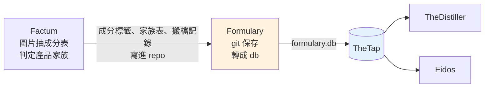

# Formulary - 產品標籤資料庫（成分表的版本倉庫）

---

## 📋 文檔目的

本文檔介紹 **Formulary**，幫助新人理解：

- 它存了什麼：每個產品標籤上的成分表，一個產品一個 JSON 檔
- 資料從哪來（Factum）、交給誰（TheDistiller、Eidos）、怎麼交（`formulary.db` 經 TheTap）
- 為什麼它決定了「哪些產品會出現在 distiller.db」

> **給你的閱讀建議**：先看「🎯 系統職責」與「🔄 在管線裡的位置」；想知道它對下游有多重要，看「🔑 為什麼 Formulary 很關鍵」。

> **完整技術文檔**：[Formulary repo](https://github.com/mapleelpam/LuminNexus-AlchemyMind-Formulary) 的 `CLAUDE.md`

---

## 🎯 系統職責

**Formulary** 是產品標籤資料的**版本倉庫**。Factum 從產品圖片讀出成分表後，把結果存成 JSON 檔放進 Formulary；Formulary 用 git 記錄每一次新增、修改、刪除，再定期把全部 JSON 轉成一份 SQLite 資料庫 `formulary.db` 給下游用。

| 項目 | 說明 |
|------|------|
| **職責** | 保存成分標籤 JSON、檢查格式、轉成 `formulary.db` |
| **輸入** | Factum 寫進來的成分標籤 JSON 與產品家族表；Factum 搬檔或刪除重複檔時留下的搬檔記錄（Formulary 轉成 ID 對照表） |
| **輸出** | `formulary.db`：產品、品牌、成分表、產品家族、ID 對照 |
| **下游** | TheDistiller、Eidos（都經 TheTap 取得） |
| **現況** | 2026-10-18 線上版：387,460 個產品、23,843 個品牌 |

### 命名由來

**Formulary** 原意是「配方集」，藥局用來列出藥品與成分的手冊。這個 repo 收的正是每個保健品的配方：裡面有什麼成分、各多少劑量。

### 資料長什麼樣

每個產品是一個 JSON 檔，格式沿用美國 NIH 的 **DSLD**（Dietary Supplement Label Database，保健品標籤資料庫）。檔案依來源分開放：

| 來源 | 檔案數（約） |
|------|-------------|
| Amazon 美國站 | 22 萬 |
| Amazon 英國站 | 1.6 萬 |
| 品牌自營的 Shopify 網店 | 9.3 萬 |
| 品牌官網（Trawler，AtlasVault-Trawler 收集的品牌網站商品頁） | 3.2 萬 |
| iHerb | 3 萬 |
| DailyMed（美國藥品標籤資料庫） | 3.1 萬，**保留但不轉進 db** |

轉成 db 時會排除格式不合格的檔，所以產品數比檔案總數略少。

---

## 🔄 在管線裡的位置

- **Factum 不自己發 `.db`**：它把結果直接寫進 Formulary repo，由 Formulary 這邊 commit。
- **TheTap 從 git 建置**：TheTap 拿 Formulary `main` 上的最新內容建出 `formulary.db`，通過檢查才上架。所以**只有 push 到 main 的資料才會進正式版**，留在某人電腦上的不算。
- 有新 commit，當晚就會重建。

---

## 📤 交接方式：formulary.db

`formulary.db` 裡主要是這幾類資料：

- **產品與品牌**：每個產品的來源、名稱、品牌、劑型等。
- **成分表**：產品裡有哪些成分、劑量多少。
- **產品家族**：同一配方、同口味、同劑型的不同包裝，算同一家族。舊的產品關係表過渡期還在產出，之後會移除，新用途請用家族表。
- **ID 對照**：網店換網址合併、或重複檔刪除時，舊 ID 能對到新 ID。
- **db 的身分證**：版本、從哪個 git commit 建出來、各種筆數。

**TheTap 上架前會檢查**：資料庫完整、主要的表都在、產品與品牌筆數沒有異常減少。沒過就不上架，下游繼續用上一版。

**給下游的規則**：版本與來源以 db 的身分證為準。完整的表結構與對下游的契約，看 repo 文件。

---

## 🔑 為什麼 Formulary 很關鍵

### 1. 它是 Distiller 的「收錄名單」

TheDistiller 匯入產品時，**不論哪個來源，都只收 Formulary 裡有的產品**。Amazon（資料來自 `keepa.db`）、iHerb 上有、但 Formulary 沒收錄的產品，一進門就被丟掉；品牌官網與 Shopify 則是直接從 `formulary.db` 讀產品清單，價格、網址、圖片等再從 `trawler.db`、`shopify.db` 補上。

這樣做的好處是：進到 `distiller.db` 的每個產品都有完整的成分資料，不會缺東缺西。代價是：**Formulary 沒收到的產品，下游就看不到**。有人問「為什麼某個產品不在 distiller.db」，第一個要查的就是 Formulary。

### 2. 它決定哪些產品算「同一個」

同一款產品常有好幾個包裝（60 粒、120 粒、兩入組）。「哪些算同一個產品」完全由 Formulary 的產品家族表決定，Distiller 照搬，自己不再判斷。家族表由 Factum 用 LLM（大型語言模型，像 ChatGPT、Claude 這類 AI）逐品牌判定，存在 Formulary repo。

---

## 📖 故事

| 時間 | 事件 |
|------|------|
| 2026-01-17 | repo 建立，從 Factum 匯入第一批 610 個檔 |
| 2026-10-12 | **改成原子發佈**：以前重建時會先清空再寫入，Distiller 剛好在這時讀檔，就讀到空的產品表。之後改成先寫到暫存檔，檢查通過才一次換上 |
| 2026-10-13 | **產品家族表從 Factum 搬進 Formulary**，改由 Formulary commit；版本不見的家族 ID 會讓建置直接失敗，避免下游的產品 ID 無聲改變 |
| 2026-10-13 | 新增 ID 對照表，Shopify 網店合併網址（有沒有 www）時，舊 ID 能對到新 ID |

> **教訓**：下游可能隨時來讀檔，**檔案要嘛是舊的完整版，要嘛是新的完整版**，不能出現「寫到一半」的狀態。

---

## 🐛 常見問題

### Q1: 某個產品在 Amazon 上有，distiller.db 卻找不到？

先查 Formulary 有沒有這個產品。Distiller 只收 Formulary 收錄的產品，Formulary 沒有，下游就不會有。

### Q2: 我可以直接改 formulary.db 嗎？

不行。`formulary.db` 每次都從 repo 裡的 JSON 重建，直接改 db 下次就被蓋掉。要改資料，改 JSON 並 commit 到 main。

---

## 📚 相關文檔

### Learning Map 文檔
- [Factum](factum.md)：寫入 Formulary 的上游
- [TheTap](thetap.md)：`formulary.db` 的發佈與分發
- [TheDistiller](thedistiller.md)：最主要的下游
- [Eidos](eidos.md)：也讀 `formulary.db` 的下游

### Formulary 專案文檔
- [Formulary repo](https://github.com/mapleelpam/LuminNexus-AlchemyMind-Formulary) 的 `CLAUDE.md`：表結構、原子發佈、家族表、ID 對照表

---

## 📝 文檔維護

### 版本歷史

| 版本 | 日期 | 變更 |
|------|------|------|
| 1.0 | 2026-10-20 | 初版，依 Formulary repo 文件、TheTap 設定與線上 manifest 撰寫 |
| 1.1 | 2026-10-21 | 依合併後 review 修正：收錄範圍改為「每個來源都以 Formulary 為準」（與 TheDistiller 一致）；ID 對照表改為「Factum 留搬檔記錄、Formulary 轉成對照表」；名詞依第三輪對照統一（品牌官網（Trawler）、`keepa.db`）；補充品牌官網、Shopify 的產品清單與價格圖片各從哪來；LLM 補白話說明；刪去路徑、程式檔名、版本號、stage 編號與完整表清單；刪除「repo 文件過時」的 FAQ；拿掉 TheDistiller 過時提醒 |

### 系統依賴

**上游依賴**：
- Factum：成分標籤 JSON、產品家族表、搬檔記錄

**下游依賴**：
- TheDistiller：產品收錄範圍、成分、家族、ID 對照
- Eidos：品牌與產品資料

---

**文檔結束**

> **注意**：產品與品牌數會隨每天的 commit 改變，現況以 http://maple-msi.local/formulary/daily/manifest.json 為準。
