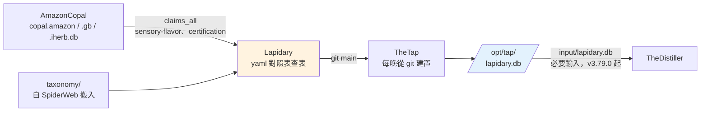

# Lapidary - 把 copal 的宣稱切成 facet（查表、不經 LLM）

---

## 📋 文檔目的

本文檔介紹 **Lapidary**，幫助新人理解：

- 為什麼口味（flavor）和證照（certification）不用 AI 判，改用查表
- 它從 AmazonCopal 讀什麼、交給 TheDistiller 什麼
- 它和 SpiderWeb、TheWeaver 的分工怎麼換手
- 它守的幾條設計原則，以及背後的理由

> **注意**：Lapidary 是 2026-10-21 才上線的新系統；flavor 已完成切換，certification 仍在進行中。

> **完整技術文檔**：[Lapidary repo](https://github.com/mapleelpam/LuminNexus-AlchemyMind-Lapidary) 的 `CLAUDE.md`

---

## 🎯 系統職責

**一句話**：把 copal 已切好的、屬於有限集合的 kind，透過 yaml 對照表對到分類樹，寫成 `lapidary.db`。**純查表，不經 LLM。**

| 項目 | 說明 |
|------|------|
| **輸入** | AmazonCopal 的 `copal.amazon.db`、`copal.amazon.gb.db`、`copal.iherb.db`（只讀 `claims_all`，assay_spec v3.5） |
| **輸出** | `/opt/tap/lapidary.db`：一檔多表，市場放在 `source` 欄（keepa／keepa_gb／iherb） |
| **兩條線** | flavor（生產中：22,921 列、216 個節點）、certification（yaml 撰寫中） |
| **下游** | TheDistiller（v3.79.0 起必要輸入） |

### 命名由來

AmazonCopal 用樹脂當比喻：copal 是還沒完全石化的琥珀，它把產品頁（PDP）讀成一句句宣稱（claims）。**Lapidary 是寶石切磨師**，把琥珀切出一個個切面（facet），例如口味、證照。

候選名還有 ThePalate（味覺），但它只對 flavor 有意義。certification 是真的存在的第二條線，名字要能涵蓋兩條，所以選了 Lapidary。

### 為什麼不用 AI

AmazonCopal 已經把宣稱句正規化成標準命題（canonical proposition），同一個意思的說法變體很有限：

- flavor：22,921 列只對到 216 個節點
- certification：前 200 句不同的文字，就涵蓋 82% 的 claim

既然變體有限，查表就能做完，而且結果可重現、零成本。**對不上的句子代表 yaml 有缺口**，補別名（alias）或加葉節點（leaf），不叫模型去猜。

copal 另外六種 kind（benefit、attribute、warning、brand-fact、usage、generic-fact）不是有限集合，不會進 Lapidary，繼續由 TheWeaver 的 LLM 線處理。

---

## 🔄 在管線裡的位置

**建置**：TheTap 從 Lapidary 的 git main 建置（`lapidary build --copal-dir input`），copal 的三份 db 由 TheTap 接進 `input/`，所以每份 `lapidary.db` 都對得到它讀的是哪一版 copal。

### 和 SpiderWeb、TheWeaver 的換手

| 系統 | flavor / certification 之前 | 之後 |
|------|------|------|
| TheWeaver | LLM analyzer 產生分類 | 不再是生產線（`scripts/flavor` 與 `flavors.yaml` 已刪，commit `e70663a`）；其他知識領域不受影響 |
| SpiderWeb | 保存結果、轉成 `spiderweb.db` | flavor 自 2026-10-21 凍結；Distiller 切換後移除 flavor 的來源與 forge 設定 |
| Lapidary | — | 接手；taxonomy 檔 2026-10-21 自 SpiderWeb 原樣搬入，FlavorCharacteristics 的 taxonomy id 主人改為 Lapidary |

---

## 📤 交接方式：lapidary.db

- **和 spiderweb.db 同表名、同欄位、同 CHECK**：`FlavorCharacteristics` + `FlavorCharacteristicsTaxonomy`，之後加上 `Certification` + `CertificationTaxonomy`。所以 TheDistiller 讀這些表的程式（stage 10、11b、13b）**完全不用改，只改 attach 的檔案**。
- **單一 db，不分市場**：市場是一個欄位而不是一個檔，Distiller attach 一次就好。
- **`_metadata`**：`built_at`、`assay_spec`、每個 realm 的 `records`／`nodes`／`rejected`。
- **時間欄位是 build 時間**，不是 claim 的時間。舊線「分析產生時間」的語意已經不存在。

### 經過 TheTap

`lapidary.db` 由 **TheTap 每晚從 Lapidary 的 git main 建置**，再經 TheTap 的檢查上架到 `/opt/tap/`。TheDistiller 的 `input/lapidary.db` 由 TheTap 接線，是**必要輸入**：缺檔時 build 直接失敗。

設成必要而不是選用，是因為選用輸入缺席時只會產出空的口味表，所有檢查卻照樣通過，沒人會發現（[TheTap #14](https://github.com/mapleelpam/LuminNexus-AlchemyMind-TheTap/issues/14)）。

> 開發時也可以在本機跑 `uv run lapidary build -o /opt/tap/lapidary.db` 直接寫檔，但那只是開發機的捷徑；正式版一律以 TheTap 建置的為準。

### 切換紀錄（2026-10-21）

- `lapidary.db` 第一版（built_at `2026-10-21T14:35:01Z`）：FlavorCharacteristics 22,921 列、216 個節點，**和 spiderweb.db 的同一張表零差異**。
- TheDistiller **v3.79.0** 改從 `lapidary.db` 讀 Flavor，已 merge main。和 v3.78.0（從 spiderweb 讀）比對，FlavorCharacteristics 27,680 列兩個方向都零差異（[#88 回報](https://github.com/mapleelpam/LuminNexus-AlchemyMind-TheDistiller/issues/88#issuecomment-6319497187)）。
- TheTap 把 lapidary 接成 distiller 的必要輸入，2026-10-21 夜起 nightly 的 Flavor 讀 `lapidary.db`。

---

## 💡 設計原則

| 原則 | 理由 |
|------|------|
| **不加 LLM** | 這條線存在的理由。對不上 = yaml 有缺口，補 alias 或 leaf |
| **taxonomy_id 只增不改不重用** | 節點離開樹仍保留條目，新節點拿下一個號碼。id 是對 Distiller 和下游已發佈的契約，改了不可逆 |
| **零差異是重構的驗收標準** | build 先寫 `.new`，看過 diff 再替換；差異必須能用 yaml 的改動解釋 |
| **寧可失敗，不默默丟列** | yaml 對到樹裡沒有的路徑，build 直接報錯 |
| **一個 facet 一個函式** | 每個 facet 一個 `<realm>_rows()`，回傳固定 8 欄；build、coverage、diff、taxonomy 指令共用 |
| **三個檔一起 commit** | 改 `flavors.yaml` 後一定跑 taxonomy build → assign-ids，三個檔一起進 git；`*.db` 不進 git |

---

## 🚧 進行中：certification 的語意變更

需等 Maple 確認：

- copal 的 certification 只收「certified by X」這種**第三方認證**。舊線把 Vegan、Gluten-Free、Dairy Free 這類飲食屬性也當成證照，新線會把它們拿掉；飲食屬性本來就屬於 dietary_adaptability。
- 舊線 spiderweb.db 的 Certification 有 61,844 個 DSLD 產品不在 copal 裡，切換後這些產品就沒有 certification。
- 第一版不新增認證機構的葉節點（例如 Intertek、NPA、UL），先對到既有的標準節點，機構名寫在 reason 欄。理由同「taxonomy_id 只增不改」：節點一旦發佈就收不回來。

---

## 🐛 常見問題

### Q1: Lapidary 和 TheWeaver 的分界在哪？

看 copal 的 kind 是不是**有限集合**。口味、證照的說法有限，查表就能做完，歸 Lapidary；功效、屬性這類說法無限，需要理解語意，歸 TheWeaver 的 LLM 線。除非 copal 新增 kind，Lapidary 不會有第三條線。

### Q2: 為什麼和 spiderweb.db 用一模一樣的表結構？

這樣 TheDistiller 只要換 attach 的檔案，程式一行都不用改，切換的風險最小，也能直接比對新舊兩份是否零差異。

### Q3: 這和分類術語裡的 kind、facet 有什麼關係？

Lapidary 就是「kind → 對照表 → facet」這條映射的機械實作：kind 是 copal 的分類（例如 sensory-flavor），對照表是 `flavors.yaml` 的 alias → 葉節點路徑，facet 是 realm 表裡帶 taxonomy_id 的一列。術語定義見[分類體系術語](../../general/classification-terminology.md)。

---

## 📚 相關文檔

### Learning Map 文檔
- [AmazonCopal](amazoncopal.md)：上游，產生 claims
- [SpiderWeb](spiderweb.md)、[TheWeaver](theweaver.md)：flavor / certification 的前任
- [TheDistiller](thedistiller.md)：下游
- [分類體系術語](../../general/classification-terminology.md)：kind、facet、taxonomy

### Lapidary 專案文檔
- `CLAUDE.md`：工作規則與設計原則
- `taxonomy/flavor/flavors.yaml`：flavor 對照表

---

## 📝 文檔維護

### 版本歷史

| 版本 | 日期 | 變更 |
|------|------|------|
| 1.0 | 2026-10-21 | 初版，依 Lapidary agent 提供的資料撰寫 |
| 1.1 | 2026-10-21 | flavor 切換完成：distiller v3.79.0 起必要輸入，TheTap 從 git 建置 |

### 系統依賴

**上游**：AmazonCopal（`copal.amazon.db`、`copal.amazon.gb.db`、`copal.iherb.db`）

**下游**：TheDistiller（`input/lapidary.db`，v3.79.0 起必要輸入）

---

**文檔結束**

> **注意**：certification 上線後，請更新「兩條線」與「進行中：certification 的語意變更」兩處。
