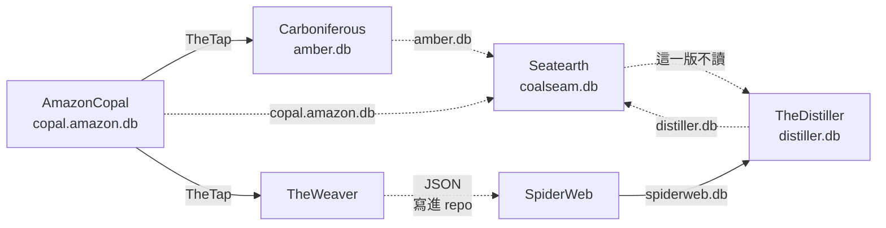

# Seatearth - 宣稱 set 判斷層（coalseam.db）

---

## 📋 文檔目的

本文檔介紹 **Seatearth**，幫助新人理解：

- 「宣稱 set」是什麼、誰來判斷
- 它的輸入（`amber.db` 等）與輸出（`coalseam.db`）
- 它和 TheDistiller、TheWatershed 的關係

> **完整技術文檔**：[Seatearth repo](https://github.com/mapleelpam/LuminNexus-AlchemyMind-Seatearth)

---

## 🎯 系統職責

**Seatearth**（煤層底下的黏土層）是宣稱線的**判斷層**：判斷由人來做，程式照人定好的規則執行。[Carboniferous](carboniferous.md) 已經把每條**標準宣稱**（把宣稱句整理成統一寫法的一條）編成「主詞－述詞－受詞」，Seatearth 只看其中「述詞＋受詞」的組合（例如「提升＋耐力」），把它們歸成一個個 **set**。

**一個宣稱 set＝人工事先定義的一個訴求**：一句話講得清楚的訴求（例如記憶、專注），加上哪些「述詞＋受詞」組合算進來。這些判斷全部由人寫在 repo 的 set 定義檔裡；程式只照表比對，標出每個產品命中哪些 set。

- 一個產品可以命中好幾個 set。
- set 之間可以重疊，大 set 可以包含小 set（例如一個籠統的大訴求包含幾個細分訴求）。

| 項目 | 說明 |
|------|------|
| **職責** | 編碼好的標準宣稱 → 宣稱 set；標註每個產品命中哪些 set |
| **輸入** | `amber.db`（必要）；`distiller.db`（選用，給過渡級比對產品文字）；`copal.amazon.db`（選用，整理過渡級詞庫時回查宣稱句原文） |
| **輸出** | `coalseam.db`（不進 git，可重新產生） |
| **下游** | TheDistiller 2026-10-16 起不讀；長期仍希望用這條線供 TheWatershed 建群組 |
| **現況** | 目前只新增 set、不改舊的，手動執行 |

### 兩種證據等級

| 等級 | 怎麼來 |
|------|-------|
| **管線級** | AmazonCopal 抄下宣稱句、整理成標準宣稱 → Carboniferous 編碼 → set |
| **過渡級** | 直接比對 `distiller.db` 裡的產品文字，暫時補上管線還沒覆蓋的產品，可以含非 Amazon 產品 |

兩級分開存放、不重疊，看得出每個標註的證據等級。另外附一份所有 set 的清單。

三份輸入都**不經過 TheTap**，讀的是同一台電腦上各 repo 自己建出的那一份：`amber.db` 來自 Carboniferous repo、`distiller.db` 來自 TheDistiller repo、`copal.amazon.db` 來自 AmazonCopal repo，不是 TheTap 上架的版本。

---

## 🔄 在管線裡的位置

- 實線經過 TheTap；虛線沒經過 TheTap（直接讀對方 repo 的檔案或寫進對方 repo）。標「這一版不讀」的虛線＝2026-10-16 起沒接。
- **宣稱線**（AmazonCopal → Carboniferous → Seatearth）：產出 `coalseam.db`，TheDistiller 2026-10-16 起不讀。
- **功效分類線**（AmazonCopal → TheWeaver → SpiderWeb → Distiller）：產出十個知識領域的 AI 分類，正常運作。其中的**功效分類**（健康效果、效能提升、生活品質＝HE／PE／QoL）就是 TheWatershed 目前用來切訴求群的那部分。
- 三者差別：宣稱 set 是產品自己說的；功效分類是 AI 判的；訴求群是 TheWatershed 在市場層級切出的分群（例如睡眠、關節）。
- Seatearth 雖然讀 `distiller.db`，但 TheDistiller 2026-10-16 起不讀回 `coalseam.db`，所以**不構成回圈**。

---

## 📤 交接：coalseam.db

**TheDistiller 2026-10-16 起不讀 `coalseam.db`**（maple（AlchemyMind 負責人）決定），所以 `distiller.db` 的產品宣稱表（`ProductBenefitClaims`）是空表，屬正常。長期仍希望用這條線供 [TheWatershed](thewatershed.md) 建群組。

`coalseam.db` 裡要交給下游的有三類資料：

- **管線級產品標註**：每個產品命中哪些 set
- **過渡級產品標註**：同上，證據等級較低
- **set 清單**：所有 set 的定義

閱讀時要注意：一個 set 的命中數**不可跨 set 相加**。大 set 會包含小 set，同一批標準宣稱會被多個 set 各算一次。

---

## 📚 相關文檔

### Learning Map 文檔
- [Carboniferous](carboniferous.md)：上游，產出 amber.db
- [AmazonCopal](amazoncopal.md)：宣稱線的起點
- [TheTap](thetap.md)：交接中心
- [TheDistiller](thedistiller.md)：2026-10-16 起不讀 coalseam.db
- [TheWatershed](thewatershed.md)：長期希望用宣稱 set 建群組

### Seatearth 專案
- [Seatearth repo](https://github.com/mapleelpam/LuminNexus-AlchemyMind-Seatearth)：set 判準、過渡級規則與交接設計

---

## 📝 文檔維護

### 版本歷史

| 版本 | 日期 | 變更 |
|------|------|------|
| 1.0 | 2026-10-20 | 初版：宣稱 set 是什麼、兩種證據等級、在管線裡的位置與交接 |
| 1.1 | 2026-10-21 | 依 leana review：宣稱線改為「這一版不讀＋長期希望」兩種一起寫；圖上補讀 distiller.db、copal.amazon.db，並說明不構成回圈；拿掉 thedistiller.md 過時提醒；刪 repo 文件過時與已知問題 FAQ；刪路徑、檔名、資料表清單；名詞照第三輪對照統一（標準宣稱、宣稱 set、功效分類、訴求群、功效分類線）；新人視角：宣稱 set 定義改為「人工事先定義的訴求、產品可命中多個」，寫明三份輸入讀的是各 repo 自己建出的那份、copal.amazon.db 的用途，「這一版不讀」改寫日期；最終複查：整理歸 AmazonCopal、判斷層說法與「程式照表執行」一致、拿掉內部代碼、表名改白話；收尾：maple 首次出現補身分、功效分類線與功效分類定義對齊 |

### 系統依賴

**上游**：Carboniferous（`amber.db`，必要）、TheDistiller（`distiller.db`，選用）、AmazonCopal（`copal.amazon.db`，選用）

**下游**：TheDistiller 2026-10-16 起不讀；長期希望供 TheWatershed 建群組

---

**文檔結束**
