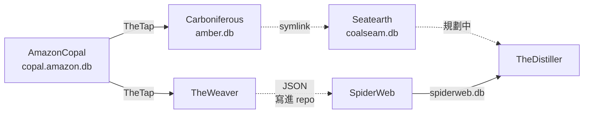

# Seatearth - 宣稱 set 判斷層（coalseam.db）

---

## 📋 文檔目的

本文檔介紹 **Seatearth**，幫助新人理解：

- 「宣稱 set」是什麼、誰來判斷
- 它的輸入（`amber.db` 等）與輸出（`coalseam.db`）
- 它規劃中的下游：規劃接上 TheDistiller，供 TheWatershed 建群組

> **完整技術文檔**：[Seatearth repo](https://github.com/mapleelpam/LuminNexus-AlchemyMind-Seatearth) 的 `CLAUDE.md`、`specs/coalify.md`、`specs/lignite.md`

---

## 🎯 系統職責

**Seatearth**（煤層底下的黏土層）是宣稱線的**判斷層**。[Carboniferous](carboniferous.md) 已經把宣稱編成「主詞－述詞－受詞」，Seatearth 只看其中「述詞＋受詞」的組合（例如 `increases:stamina`＝提升耐力），把它們歸成一個個 **set**。

**一個 set＝一句話講得清楚的訴求**，例如 `memory`（記憶）、`focus-attention`（專注）。哪些組合算進哪個 set，全部寫在人工策展的 `sets/benefit_claim.yaml`；程式只照表聚合，不做判斷。

| 項目 | 說明 |
|------|------|
| **職責** | 編碼好的宣稱 → 宣稱 set；標註每個產品命中哪些 set |
| **輸入** | `input/amber.db`（必要）、`input/distiller.db` 與 `input/copal.amazon.db`（選用，缺了只停用過渡級），全是 symlink |
| **輸出** | `output/coalseam.db`（不進 git，可重新產生） |
| **下游** | 規劃接上 TheDistiller，供 TheWatershed 建群組（未來會繼續發展） |
| **現況** | 目前只新增 set、不改舊的，手動執行 |

### 兩種證據等級

| 等級 | 產品表 | 怎麼來 |
|------|-------|-------|
| **管線級** | `CoalseamProducts` | 產品頁宣稱 → AmazonCopal → Carboniferous 編碼 → set |
| **過渡級** | `LigniteProducts` | lignite（褐煤）：讀選用輸入 `distiller.db` 的產品文字做比對，暫時補上管線還沒覆蓋的產品，可以含非 Amazon 產品 |

兩張表不重疊，看表名就知道證據等級。另有 `BenefitClaimSet` 列出所有 set。

---

## 🔄 在管線裡的位置

- 實線經過 TheTap；虛線是 symlink（捷徑）、寫進對方 repo，或還在規劃中。
- 宣稱線（AmazonCopal → Carboniferous → Seatearth → Distiller）：Carboniferous → Seatearth 是 symlink，最後一段還在規劃中。
- 功效線（AmazonCopal → TheWeaver → SpiderWeb → Distiller）正常運作。

---

## 📤 規劃中的交接：coalseam.db

接上 TheDistiller（供 TheWatershed 建群組）的部分還在規劃中，未來會繼續推進。下面是目前設計好的交接方式。

| 表 | 給誰 | Distiller 落地成 |
|----|------|-----------------|
| `CoalseamProducts` | 下游 | `ProductBenefitClaims`（標為管線級） |
| `LigniteProducts` | 下游 | `ProductBenefitClaims`（標為過渡級） |
| `BenefitClaimSet` | 下游 | `BenefitClaimSets` |
| 其他 `coalseam_*` 表 | 內部 | 不交出 |

- **規劃的送法**：Distiller 的 `input/coalseam.db` 是 symlink（捷徑），指到 Seatearth 的 `output/coalseam.db`。
- **版本**：git 只記判斷規則（set 定義檔等），不存 `coalseam.db`，需要時重新產生。
- 一個 set 的命中數**不可跨 set 相加**：大 set 會包含小 set，同一批宣稱會被多個 set 各算一次。

---

## 🐛 常見問題

### Q1: README 只列兩張發佈表，這裡寫三張？

README 沒跟上。`LigniteProducts` 是後來加的（2026-08-18 首度裝入非 Amazon 產品），以 `CLAUDE.md` 與 `specs/lignite.md` 為準。

### Q2: 已知的資料問題？

約 7% 的 ASIN 不在 Distiller 的產品母體裡（AmazonCopal#66）；amber 的產品鍵還沒對齊 `product_id`（Carboniferous#104）。

---

## 📚 相關文檔

### Learning Map 文檔
- [Carboniferous](carboniferous.md)：上游，產出 amber.db
- [AmazonCopal](amazoncopal.md)：宣稱線的起點
- [TheTap](thetap.md)：交接中心，以及不經 TheTap 的交接
- [TheDistiller](thedistiller.md)：規劃中的下游（該篇部分內容過時，以 TheTap／本篇為準）
- [TheWatershed](thewatershed.md)：規劃中，經 TheDistiller 間接使用

### Seatearth 專案文檔
- `CLAUDE.md`：工作規則、發佈表
- `specs/coalify.md`：set 判準（唯一真相源）
- `specs/lignite.md`：過渡級判準與發佈語意（§六）
- `sets/benefit_claim.yaml`：人工策展的 set 定義
- `input/README.md`：重建 symlink 的方法
- `docs/20260813_coalify_split_and_contract_publishing.md`：切 repo 與契約設計

---

## 📝 文檔維護

### 版本歷史

| 版本 | 日期 | 變更 |
|------|------|------|
| 1.3 | 2026-10-20 | 第二輪複查：下游統一為「規劃接上 TheDistiller，供 TheWatershed 建群組」；刪「未來讀 distiller.db 再給下一版」那段與規模數字；distiller.db 照實寫為現有選用輸入；送法改「規劃的送法」；階段一改白話 |
| 1.2 | 2026-10-20 | 新人視角修正：互為上下游改為規劃中說法；刪 Stage／版本號與 commit 日期；圖上功效線改經 SpiderWeb 實線；刪 rollup、evidence_tier、版本錨／水位／sha 等內部詞，母集子集改白話；述詞:受詞補上與 S-P-O 的關係；thedistiller.md 連結註明過時 |
| 1.1 | 2026-10-20 | 宣稱線改寫為「規劃中」：下游改列 TheDistiller／TheWatershed（規劃中），刪除未接上正式版的查證細節（證據、覆蓋率比較、本機 FAQ） |
| 1.0 | 2026-10-19 | 初版，依 Seatearth repo 文件、Distiller `CLAUDE.md`、TheWatershed 契約與 maple-msi.local 線上 manifest 撰寫；承接 thetap.md 移出的 coalseam 查證細節 |

### 系統依賴

**上游**：Carboniferous（`amber.db`，必要）、TheDistiller（`distiller.db`，選用）、AmazonCopal（`copal.amazon.db`，選用）

**下游**：規劃接上 TheDistiller，供 TheWatershed 建群組

---

**文檔結束**
