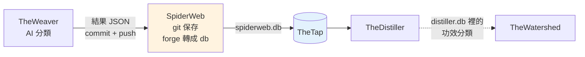

# SpiderWeb - 功效網（AI 分類結果的版本倉庫）

---

## 📋 文檔目的

本文檔介紹 **SpiderWeb**，幫助新人理解：

- 它存了什麼：每個產品在每個分類面向上的 AI 判斷結果，一個結果一個 JSON 檔
- 資料從哪來（TheWeaver）、交給誰（TheDistiller）、怎麼交（`spiderweb.db` 經 TheTap）
- 為什麼分類樹（taxonomy）在這裡是「封閉集合」

> **給你的閱讀建議**：先看「🎯 系統職責」與「🔄 在管線裡的位置」；想知道下游拿到什麼，看「📤 交接方式」。

> **完整技術文檔**：[SpiderWeb repo](https://github.com/mapleelpam/mapleelpam-LuminNexus-AlchemyMind-SpiderWeb) 的 `CLAUDE.md`

---

## 🎯 系統職責

**SpiderWeb** 是 AI 分類結果的**版本倉庫**，和 TheWeaver 合起來叫「功效分類線」。TheWeaver 判斷完一個產品的功效、認證、口味等分類後，把結果存成 JSON 放進 SpiderWeb；SpiderWeb 用 git 記錄每一次變動，再把全部 JSON 轉成一份 SQLite 資料庫 `spiderweb.db` 給下游用。

| 項目 | 說明 |
|------|------|
| **職責** | 保存分類結果 JSON、保存分類樹副本與節點編號、轉成 `spiderweb.db` |
| **輸入** | TheWeaver 寫進來的分類結果 JSON |
| **輸出** | `spiderweb.db`：十個知識領域（realm）各自的分類結果與分類樹，加上可不可以吃、劑型 |
| **下游** | TheDistiller（經 TheTap）；TheWatershed 透過 distiller.db 間接使用功效分類 |
| **現況** | 2026-10-19 線上版：3,159,024 個檔、約 1.25 GB |

### 跟 TheWeaver 怎麼分工

一句話：**TheWeaver 負責「判」，SpiderWeb 負責「存」和「轉成 db」。**

| 工作 | 誰做 |
|------|------|
| 定分類選單（分類樹） | TheWeaver（正本） |
| 跑 AI／查表，判斷每個產品屬於哪一格 | TheWeaver |
| 把結果 JSON 寫進 SpiderWeb、commit、push | TheWeaver 那邊的人，在 SpiderWeb repo 裡做 |
| 保存結果與歷史（git） | SpiderWeb |
| 保存選單副本、替節點發固定號碼 | SpiderWeb |
| 用 forge（SpiderWeb 的轉檔程式）把全部 JSON 轉成 `spiderweb.db` | SpiderWeb 的程式，由 TheTap 每晚執行 |

### 命名由來

TheWeaver（織工）織出的分類網，就掛在 **SpiderWeb**（蜘蛛網）上。repo 的文件也叫它「畫布」（canvas）。

### 資料長什麼樣

每個 JSON 由三件事決定放在哪：

- **哪一種分析**：十個知識領域（realm），例如健康效果（HE）、效能提升（PE）、生活品質（QoL）、認證標章、飲食適性、風味特徵，見 [TheWeaver](theweaver.md)；另外還有「可不可以吃」與「劑型」。
- **哪個來源**：現在持續有新結果的是 **Amazon 美國站、Amazon 英國站、iHerb**（新做法以 AmazonCopal 抄下的宣稱句為底）。Shopify、品牌官網（Trawler，各品牌自己網站的商品頁）、DSLD 只有早期留下的舊結果（最後一次新增在 2026-05），仍在 `spiderweb.db` 裡，但口味分類已在 2026-10-14 拿掉。
- **哪個產品**：該來源的產品 ID（例如 ASIN）。

每個檔除了分類結果，還記著用哪版 prompt、哪個模型、何時產生、花多少錢。**一個產品的一種分析只留一份目前最好的結果**，新的直接覆蓋，歷史靠 git 追。

---

## 🔄 在管線裡的位置

- **TheWeaver 不自己發 `.db`**：它把結果直接寫進 SpiderWeb，在 SpiderWeb 這邊 commit。
- **TheTap 從 git 建置**：TheTap 每晚抓 SpiderWeb 的 main，用 forge 產出 `spiderweb.db`，通過檢查才上架。所以**只有 push 到 GitHub main 的結果才會進正式版**。
- 分類結果或分類樹副本一有新 commit，當晚就會重建。結構和 [Formulary](formulary.md) 一樣：資料本身就是 repo。

---

## 🌳 分類樹是封閉集合

**分類樹**是事先定好的選單，例如「健康效果 › 消化系統 › 消化道 › 腸道菌叢平衡」。AI 只能從選單裡挑。

- **封閉＝選擇題，不是填空題**（2026-10-12 起）：AI 寫了選單上沒有的分類（拼錯、自己編的），forge 就丟掉那一列並記下來。丟得太多，這一版就不上架。
- **編號固定**：每個節點有固定號碼，像學號。刪掉一個，別人不補位；退役的號碼不重用。下游靠號碼對資料，號碼一移位就會對錯，而且不會報錯。

所以每個知識領域在 SpiderWeb 裡有兩份檔：一份是選單（從 TheWeaver 同步過來），一份是號碼表（SpiderWeb 自己發號）。改選單時，從 TheWeaver 複製新選單、替新節點發號碼，兩份一起 commit。

---

## 📤 交接方式：spiderweb.db

forge 每次都**刪掉舊 db 從零重建**，讀全部 JSON。db 裡有三類內容：

- **分類結果**：每個知識領域一張表，記每個產品被分到哪些節點
- **分類樹**：每個知識領域一張，就是上面那份選單
- **其他分析**：可不可以吃、劑型；另有一張記這次建置的版本、檔案數、錯誤數、被丟掉幾列

**TheDistiller 讀哪些**：分類樹、每個產品的各知識領域分類、可食用分析。它把這些搬進 distiller.db，做成每個產品一列的分類總覽，並依 UPC（商品條碼）把分類傳給同條碼的其他產品。

**TheTap 上架前會檢查**：資料庫完整、主要的表都在、沒有讀檔錯誤、分類沒有指到不存在的節點、筆數沒有異常變少。任何一項不過就不上架；forge 自己的健康檢查失敗也一樣。

**與 TheWatershed 的關係**：TheWatershed 用 distiller.db 裡的功效分類（TheWeaver 判出的 HE／PE／QoL 節點），看哪些節點常一起出現在同一批產品上，切出訴求群（市場上一群一群的主打需求，例如睡眠、關節）。所以這三個知識領域的節點一改名或搬位置，會一路影響到市場地圖。

---

## 📖 故事

| 時間 | 事件 |
|------|------|
| 2026-03-02 | forge 上線，分類結果改以 git 管理、轉成 db |
| 2026-10-03 | Distiller 之前讀的是自己存的 2026-05-11 舊複本，所以之後的新資料（例如 10-03 新增的 24 萬列分類）都沒進 distiller.db；10-03 改成直接讀 TheTap 上的版本才修好 |
| 2026-10-04 | **TheTap 改從 git 自動建置**。之前 TheTap 上的版本要靠人手動匯入，遠遠落後 repo；現在每晚自動重建 |
| 2026-10-12 | 分類樹改為封閉集合，節點編號固定 |
| 2026-10-14～18 | 口味分類改用 AmazonCopal 的資料查表；iHerb 的功效分類舊結果全換成以 AmazonCopal 宣稱句為底的新結果 |

> **教訓**：舊複本和正式版長得一模一樣，光看檔案分不出來。所以下游要直接讀 TheTap 上的正式版，不要讀自己存的複本，並看建置紀錄確認是哪一版。

---

## 🐛 常見問題

### Q1: 某個產品在 distiller.db 沒有功效分類？

先查 SpiderWeb 有沒有這個產品的功效分類結果。沒有，代表 TheWeaver 還沒跑到它；有，可能是它的分類對不上分類樹，在 forge 時被丟掉了（db 裡有記每個知識領域丟了幾列）。

### Q2: 我可以直接改 spiderweb.db 嗎？

不行。每次 forge 都從 JSON 重建，直接改 db 下次就被蓋掉。要改結果，經 TheWeaver 重跑，commit 並 push 到 GitHub main。

---

## 📚 相關文檔

### Learning Map 文檔
- [TheWeaver](theweaver.md)：寫入 SpiderWeb 的上游
- [TheTap](thetap.md)：`spiderweb.db` 的發佈與分發
- [TheDistiller](thedistiller.md)：主要下游
- [TheWatershed](thewatershed.md)：用功效分類切訴求群
- [AmazonCopal](amazoncopal.md)：口味與 iHerb 功效分類的資料來源
- [Carboniferous](carboniferous.md)：讀 AmazonCopal 的標準宣稱，以句子為單位編碼，做法和功效分類線不同
- [Formulary](formulary.md)：同樣「資料就是 repo」的生產者

### SpiderWeb 專案文檔
- [SpiderWeb repo](https://github.com/mapleelpam/mapleelpam-LuminNexus-AlchemyMind-SpiderWeb) 的 `CLAUDE.md`：目錄、JSON 格式、forge、表結構、封閉分類樹

---

## 📝 文檔維護

### 版本歷史

| 版本 | 日期 | 變更 |
|------|------|------|
| 1.0 | 2026-10-20 | 初版，依 SpiderWeb repo 文件、TheTap `pipeline.yaml`、TheDistiller 文件與 maple-msi.local 線上 manifest 撰寫 |
| 1.1 | 2026-10-21 | 依合併後 review 修正：拿掉 repo 文件過時的提醒、刪減指令／路徑／欄位／版本號等操作細節、與新版 TheDistiller 用詞對齊、統一名詞、寫清哪些來源仍在更新、補列相關文檔 |

### 系統依賴

**上游依賴**：
- TheWeaver：分類結果 JSON、分類樹定義

**下游依賴**：
- TheDistiller：分類樹、知識領域分類、可食用分析
- TheWatershed：經 distiller.db 使用功效分類

---

**文檔結束**

> **注意**：檔案數與各表筆數每天都會變，現況以 http://maple-msi.local/spiderweb/daily/manifest.json 為準。
