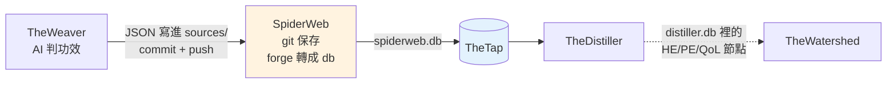

# SpiderWeb - 功效網（AI 分類結果的版本倉庫）

---

## 📋 文檔目的

本文檔介紹 **SpiderWeb**，幫助新人理解：

- 它存了什麼：每個產品在每個分類面向上的 AI 判斷結果，一個結果一個 JSON 檔
- 資料從哪來（TheWeaver）、交給誰（TheDistiller）、怎麼交（`spiderweb.db` 經 TheTap）
- 為什麼分類樹（taxonomy）在這裡是「封閉集合」

> **給你的閱讀建議**：先看「🎯 系統職責」與「🔄 在管線裡的位置」；想知道下游用了哪些表，看「📤 交接方式」。

> **完整技術文檔**：[SpiderWeb repo](https://github.com/mapleelpam/mapleelpam-LuminNexus-AlchemyMind-SpiderWeb) 的 `CLAUDE.md`（README 部分內容已過時，見文末相關文檔）

---

## 🎯 系統職責

**SpiderWeb** 是 AI 分類結果的**版本倉庫**。TheWeaver 判斷完一個產品的功效、認證、口味等分類後，把結果存成 JSON 放進 SpiderWeb；SpiderWeb 用 git 記錄每一次變動，再把全部 JSON 轉成一份 SQLite 資料庫 `spiderweb.db` 給下游用。

| 項目 | 說明 |
|------|------|
| **職責** | 保存分類結果 JSON、保存分類樹副本與節點編號、轉成 `spiderweb.db` |
| **輸入** | TheWeaver 寫進 `sources/` 的 JSON |
| **輸出** | `spiderweb.db`：每個 realm 一張分類表與一張分類樹表，加可食用、劑型等，共 24 張表 |
| **下游** | TheDistiller（經 TheTap）；TheWatershed 透過 distiller.db 間接使用 HE/PE/QoL 節點 |
| **現況** | 2026-10-19 線上版：3,159,024 個檔、約 1.25 GB；schema 1.4.0 |

### 跟 TheWeaver 怎麼分工

一句話：**TheWeaver 負責「判」，SpiderWeb 負責「存」和「轉成 db」。**

| 工作 | 誰做 |
|------|------|
| 定分類選單（分類樹） | TheWeaver（正本） |
| 跑 AI／查表，判斷每個產品屬於哪一格 | TheWeaver |
| 把結果 JSON 寫進 `sources/`、commit、push | TheWeaver 那邊的人，在 SpiderWeb repo 裡做 |
| 保存結果與歷史（git） | SpiderWeb |
| 保存選單副本、替節點發固定號碼 | SpiderWeb |
| 用 forge（SpiderWeb 的轉檔程式）把全部 JSON 轉成 `spiderweb.db` | SpiderWeb 的程式，由 TheTap 每晚執行 |

### 命名由來

TheWeaver（織工）織出的分類網，就掛在 **SpiderWeb**（蜘蛛網）上。repo 的文件也叫它「畫布」（canvas），TheWeaver 那邊的 `canvas/` 資料夾就是指到這裡的捷徑。

### 資料長什麼樣

路徑是 `sources/{analyzer}/{source}/{id}.json`：

- **analyzer**（分析器）：10 個 realm（HE、PE、QoL、認證、飲食適性、口味等，見 [TheWeaver](theweaver.md)），加上 `edible`（可不可以吃）、`dosage_form`（劑型）。另有 `material`、`formulation`、`intake` 三個資料夾目前沒有資料，建置時跳過。
- **source**（來源）：`keepa`（Amazon 美國站）、`keepa_gb`（Amazon 英國站）、`iherb`、`shopify`、`official`（品牌官網）、`dsld`。
- **id**：該來源的產品 ID（例如 ASIN）。

每個檔是分類結果加一段 `_meta`：用哪版 prompt、哪個模型、何時產生、花多少錢、`origin`（`batch` 批次或 `agent`）。**一個產品一個 analyzer 只留一份目前最好的結果**，新的直接覆蓋，歷史靠 git 追。

---

## 🔄 在管線裡的位置

- **TheWeaver 不自己發 `.db`**：它把結果直接寫進 SpiderWeb 的 `sources/`，在 SpiderWeb 這邊 commit。
- **TheTap 從 git 建置**（2026-10-04 起）：TheTap 用自己的機器人帳號 checkout SpiderWeb 的 `main`，執行 `spiderweb forge` 產出 `spiderweb.db`，通過檢查才上架。所以**只有 push 到 GitHub main 的結果才會進正式版**。
- `sources/` 或程式資料夾 `spiderweb/`（裡面有分類樹副本）一有新 commit，當晚就會重建。結構和 [Formulary](formulary.md) 一樣：資料本身就是 repo。

---

## 🌳 分類樹是封閉集合

**分類樹**是事先定好的選單，例如「功效 › 消化健康 › 腸道菌叢」。AI 只能從選單裡挑。

- **封閉＝選擇題，不是填空題**（2026-10-12 起）：AI 寫了選單上沒有的分類（拼錯、自己編的），forge 就丟掉那一列並記在 `_metadata`。丟超過 0.1%，這一版就不上架。
- **編號固定**：每個節點有固定號碼，像學號。刪掉一個，別人不補位；退役的號碼不重用。下游靠號碼對資料，號碼一移位就會對錯，而且不會報錯。

選單和號碼表放在 `spiderweb/taxonomy/realm/`，每個 realm 兩個檔：

| 檔案 | 內容 | 誰維護 |
|------|------|--------|
| `{Name}.json` | 選單（分類樹） | 從 TheWeaver 同步過來 |
| `{Name}.ids.json` | 每個節點的固定號碼 | SpiderWeb 自己（`spiderweb taxonomy assign-ids` 產生） |

改選單的步驟：從 TheWeaver 複製 `{Name}.json` → 跑 `assign-ids` 發號碼 → 兩個檔一起 commit。

---

## 📤 交接方式：spiderweb.db

`spiderweb forge` 每次都**刪掉舊 db 從零重建**，讀全部 JSON。24 張表分四類：

| 類型 | 張數 | 例子 |
|------|------|------|
| realm 分類表 | 10 | `HealthEffect`、`PerformanceEnhancement`、`QualityOfLife`、`Certification` |
| 分類樹表 | 10 | `HealthEffectTaxonomy` 等 |
| 獨立分析表 | 3 | `EdibleAnalysis`、`DosageForm`、`DosageFormFacet` |
| 身分證 | 1 | `_metadata`：schema 版本、檔案數、錯誤數、每個 realm 被丟掉幾列 |

**TheDistiller 讀哪些**：分類樹、每個產品的各 realm 分類、可食用分析。它把這些搬進 distiller.db，做成每個產品一列的分類總覽，並依 UPC（商品條碼）把分類傳給同條碼的其他產品。

Distiller 的 `input/spiderweb.db` 是 symlink，直接指到 `/opt/tap/spiderweb.db`。

**TheTap 上架前會檢查**：資料庫完整、主要的表都在、沒有讀檔錯誤、分類沒有指到不存在的節點、筆數沒有異常變少。任何一項不過就不上架；forge 自己的健康檢查失敗也一樣。

**與 TheWatershed 的關係**：TheWatershed 用 distiller.db 裡的 HE / PE / QoL 節點，看哪些節點常一起出現在同一批產品上，切出訴求群。所以這三個 realm 的節點一改名或搬位置，會一路影響到市場地圖。另一條宣稱線（Carboniferous → Seatearth）規劃接上 TheDistiller，供 TheWatershed 建群組，見 [Seatearth](seatearth.md)。

---

## 📖 故事

| 時間 | 事件 |
|------|------|
| 2026-03-02 | `spiderweb forge` 上線，分類結果改以 git 管理、轉成 db |
| 2026-10-03 | Distiller 之前讀的是自己存的 05-11 舊複本，所以之後的新資料（例如 10-03 新增的 24 萬列分類）都沒進 distiller.db；10-03 改成用捷徑直接讀 TheTap 上的版本才修好 |
| 2026-10-04 | **TheTap 改從 git 自動建置**。之前 TheTap 上的版本要靠人手動匯入，遠遠落後 repo；現在每晚自動重建 |
| 2026-10-12 | 分類樹改為封閉集合，節點編號固定 |
| 2026-10-14～18 | Flavor 改用 copal 查表線；iHerb 的 HE/PE/QoL 舊線全換成 copal 線 |
| 2026-10-21 | **Flavor 凍結，交給 [Lapidary](lapidary.md)**。TheDistiller 自 v3.79.0 起改讀 `lapidary.db`，這裡的 flavor 來源與 forge 設定隨之移除 |
| 2026-10-22 | **Certification 交給 [Lapidary](lapidary.md)**（只收第三方認證、機構另成 certifier realm）；TheDistiller v3.81.0 起改讀 lapidary.db 的 Certification |

> **教訓**：舊複本和正式版長得一模一樣，光看檔案分不出來。所以下游要用捷徑（symlink）直接讀 TheTap 上的正式版，並看 `_metadata` 確認是哪一版。

---

## 🐛 常見問題

### Q1: 某個產品在 distiller.db 沒有功效分類？

先查 SpiderWeb 有沒有這個產品的 `sources/health_effect/{source}/{id}.json`。沒有，代表 TheWeaver 還沒跑到它；有，再看 `_metadata` 的 `analyzer.health_effect.rejected`，路徑對不上分類樹的列會被丟掉。

### Q2: 我可以直接改 spiderweb.db 嗎？

不行。每次 forge 都從 `sources/` 重建，直接改 db 下次就被蓋掉。要改結果，經 TheWeaver 重跑，commit 並 push 到 GitHub main。

---

## 📚 相關文檔

### Learning Map 文檔
- [TheWeaver](theweaver.md)：寫入 SpiderWeb 的上游
- [TheTap](thetap.md)：`spiderweb.db` 的發佈與分發
- [TheDistiller](thedistiller.md)：主要下游（該篇部分內容過時，以 TheTap／本篇為準）
- [TheWatershed](thewatershed.md)：用 HE/PE/QoL 節點切訴求群
- [Formulary](formulary.md)：同樣「資料就是 repo」的生產者
- [Seatearth](seatearth.md)：另一條宣稱線（Carboniferous → Seatearth），規劃接上 TheDistiller，供 TheWatershed 建群組

### SpiderWeb 專案文檔
- `CLAUDE.md`：目錄、JSON 格式、forge、表結構、封閉分類樹（README 寫 forge「規劃中」、只有三個來源，已過時，以 CLAUDE.md 為準）
- `docs/20260302_spiderweb_forge_design.md`：forge 與表結構設計（文中 schema 版本停在 1.2.0，以程式為準）
- `spiderweb/forge.py`、`spiderweb/healthcheck.py`

---

## 📝 文檔維護

### 版本歷史

| 版本 | 日期 | 變更 |
|------|------|------|
| 1.0 | 2026-10-19 | 初版，依 SpiderWeb repo 文件、TheTap `pipeline.yaml`、TheDistiller `CLAUDE.md` 與 maple-msi.local 線上 manifest 撰寫 |

### 系統依賴

**上游依賴**：
- TheWeaver：`sources/` 的分類結果 JSON、分類樹定義

**下游依賴**：
- TheDistiller：分類樹、realm 分類、可食用分析
- TheWatershed：經 distiller.db 使用 HE/PE/QoL 節點

---

**文檔結束**

> **注意**：檔案數與各表筆數每天都會變，現況以 http://maple-msi.local/spiderweb/daily/manifest.json 為準。
