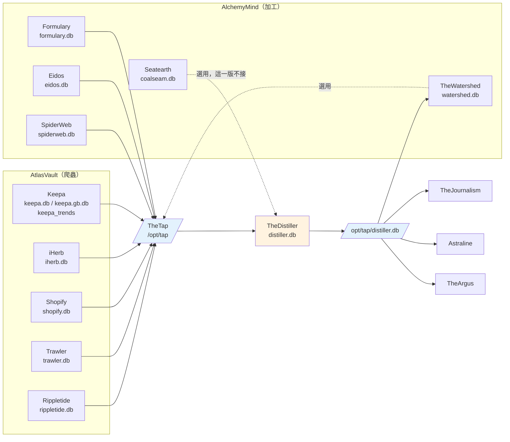

# TheDistiller - 把所有來源蒸餾成一份產品資料庫

---

## 📋 文檔目的

本文檔介紹 **TheDistiller**，幫助新人理解：

- 它在資料管線裡的位置：AlchemyMind 的**匯流點**，上游有十幾個 repo，下游是所有分析
- 它吃進哪些 `.db`、各自從哪個 repo 來、有沒有經過 TheTap（`/opt/tap`）
- 它交出去的 `distiller.db` 裡大致有什麼，下游讀的時候要注意什麼
- 幾個「看起來理所當然、其實會算錯」的觀念

> **給你的閱讀建議**：先看「🎯 系統職責」和「🔄 在管線裡的位置」建立直覺；讀 `distiller.db` 之前，一定要看「⚠️ 新人最常踩的觀念」。

> **完整技術文檔**：[TheDistiller repo](https://github.com/mapleelpam/LuminNexus-AlchemyMind-TheDistiller) 的 `CLAUDE.md`（每個欄位的來歷與陷阱都在裡面）、`schema/*.sql`（表結構與註解）

> **版本說明**：本文 2.x 版描述的是 2025 年的架構（輸入 unified / enriched / weaver.db、輸出 product_info.db），那些檔案都已經不存在。本版依 distiller **v3.73.1** 重寫。

---

## 🎯 系統職責

**TheDistiller** 是一條 ETL 管線（Extract 抽取、Transform 轉換、Load 載入）。保健品的資料散在各處：Amazon 上的價格、iHerb 的評論、品牌官網的商品頁、Factum 讀標籤得到的成分表、Eidos 整理的品牌資料。TheDistiller 把它們**合併成同一份 SQLite 資料庫 `distiller.db`**。下游不必各自去接十幾個來源，只要讀這一份。

| 項目 | 說明 |
|------|------|
| **職責** | 合併、清理、對齊多來源產品資料，並把上游對品牌、產品家族的判定正確套到每個產品上 |
| **輸入** | 十幾個上游 `.db`（見「📥 輸入」），其中兩個是選用的 |
| **輸出** | `distiller.db`：約 38 萬個產品、78 張表 + 8 個 view、約 5 GB |
| **下游** | TheJournalism、Astraline、TheArgus、TheWatershed 等，都讀 `/opt/tap/distiller.db` |
| **執行方式** | 每次從零重建（不做增量），28 個 stage，約 19 分鐘 |
| **現況** | v3.73.1（build 2026-10-20）：379,406 個產品、244,167 個產品家族、22,225 個品牌 |

### 命名由來

**蒸餾**：把一大鍋混雜的原料加熱，只收集需要的成分。TheDistiller 不自己生產資料，它的價值在「合併」與「對齊」：同一個產品在 Amazon、iHerb、品牌官網各有一筆，它要認出這幾筆是同一個東西，並決定每個欄位聽誰的。

### 它「不」做的事

這條界線很重要，新人常以為 distiller 什麼都管：

| 問題 | 誰決定 | distiller 的角色 |
|------|--------|------------------|
| 哪些產品算在範圍內？ | **Formulary**（Factum 的成果） | 照單全收，不自己判斷 |
| 這個產品是哪個品牌？品牌要不要排除？ | **Eidos** | 照搬判定，不自己改 |
| 這個產品有什麼功效分類？ | **SpiderWeb**（TheWeaver 產生） | 照搬 |
| 哪幾筆是同一個產品家族？ | **Formulary** 的家族表 | 照搬家族 uuid |
| 市場怎麼切成訴求群？ | **TheWatershed** | 照搬地圖，再自己算每個產品屬於哪一群 |

一句話：**判斷交給上游的單一真實來源（SSOT），distiller 負責把這些判斷正確地合在一起，而且合錯時要大聲失敗。**

---

## 🔄 在管線裡的位置



從圖上可以看出三件事：

- **TheTap 是中間的貨架**。上游把成品放上 `/opt/tap`，distiller 從那裡拿；distiller 的成品也放回 `/opt/tap`，下游再從那裡拿。詳見 [TheTap](thetap.md)。
- **distiller 同時是 TheWatershed 的上游和下游**。TheWatershed 讀上一版 `distiller.db` 畫市場地圖，下一版 distiller 再把地圖讀回來，替每個產品貼上訴求群標籤。這個迴圈靠契約（「只出地圖、不出歸屬」）防止失控，詳見 [TheWatershed](thewatershed.md)。
- **Seatearth 也有類似的迴圈**：它掃 distiller 的產品標題來產生 `coalseam.db`。這一版刻意不接回來（見下方輸入表）。

---

## 📥 輸入：每個 .db 從哪裡來

所有輸入都放在 distiller repo 的 `input/` 目錄下，**而且全部是 symlink**，指向上游的成品。程式只讀 `input/`，不寫死任何 `/opt/tap/...` 路徑，因為不同機器的目錄長得不一樣。

| 檔案 | 來源 repo | 經過 TheTap？ | 提供什麼 | 必要？ |
|------|-----------|:---:|----------|:---:|
| `keepa.db` | AtlasVault-Keepa | ✅ | Amazon 美國站的商品、價格、銷售排名、圖片 | 必要 |
| `keepa.gb.db` | AtlasVault-Keepa | ✅ | Amazon 英國站，結構和美國站相同 | 必要 |
| `keepa_trends/`、`keepa_trends_gb/` | AtlasVault-Keepa | ✅ | 每月價格歷史（parquet 檔，每週一更新），用來補「現在沒人賣的產品，上次賣多少」 | 必要 |
| `iherb.db` | AtlasVault-iHerb | ✅（人工匯入） | iHerb 全目錄、下架紀錄、評論摘要 | 必要 |
| `shopify.db` | AtlasVault-Shopify | ✅（人工匯入） | Shopify 店家的商品、變體、標籤、評分。**2026-06 起停止更新**，現在只當後備 | 必要 |
| `trawler.db` | AtlasVault-Trawler | ✅（人工匯入） | 品牌官網爬到的商品頁、價格、圖片 | 必要 |
| `rippletide.db` | AtlasVault-Rippletide | ✅（人工匯入） | 官網與 Shopify 商品的上下架觀察：何時出現、何時消失、是否確認下架 | 必要 |
| `formulary.db` | AlchemyMind-Formulary（Factum 讀標籤的成果） | ✅ | **範圍的唯一依據**：哪些產品算數，以及成分表、包裝數、產品家族 | 必要 |
| `eidos.db` | AlchemyMind-Eidos | ✅ | 品牌主檔、產品↔品牌對照、排除判定、品牌原料（BI / BT / BP） | 必要 |
| `spiderweb.db` | AlchemyMind-SpiderWeb（TheWeaver 產生） | ✅ | 十個知識領域的分類，例如功效（HealthEffect）、口味、劑型便利性 | 必要 |
| `lapidary.db` | AlchemyMind-Lapidary | ✅ | 口味（FlavorCharacteristics，v3.79.0 起）、證照（Certification）與認證機構（Certifier，v3.81.0 起），source 為 `lapidary:<market>`；前兩者取代 spiderweb.db 的同名表。見 [Lapidary](lapidary.md) | 必要 |
| `cartulary.db` | AlchemyMind-CartularyDSLD | ✅（人工匯入） | 美國 NIH 的 DSLD 標籤資料。目前暫停匯入 DSLD 產品，只用來比對 UPC | 必要 |
| `watershed.db` | AlchemyMind-TheWatershed | ✅ | 訴求群地圖（BenefitCluster），v3.69.0 起 | **選用** |
| `coalseam.db` | AlchemyMind-Seatearth | ❌ TheTap 沒有這個 artifact | 產品自己宣稱的功效集合（benefit claim sets） | **選用，這一版不用** |

> 開發機（maple-mbp）上有一個例外：`formulary.db` 直接指向 `/opt/formulary/formulary.db`，沒有經過本機的 `/opt/tap`。TheTap 節點上則和其他輸入一樣，由 TheTap 接線。

### 「經過 TheTap」是什麼意思

- **✅ 自動**：上游 repo 每次發佈，TheTap 都會先檢查（例如列數不能比上一版掉太多），再編版本號、放進 `/opt/tap/<名字>/` 底下，並更新 `daily` 這個指向最新版的捷徑。
- **✅（人工匯入）**：TheTap 不會自己重建這個檔案，要有人手動把新版放進去。TheTap 一樣會檢查、留版本，但**沒人會提醒檔案已經多舊**，過時的檔案看起來和最新的一模一樣。
- **❌**：TheTap 不認識這個檔案。在 TheTap 的節點（maple-msi）上 build 時，它就不存在。

### 兩個選用輸入

**選用**的意思是：檔案不在時，相關的表照樣建出來但是空的，log 印一行 WARN，build 照樣成功。

- **`watershed.db`**：載入結果記在 `_metadata.watershed_status`，值是 `loaded`（載入）、`absent`（缺席）、`incompatible`（版本不相容）三者之一。但如果檔案**宣稱相容、內容卻違反契約**，build 會直接失敗。那代表上游出錯了，不能安靜地吞下去。
- **`coalseam.db`**：Maple 在 2026-10-16 決定這一版不用 coalseam（也不用 amber 字典），所以本機和 TheTap 都不接。`ProductBenefitClaims` 是空表，屬於正常。

### 新增必要輸入的規矩

TheTap 在自己的節點上 build distiller，依 `pipeline.yaml` 把輸入接進 `input/`；它**看不到**開發者電腦上的 symlink。v3.66.0 曾經把 `keepa_trends` 改成必要輸入，卻沒通知 TheTap，隔天的 nightly build 就失敗了。所以現在的規矩是：**新增必要輸入之前，先在 TheTap 開一張知會 issue**。

---

## ⚙️ 中間做了什麼（白話版）

28 個 stage 依序執行，大致分成五段：

| 階段 | 做什麼 | 對應 stage |
|------|--------|-----------|
| **1. 匯入各來源產品** | 每個來源的產品**只有在 formulary 裡有紀錄才會進來**，各自取得不同前綴的 ID | 0–8 |
| **2. 成分** | 從 formulary 搬成分表（SupplementFact）與其他成分（OtherIngredients），保留巢狀結構 | 9–12 |
| **3. 品牌與品牌原料** | 依 Eidos 的對照表決定品牌；連上品牌原料、技術、來源標章 | 13–15 |
| **4. 分類與標籤** | 搬 SpiderWeb 的分類樹與十個知識領域；載入訴求群地圖，算出每個產品的歸屬 | 16–19 |
| **5. 收尾** | 驗證、品質摘要、上下架狀態、產品關係、產品家族、家族內共用口味 | 20–27 |

產品 ID 的前綴告訴你它從哪裡來：

| 前綴 | 來源 | 例 |
|------|------|-----|
| `A_` | Amazon 美國站（Keepa） | `A_B07XYZ1234` |
| `A_GB_` | Amazon 英國站 | `A_GB_B07XYZ1234` |
| `I_` | iHerb | `I_12345` |
| `T_` | 品牌官網（Trawler） | `T_<uuid>` |
| `S_` | Shopify 店家 | `S_<uuid>` |
| `D_` | DSLD（目前暫停，數量為 0） | `D_123456` |

### 每一段都會自我檢查

幾乎每個 stage 都有 `validate()`。發現不該發生的事，例如有產品沒拿到品牌判定、有一筆價格沒有幣別、訴求群的歸屬和重算結果不一致，就**讓整個 build 失敗**，而不是印個警告繼續跑。這是 distiller 最核心的工作習慣：**大聲的失敗，好過安靜的錯誤答案**。

---

## 📤 輸出：distiller.db 裡有什麼

不必背表名，知道有這幾類就好：

| 類別 | 代表的表 | 回答的問題 |
|------|----------|------------|
| **產品** | `Products` | 這個產品叫什麼、多少錢、哪個品牌、屬於哪個家族、現在買得到嗎 |
| **成分** | `SupplementFact`、`OtherIngredients` | 罐子裡有什麼、各多少量 |
| **品牌** | `Brands`、`Companies` | 品牌是誰、屬於哪家公司、哪個國家、什麼經營模式 |
| **品牌原料** | `BrandedIngredients` 等 | 有沒有用 BioPerine® 這類有商標的原料 |
| **分類** | 十個知識領域表（`HealthEffect` 等）與分類樹 | 模型判斷這個產品是做什麼用的 |
| **生命週期** | `ProductLifecycle` | 什麼時候上架、最後一次看到、何時下架 |
| **產品家族** | `CanonicalProduct` | 哪幾筆其實是同一個產品（不同尺寸、包裝、通路） |
| **訴求群** | `BenefitClusters`、`ProductBenefitClusters` | 這個產品屬於哪個訴求群（v3.69.0 起） |
| **評論、圖片、變體** | `ProductReview*`、`ProductImages`、`ProductShopifyVariants` | iHerb 評論摘要、多來源圖片、Shopify 變體價格 |
| **出處** | `_metadata`、`_dependencies` | 這份 db 是哪個版本、用了哪些上游的哪一版 |

### 版本號只有一個定義

版本號寫在 `distiller/version.py`，build 時寫進 `_metadata` 的 `schema_version`。下游（Astraline、TheArgus）會依這個值判斷能不能讀。**引用任何數字時，請一併註明 `schema_version`**，因為每次重建數字都會動。

---

## 🤝 交接方式

### 發佈

build 完成後，成品透過 TheTap 發佈，**不能手動複製到 `/opt/tap/distiller.db`**：

1. TheTap 先跑檢查：資料庫完整、必要的表都在、產品數至少 30 萬、每個來源的產品數不比上一版少超過 5%。
2. 通過後存成新版本，把 `daily` 指過去，舊版變成 `last`，出問題時可以 rollback。
3. 下游照舊讀 `/opt/tap/distiller.db`，它其實是指向 `daily` 的捷徑。

> **小陷阱**：TheTap 判斷「有沒有變」只看產品數和完整性檢查。如果某次只改了欄位、產品數沒動，會被當成「沒變」而跳過，這時要加 `--force`。

### 兩個 build 地點

| 地點 | 誰負責 | 說明 |
|------|--------|------|
| **maple-msi**（TheTap 節點） | TheTap 團隊 | 每晚自動從 GitHub main 重建，這是正式發佈 |
| **maple-mbp**（開發機） | distiller agent | 開發與試跑；用 `scripts/deploy_opt_tap.sh` 部署到本機 `/opt/tap` |

兩邊的輸入不一定同步，所以同一版程式算出的產品數可能差幾百筆，屬於正常。

### 和下游溝通

- **改了下游會讀的東西**：在 Slack `#alchemymind-distiller` 發公告，寫清楚改了什麼、下游的查詢要怎麼調整。
- **下游發現問題**：直接開 TheDistiller 的 GitHub issue。
- **兩個下游之間的事**（例如 Astraline 驗 TheWatershed 的地圖）：請雙方在 issue 上直接往來，不要透過 distiller 轉述，轉述會漏掉上下文。

---

## 📤 下游：誰在讀 distiller.db

| 下游 | 讀來做什麼 |
|------|-----------|
| [TheJournalism](../prismavision/thejournalism.md) | 市場分析與報導：品牌排行、成分趨勢、價格帶 |
| Astraline | 新品雷達：讀生命週期（上架日期、下架），以及訴求群排行 |
| [TheArgus](theargus.md) | 資料品質監控：抓不合理的數值，例如一份的量比一整罐還多 |
| [TheWatershed](thewatershed.md) | 讀分類節點與成分，畫出訴求群地圖，再交回 distiller |
| [Seatearth](seatearth.md) | 掃產品標題與描述，產生 coalseam.db 的過渡層（目前 distiller 不接回） |
| Polaris | 使用訴求群標籤 |

---

## ⚠️ 新人最常踩的觀念

以下每一條，都真的讓人算錯過數字。

### 1. 數產品要先收斂到產品家族

同一個產品常在 Amazon 有好幾個 listing，在 iHerb、官網又各有一筆。直接 `COUNT(DISTINCT product_id)` 數到的是 **listing 數**，不是產品數。要先收斂到 `canonical_id`（產品家族）：

```sql
SELECT COUNT(DISTINCT COALESCE(canonical_id, product_id)) FROM Products;
```

在一個功效集合的實測裡，沒收斂就多算了 38%。

### 2. 要排除的產品，用一個欄位就好

詐騙品牌、白牌代工殼、範圍外的品牌，都由 Eidos 判定。下游做市場統計時一律加 `WHERE market_excluded = 0`，不要自己另寫一套排除規則，否則會出現兩種不同的「市場」。

### 3. 「沒有值」和「值是 0」不一樣

上游常用 `-1` 表示「不知道」。distiller 匯入時會把它轉成 NULL，但 SQL 的 `WHERE NOT (...)`、`SUM(...)` 遇到 NULL 時，會把那幾列整個丟掉。算比例之前，先確認每個分組加起來等於總數。

### 4. 欄位名字不一定是你以為的意思

- `current_price` 是「這個產品的價格」，不是「今天買得到的價格」。能不能買，要看 `is_available`。
- `price_since` 是「這個價格從哪天開始沒變過」，不是「最後一次看到的日期」。要判斷資料新不新，用 `price_checked_at`。
- S_* / T_* 的上架日期用 `first_seen_at`，不要用 `shopify_published_at`：店家一重新發佈，後者就會往後跳。

### 5. 不同來源不能直接比

- Amazon 美國站和英國站是不同的 `source_type`（`keepa` 與 `keepa_gb`），價格的幣別也不同。要兩站一起算，必須明寫 `source_type IN ('keepa', 'keepa_gb')`。
- 判斷前綴**不要用 `LIKE 'A_%'`**：`_` 在 SQL 裡是萬用字元，會連 `A_GB_` 一起抓進來。要用 `substr(product_id, 1, 2) = 'A_'` 這類寫法。

### 6. 訴求群的層級不是樹

`ProductBenefitClusters` 有三層，但層與層之間**沒有包含關係**。每次計數都要寫 `WHERE basis = 'taxonomy' AND level = …`；做排行時加 `is_catch_all = 0`，排除「日常活力」這類泛用群。層級的意義只在同一個地圖版本內成立，跨版本比較要用 `cluster_key`。

---

## 🐛 常見問題

### Q1: 為什麼 distiller 不自己判斷哪些產品算保健品？

因為那是 Formulary 的職責（Scope Authority）。如果 distiller 和上游各判一次，兩邊遲早不一致，而且沒人知道該信誰。所以 distiller 對每個來源都用 formulary 做 INNER JOIN：不在 formulary 裡的產品，進門時就丟掉，並記下丟了哪些、為什麼丟。

### Q2: 為什麼每次都從零重建，不做增量？

簡單、可重現：同樣的輸入一定產生同樣的輸出。代價是每次大約 19 分鐘，而且任何一個輸入過時，整份都要重跑。

### Q3: 我在 distiller.db 看到一個奇怪的值，該找誰？

先看 `_dependencies`，確認這份 db 用了哪個上游的哪一版。如果是上游資料本身的問題（例如品牌判錯），找那個上游的 repo；如果是 distiller 合併時出錯（例如欄位對錯、該失敗卻沒失敗），開 TheDistiller 的 issue。不確定就先開在 TheDistiller，distiller agent 會幫忙追到源頭。

### Q4: 讀不到 watershed.db 或 coalseam.db，build 會壞嗎？

不會。兩者都是選用輸入，缺席時相關表留空、印 WARN，build 照常完成。只有 watershed.db「宣稱相容卻違反契約」時，build 才會失敗。

### Q5: 本機和 maple-msi 的產品數為什麼不一樣？

兩邊的輸入檔不一定是同一版，人工匯入的那幾個尤其容易不同步，所以差幾百筆是正常的。引用數字時，請註明是哪一份 build（`schema_version` 加上 `created_at`）。

---

## 📚 相關文檔

### Learning Map 文檔
- [AlchemyMind 總覽](00_overview.md)
- [TheTap](thetap.md)：發佈與輸入接線
- [Formulary](formulary.md)、[Factum](factum.md)：範圍、成分與產品家族的來源
- [Eidos](eidos.md)：品牌與排除判定的來源
- [SpiderWeb](spiderweb.md)、[TheWeaver](theweaver.md)：知識領域分類的來源
- [TheWatershed](thewatershed.md)：訴求群地圖
- [Seatearth](seatearth.md)：功效宣稱集合（coalseam.db）
- [TheArgus](theargus.md)、[TheJournalism](../prismavision/thejournalism.md)：下游
- [分類體系術語](../../general/classification-terminology.md)：taxonomy、realm 等先備概念

### TheDistiller 專案文檔
- `CLAUDE.md`：完整技術說明，含每個欄位的來歷與消費陷阱
- `schema/*.sql`：表結構，註解裡有消費注意事項
- `docs/20261015_benefit_cluster_ingest_design.md`：訴求群的匯入設計
- `docs/20260819_coalseam_claimset_ingest_design.md`：功效宣稱集合的匯入設計

---

## 📝 文檔維護

### 版本歷史

| 版本 | 日期 | 變更 |
|------|------|------|
| 3.0 | 2026-10-20 | 依 distiller v3.73.1 全面重寫：輸入改為現行十幾個 .db（含來源 repo 與是否經過 TheTap），加入選用輸入 watershed.db / coalseam.db、下游、交接方式與新人觀念陷阱；結構改照 thewatershed.md 範本 |
| 2.2 | 2026-07-22 | v2 時代架構（unified / enriched / weaver.db → product_info.db），已過時 |

### 系統依賴

**上游依賴**：
- AtlasVault：Keepa、iHerb、Shopify、Trawler、Rippletide
- AlchemyMind：Formulary、Eidos、SpiderWeb、CartularyDSLD；選用 TheWatershed、Seatearth
- TheTap：除了 coalseam.db，所有輸入都經過它

**下游依賴**：
- TheJournalism、Astraline、TheArgus、TheWatershed、Seatearth：讀 `/opt/tap/distiller.db`
- Polaris：使用訴求群標籤

---

**文檔結束**

> **注意**：產品數、表數與版本會隨每次重建改變，現況以 TheDistiller repo 的 `CLAUDE.md` 與 `distiller.db` 的 `_metadata` 為準。
