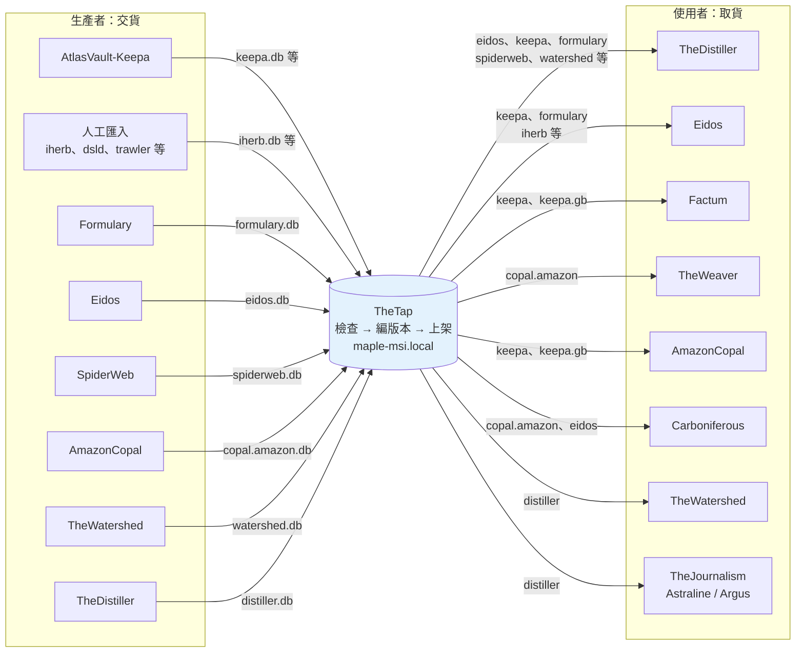
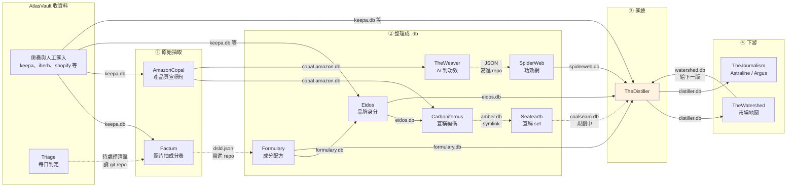
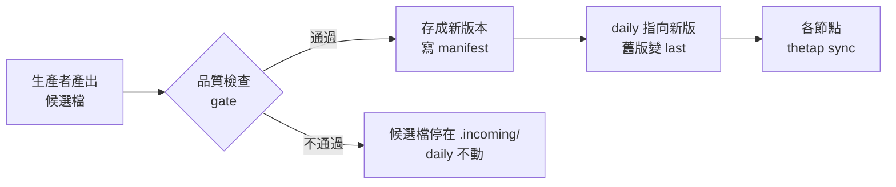

# TheTap - 資料交接中心（.db 發佈與分發）

---

## 📋 文檔目的

本文檔介紹 **TheTap**，幫助新人理解：

- AlchemyMind 各系統之間的資料是**怎麼交接**的
- 一份 `.db` 從生產者手上，到下游讀得到，中間經過哪些關卡
- 想拿最新資料時，該去哪裡拿
- 目前有哪些交接**不經過** TheTap

> **給你的閱讀建議**：先看「🗺️ 交接全景圖」，這張圖是 Distiller 上游各篇教材的共同地圖。各系統本身做什麼，請點進各自的教材。

> **完整技術文檔**：[TheTap repo](https://github.com/mapleelpam/LuminNexus-AlchemyMind-TheTap) 的 `README.md`（發佈端）、`README.client.md`（消費端）、`pipeline.yaml`

---

## 🎯 系統職責

**TheTap**（水龍頭）負責**把關、發佈、分發** AlchemyMind 各系統之間交換的 `.db` 檔。它自己不產出任何領域資料，只負責交接。

先認識幾個詞：**artifact** 是 TheTap 上架的一份 `.db`（例如 `keepa`）；**gate** 是上架前的品質檢查；每個 artifact 保留兩版，**daily** 是目前使用的版本，**last** 是上一版，出問題時可以換回去。

| 項目 | 說明 |
|------|------|
| **職責** | 收下生產者的候選檔 → 品質檢查 → 編版本號發佈 → 讓各節點同步 |
| **輸入** | 各生產者 repo 產出的 `.db`（或由人工匯入的外部 `.db`） |
| **輸出** | 原樣發佈的 `.db`，加上一份記錄來源與檢查結果的 `manifest.json` |
| **發佈位置** | maple-msi 上的 `/opt/tap/`，以唯讀 HTTP 服務於 **http://maple-msi.local/** |
| **頻率** | 每晚 00:30 自動重建（`thetap run`），只重建上游有變動的項目 |
| **現況** | 2026-10-19 線上有 20 個 artifact；`pipeline.yaml` 宣告 21 個（`keepa.de` 尚未發佈） |

### 白話比喻

把 TheDistiller 想成每晚開工的中央廚房，TheTap 就是它的**倉庫**：

- 各站把食材（`.db`）送進倉庫，倉庫**先驗貨**，不合格就退回，架上維持上一批好貨。
- 每批貨都貼上日期標籤（版本號），並保留上一批，出問題可以立刻換回。
- 廚房（以及其他下游）**只從倉庫拿貨**。沒送進倉庫的東西，正式開工時就拿不到。

---

## 🗺️ 交接全景圖

以 TheTap 為中心：左邊是**交貨**的生產者，右邊是**取貨**的使用者。所有經過 TheTap 的交接，都是「生產者 → TheTap → 使用者」這個形狀。

讀圖重點：

1. **TheTap 只轉手，不加工**。上架的 `.db` 就是生產者交出的那一份，TheTap 只負責檢查、編版本號、讓大家下載。怎麼產出這份資料，寫在生產者自己的 repo 裡。
2. **有些 repo 兩邊都出現**：Eidos、TheDistiller、TheWatershed 既交貨也取貨。TheTap 是大家共用的倉庫，不是一條單向的輸送帶。
3. **沒進 TheTap，就拿不到**。使用者正式建置時只從 TheTap 取貨，生產者本機有、但沒交給 TheTap 的檔案，對下游來說等於不存在。
4. 圖上只畫 TheDistiller 上游這一圈。TheTap 另外也發佈 `triage`、`goviral`、`amazon.reviews` 等，完整清單見「📦 現在交接哪些 .db」。

### 各 repo 之間的關係

AlchemyMind 全層的介紹見 [AlchemyMind 總覽](00_overview.md)。

上圖回答「誰交貨、誰取貨」；這張圖回答「誰的產出給了誰」，從左到右是資料被加工的順序。

- **實線**：經過 TheTap 交接，為了好讀省略中間的 TheTap。
- **虛線**：不經過 TheTap，有四種：寫進對方的 repo、直接讀對方的 git repo、用 symlink 讀對方的檔案，以及規劃中的交接。說明見下方「⚠️ 不經過 TheTap 的交接」。

讀圖重點：

1. **有兩站不自己發 `.db`**：Factum 把結果寫進 Formulary 的 repo，由 Formulary 發 `formulary.db`；TheWeaver 把結果寫進 SpiderWeb 的 repo，由 SpiderWeb 發 `spiderweb.db`。
2. **AmazonCopal 一份產出餵兩條線**：一條給 TheWeaver 判功效，經 SpiderWeb 進 Distiller；另一條給 Carboniferous → Seatearth 整理成宣稱 set。
3. **TheWatershed 和 Distiller 互為上下游**：TheWatershed 讀上一版 `distiller.db` 畫地圖，地圖再交給下一版 Distiller。詳見 [TheWatershed](thewatershed.md)。

---

## 🔄 一份 .db 怎麼被交接

| 步驟 | 白話 |
|------|------|
| **交出** | 生產者執行 `thetap publish <db> <file>`，或由每晚的 `thetap run` 自動重建 |
| **驗貨** | 先做快照，再跑 `pipeline.yaml` 宣告的檢查：資料庫完整性、必要的表在不在、筆數不得低於下限、不得比上一版掉太多 |
| **上架** | 通過才存成新版本，版本名是日期 `YYYYMMDD`，同一天再發就加 `-2`、`-3`，名稱永不重複 |
| **換版** | `daily` 指向新版，原本的版本變成 `last`（回退目標）；每個 artifact 只留這兩版 |
| **退貨** | 檢查沒過，`daily` 不動，下游繼續讀上一個好版本；壞檔留在 `.incoming/<db>.failed.db` 供檢查 |
| **領貨** | 各節點用 `thetap sync` 下載，換版後下游自動讀到新版 |

**為什麼要有檢查**：筆數驟降、整個市場消失這類問題，表面上 build 都是「成功」的。例如 Distiller 會按來源分組檢查筆數，因為曾經有英國站資料整批缺席，總筆數卻看起來正常。

---

## 📦 現在交接哪些 .db

2026-10-19 線上版本（以 http://maple-msi.local/index.json 為準）：

| artifact | 生產者 | 線上版本 | 主要下游 |
|----------|--------|---------|---------|
| `formulary` | [Formulary](formulary.md) | 20261018 | Distiller、Eidos |
| `eidos` | [Eidos](eidos.md) | 20261019 | Distiller、Carboniferous、GoViral |
| `spiderweb` | [SpiderWeb](spiderweb.md) | 20261019 | Distiller |
| `copal.amazon` | [AmazonCopal](amazoncopal.md) | 20261019 | TheWeaver、Carboniferous |
| `copal.amazon.gb` | [AmazonCopal](amazoncopal.md) | 20261018 | TheWeaver |
| `watershed` | [TheWatershed](thewatershed.md) | 20261018 | Distiller（選用） |
| `distiller` | [TheDistiller](thedistiller.md) | 20261019 | TheWatershed、TheJournalism、Astraline、Argus |
| `keepa` / `.gb`、`keepa_trends` / `.gb` | AtlasVault-Keepa | 20261019 系列 | Distiller、Eidos、Factum、AmazonCopal |
| `triage` | AtlasVault-Triage | 20261019 | Brokkr |
| `goviral` | AtlasVault-GoViral | 20261017 | — |
| `amazon.reviews` | AtlasVault-AmazonReview | 20260930 | — |
| `iherb`、`trawler`、`rippletide`、`shopify`、`cartulary`、`dsld` | 他處產出，人工匯入 | 各異 | Distiller 等 |

> 版本號會每天變動，表中數字只是 2026-10-19 的快照。

### Distiller 從 TheTap 拿哪些輸入

依 `pipeline.yaml` 的 `distiller.inputs`：

- **必要**：eidos、keepa、keepa.gb、keepa_trends、keepa_trends.gb、formulary、iherb、trawler、cartulary、spiderweb、rippletide
- **選用**：shopify、watershed

各輸入在 Distiller 的哪個 stage 被讀，見 [TheDistiller](thedistiller.md)（該篇部分內容過時，以本篇為準）。

---

## ⚠️ 不經過 TheTap 的交接

上面「各 repo 之間的關係」圖裡的虛線，是不經 TheTap 的交接，分四種：

| 交接方式 | 例子 | 結果 |
|---------|------|-------------------|
| **寫進對方的 repo** | Factum → Formulary、TheWeaver → SpiderWeb | 拿得到：檔案在 git 裡，TheTap 建置時會拉下來 |
| **直接讀對方的 git repo** | Triage → Factum（待處理清單） | 讀得到：檔案在 git 裡 |
| **用 symlink（捷徑）讀對方的檔案** | Carboniferous → Seatearth（`amber.db`） | 捷徑指向作者本機的檔案，沒有進 TheTap |
| **規劃中** | Seatearth → TheDistiller（`coalseam.db`） | 規劃接上 TheDistiller，供 TheWatershed 建群組 |

symlink 本身是正常的讀檔方式，讀 TheTap 的檔案也是透過它；要看的是它指向的檔案有沒有進 git 或 TheTap。

另有 iHerb 的 `copal.iherb.db` 例外，見 [AmazonCopal](amazoncopal.md)。

---

## 🔍 想拿最新資料

最新的 `.db` 一律以 **http://maple-msi.local/** 為準，本機的 `/opt/tap/` 可能是舊的。只能從公司內網連，不需要帳號。

| 你想知道 | 去看 |
|---------|------|
| 有哪些 artifact、各自最新版本 | `http://maple-msi.local/index.json` |
| 某一版用了哪些上游、筆數多少、檢查結果 | `http://maple-msi.local/<db>/daily/manifest.json` |
| 下載檔案 | 在專案目錄設定 `.thetap.toml` 後執行 `thetap sync <db>` |

很多問題**看 manifest 就能回答**，不必下載動輒數 GB 的檔案（`distiller.db` 約 5 GB）。例如「這一版 Distiller 有沒有讀到 watershed」，看 manifest 的 `watershed_status` 即可。

---

## 📖 故事：TheTap 怎麼長成現在這樣

| 時間 | 事件 |
|------|------|
| 2026-06-23 | v2 提案：改在 maple-msi 自建版本化倉庫，採納 |
| 2026-08-14 | 上線：開放唯讀下載、每晚 `thetap run` 重建 |
| 2026-08-20 | 與 Portolan 議定 `pipeline.yaml` 的檢查與命名規則 |
| 2026-10-04 | spiderweb 改由 bot checkout 建置，不再讀開發者的工作目錄 |
| 2026-10-08 | 加入 `copal.amazon` 與 `copal.amazon.gb` |
| 2026-10-16 | 加入 `watershed` 並接上 distiller |

踩過的坑（都記在 `pipeline.yaml` 的註解裡）：

- **新增必要輸入沒通知 TheTap**：Distiller v3.66.0 把 `keepa_trends` 改成必要輸入，TheTap 不知道，10-15 的夜間建置直接失敗
- **上游有了，下游沒接**：keepa.gb 接進 eidos 時沒檢查 distiller，Distiller 每一版都少了英國站產品，所有檢查卻都是綠的
- **只改欄位結構的版本被跳過**：TheTap 判斷「內容相同」只看筆數，筆數沒變的新版會被當成重複而略過

---

## 🐛 常見問題

### Q1: 我可以直接把檔案複製到 /opt/tap/ 嗎？

不行。TheTap 節點（maple-msi）上的 `/opt/tap/` **只有 `thetap publish` 能寫**。手動複製會繞過檢查、留下過期的 manifest，也會破壞回退。GoViral 與 AmazonCopal 自帶的部署腳本，在 TheTap 節點上都不能執行。

### Q2: 某個 .db 版本有問題，怎麼辦？

發佈端用 `thetap rollback <db>` 把 `daily` 換回 `last`；只想讓自己的機器換回，用 `thetap rollback <db> --local`。

### Q3: 為什麼某個系統的資料在作者本機有，正式版卻沒有？

先查它有沒有登記在 TheTap 的 `pipeline.yaml`。沒登記的輸入，正式建置時根本不存在；如果它又是選用輸入，就會靜默留空。

### Q4: 各 repo 的 README 寫的 artifact 數量不一樣？

以 `index.json`（線上實況）和 `pipeline.yaml`（宣告）為準。各 README 的數字寫於不同時期，部分已過時。

### Q5: 舊文件寫到 S3，資料是放在雲端嗎？

不是。S3 是 2026 年初的構想，從沒上線。現行交接一律走 maple-msi 上的 `/opt/tap/`，以本篇為準。

---

## 📚 相關文檔

### Learning Map 文檔
- [TheDistiller](thedistiller.md)：TheTap 最主要的下游（該篇部分內容過時，以本篇為準）
- [TheWatershed](thewatershed.md)：與 Distiller 互為上下游的範例
- [Formulary](formulary.md)、[Eidos](eidos.md)、[SpiderWeb](spiderweb.md)、[AmazonCopal](amazoncopal.md)：經 TheTap 發佈的生產者
- [Seatearth](seatearth.md)：宣稱 set（不經 TheTap）

### TheTap 專案文檔
- `README.md`：發佈端
- `README.client.md`：消費端節點設定（多數人看這份）
- `README.origin.md`：建置新的發佈機
- `pipeline.yaml`：所有 artifact 的生產者、輸入、檢查規則（SSOT）
- `docs/20260623_thetap_v2_selfhosted_proposal.md`：v2 自建提案

---

## 📝 文檔維護

### 版本歷史

| 版本 | 日期 | 變更 |
|------|------|------|
| 1.0 | 2026-10-19 | 初版，依 TheTap repo 文件、`pipeline.yaml` 與 maple-msi.local 線上 manifest 撰寫 |
| 1.1 | 2026-10-20 | 關係圖與 00_overview.md 同步；宣稱線改依統一寫法；「不經過 TheTap 的交接」改為四種對照表；補名詞定義、白話化技術細節 |

### 系統依賴

**上游**：所有生產者（見「📦 現在交接哪些 .db」）

**下游**：所有以 `thetap sync` 或 `/opt/tap/*.db` 讀資料的系統，包括 TheDistiller、TheWatershed、TheWeaver、Carboniferous、Eidos、Factum、AmazonCopal、AtlasVault-Portolan、AtlasVault-AmazonReview

---

**文檔結束**

> **注意**：artifact 清單與版本號會持續變動，現況以 http://maple-msi.local/index.json 與 TheTap repo 的 `pipeline.yaml` 為準。
