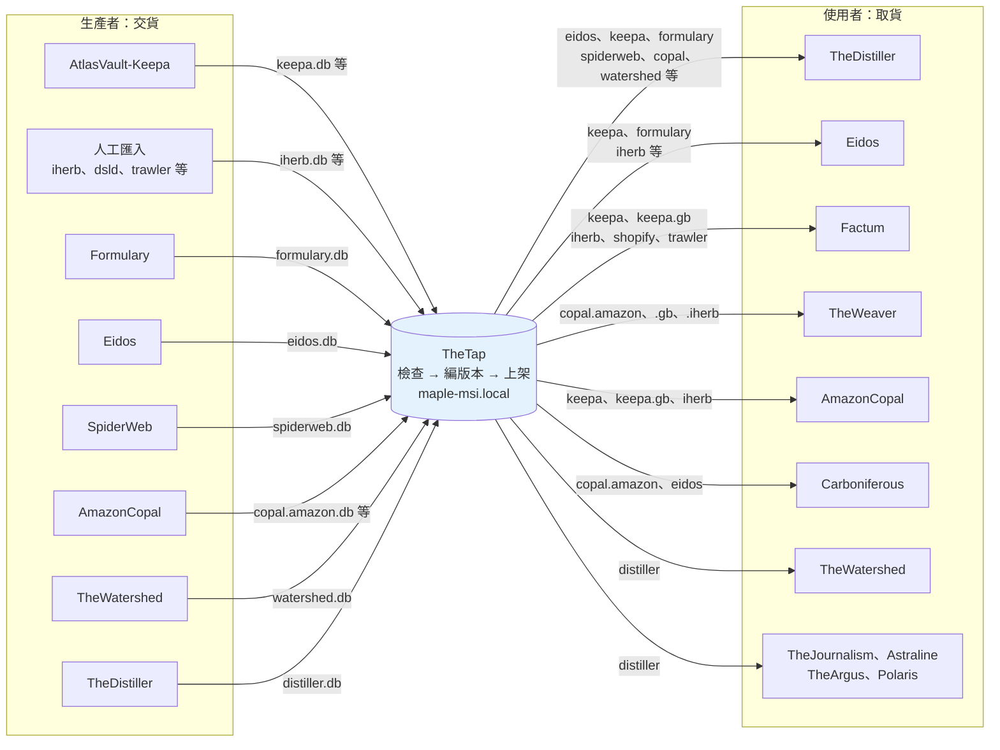
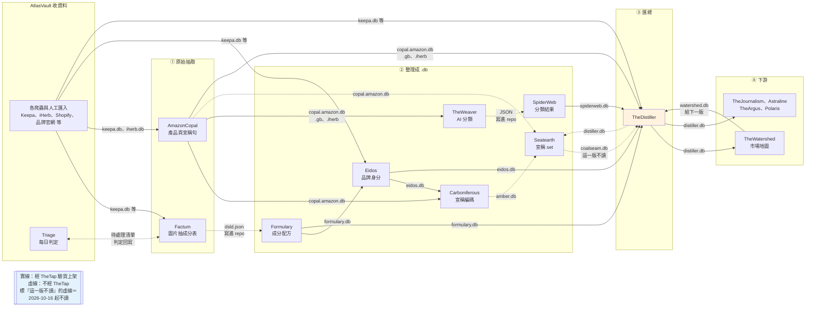
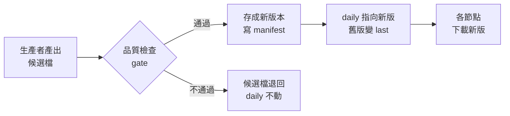

# TheTap - 資料交接中心（.db 發佈與分發）

---

## 📋 文檔目的

本文檔介紹 **TheTap**，幫助新人理解：

- AlchemyMind 各系統之間的資料是**怎麼交接**的
- 一份 `.db` 從生產者手上，到下游讀得到，中間經過哪些關卡
- 想拿最新資料時，該去哪裡拿
- 目前有哪些交接**不經過** TheTap

> **給你的閱讀建議**：先看「🗺️ 交接全景圖」，這張圖是 Distiller 上游各篇教材的共同地圖。各系統本身做什麼，請點進各自的教材。

> **完整技術文檔**：[TheTap repo](https://github.com/mapleelpam/LuminNexus-AlchemyMind-TheTap)

---

## 🎯 系統職責

**TheTap**（水龍頭）負責**把關、發佈、分發** AlchemyMind 各系統之間交換的 `.db` 檔。它自己不產出任何領域資料，只負責交接。

先認識幾個詞：**artifact** 是 TheTap 上架的一份 `.db`（例如 `keepa`）；**gate** 是上架前的品質檢查；每個 artifact 保留兩版，**daily** 是目前使用的版本，**last** 是上一版，出問題時可以換回去。

| 項目 | 說明 |
|------|------|
| **職責** | 收下生產者的候選檔 → 品質檢查 → 編版本號發佈 → 讓各節點同步 |
| **輸入** | 各生產者 repo 產出的 `.db`（或由人工匯入的外部 `.db`） |
| **輸出** | 原樣發佈的 `.db`，加上一份記錄來源與檢查結果的說明檔（manifest） |
| **發佈位置** | maple-msi 這台機器，網址 **http://maple-msi.local/**（唯讀） |
| **頻率** | 每晚 00:30 自動重建，只重建上游有變動的項目 |
| **現況** | 2026-10-21 線上有 22 個 artifact |

### 白話比喻

把 TheDistiller 想成每晚開工的中央廚房，TheTap 就是它的**倉庫**：

- 各站把食材（`.db`）送進倉庫，倉庫**先驗貨**，不合格就退回，架上維持上一批好貨。
- 每批貨都貼上日期標籤（版本號），並保留上一批，出問題可以立刻換回。
- 廚房（以及其他下游）**只從倉庫拿貨**。沒送進倉庫的東西，正式開工時就拿不到。

---

## 🗺️ 交接全景圖

以 TheTap 為中心：左邊是**交貨**的生產者，右邊是**取貨**的使用者。所有經過 TheTap 的交接，都是「生產者 → TheTap → 使用者」這個形狀。

讀圖重點：

1. **TheTap 只轉手，不加工**。上架的 `.db` 就是生產者交出的那一份，TheTap 只負責檢查、編版本號、讓大家下載。怎麼產出這份資料，寫在生產者自己的 repo 裡。
2. **有些 repo 兩邊都出現**：Eidos、AmazonCopal、TheDistiller、TheWatershed 既交貨也取貨。TheTap 是大家共用的倉庫，不是一條單向的輸送帶。
3. **沒進 TheTap，就拿不到**。使用者正式建置時只從 TheTap 取貨，生產者本機有、但沒交給 TheTap 的檔案，對下游來說等於不存在。
4. 圖上只畫 TheDistiller 上游這一圈。TheTap 另外也發佈 `triage`、`goviral`、`amazon.reviews` 等，完整清單見「📦 現在交接哪些 .db」。
5. AmazonCopal 另從 TheTap 讀 formulary、eidos、spiderweb、distiller 當挑選參考（圖略）。

### 各 repo 之間的關係

AlchemyMind 全層的介紹見 [AlchemyMind 總覽](00_overview.md)。

上圖回答「誰交貨、誰取貨」；這張圖回答「誰的產出給了誰」，從左到右是資料被加工的順序。

- **實線**：經過 TheTap 驗貨上架，為了好讀省略中間的 TheTap。
- **虛線**：不經過 TheTap，說明見下方「⚠️ 不經過 TheTap 的交接」。

讀圖重點：

1. **有兩站不自己發 `.db`**：Factum 把結果寫進 Formulary 的 repo，由 Formulary 發 `formulary.db`；TheWeaver 把結果寫進 SpiderWeb 的 repo，由 SpiderWeb 發 `spiderweb.db`。
2. **AmazonCopal 的產出分給三條線**：AmazonCopal 從產品頁逐字抄下宣稱句，再整理成標準宣稱（統一寫法的一條條宣稱）。
   - **功效分類線**：TheWeaver → SpiderWeb 這條線，產出十個知識領域的 AI 分類（例如健康效果、風味特徵、使用便利性），再進 Distiller。其中健康效果、效能提升、生活品質（HE／PE／QoL）這三個領域的結果叫**功效分類**，TheWatershed 用它切訴求群。
   - **宣稱 set 線**：Carboniferous 讀標準宣稱，Seatearth 再對照人工事先定義的訴求（宣稱 set，例如記憶、專注），判斷每個產品命中哪幾個 set。
   - **直接給 Distiller**：TheDistiller 也直接讀，找出產品自己標示矛盾的宣稱。
3. **db 之間的回圈只有 TheWatershed ⇄ TheDistiller**：TheWatershed 讀上一版 `distiller.db` 畫市場地圖，地圖再交給下一版 Distiller。詳見 [TheWatershed](thewatershed.md)。另外有幾條雙向線是工作清單或挑選參考，例如 Factum ⇄ Triage。

---

## 🔄 一份 .db 怎麼被交接

| 步驟 | 白話 |
|------|------|
| **交出** | 生產者交出新檔，或由 TheTap 每晚自動重建 |
| **驗貨** | 跑事先宣告的檢查：資料庫完整性、必要的表在不在、筆數不得低於下限、不得比上一版掉太多 |
| **上架** | 通過才存成新版本，版本名是日期，同一天再發就加 `-2`、`-3`，名稱永不重複 |
| **換版** | daily 指向新版，原本的版本變成 last（回退目標）；每個 artifact 只留這兩版 |
| **退貨** | 檢查沒過，daily 不動，下游繼續讀上一個好版本；壞檔留著供檢查 |
| **領貨** | 各節點下載新版，換版後下游自動讀到新版 |

**為什麼要有檢查**：筆數驟降、整個市場消失這類問題，表面上 build 都是「成功」的。例如 Distiller 會按來源分組檢查筆數，因為曾經有 Amazon 英國站的資料整批缺席，總筆數卻看起來正常。

---

## 📦 現在交接哪些 .db

2026-10-21 線上共 22 個（以 http://maple-msi.local/index.json 為準）：

| artifact | 生產者 | 主要下游 |
|----------|--------|---------|
| `formulary` | [Formulary](formulary.md) | TheDistiller、Eidos、AmazonCopal（挑選參考） |
| `eidos` | [Eidos](eidos.md) | TheDistiller、Carboniferous、GoViral、AmazonCopal（挑選參考） |
| `spiderweb` | [SpiderWeb](spiderweb.md) | TheDistiller、AmazonCopal（挑選參考） |
| `copal.amazon` | [AmazonCopal](amazoncopal.md) | TheWeaver、Carboniferous、TheDistiller |
| `copal.amazon.gb`、`copal.iherb` | [AmazonCopal](amazoncopal.md) | TheWeaver、TheDistiller |
| `watershed` | [TheWatershed](thewatershed.md) | TheDistiller |
| `distiller` | [TheDistiller](thedistiller.md) | TheWatershed、TheJournalism、Astraline、TheArgus、Polaris、AmazonCopal（挑選參考） |
| `keepa` / `.gb`、`keepa_trends` / `.gb` | AtlasVault-Keepa | TheDistiller、Eidos、Factum、AmazonCopal |
| `keepa.de`（Amazon 德國站） | AtlasVault-Keepa | — |
| `triage` | AtlasVault-Triage | Brokkr（抓 Amazon 產品頁的系統。`triage` 已併入 `keepa.db` 的資料，Brokkr 每天用它挑要抓的新產品；抓下的頁面整理成 `amazon.pdp.db`，目前不在 TheTap） |
| `goviral` | AtlasVault-GoViral（蒐集 Instagram、LinkedIn 上保健品社群內容的系統） | — |
| `amazon.reviews` | AtlasVault-AmazonReview | — |
| `iherb`、`trawler`、`rippletide`、`shopify` | AtlasVault 各爬蟲產出，人工匯入 | TheDistiller、Eidos、Factum、AmazonCopal（iherb）等 |
| `cartulary` | CartularyDSLD 整理的 DSLD 資料，人工匯入 | TheDistiller（目前只用來比對商品條碼） |
| `dsld` | 另一份 DSLD 匯出，人工匯入 | Eidos |

> DSLD 是美國 NIH 的保健品標籤資料庫。`cartulary` 和 `dsld` 都來自它，但結構不同。TheDistiller 只讀 `cartulary`，而且目前只拿它比對商品條碼（UPC）；DSLD 的產品暫停匯入，不會出現在 `distiller.db` 裡。
>
> 「挑選參考」指 AmazonCopal 決定要先處理哪些產品時，會參考下游已有的資料，不是建置輸入。
>
> 各 artifact 目前的版本，看 http://maple-msi.local/index.json 。

### Distiller 從 TheTap 拿哪些輸入

- **必要**：eidos、keepa、keepa.gb、keepa_trends、keepa_trends.gb、formulary、iherb、trawler、shopify（2026-06 起停更，只當後備）、cartulary、spiderweb、rippletide
- **選用**：watershed、copal.amazon、copal.amazon.gb、copal.iherb

各輸入在 Distiller 裡的用途，見 [TheDistiller](thedistiller.md)。

---

## ⚠️ 不經過 TheTap 的交接

上面「各 repo 之間的關係」圖裡的虛線，是不經 TheTap 的交接，分三種：

| 交接方式 | 例子 | 結果 |
|---------|------|-------------------|
| **寫進對方的 repo** | Factum → Formulary、TheWeaver → SpiderWeb | 拿得到：檔案在 git 裡，TheTap 建置時會拉下來 |
| **直接讀對方的 git repo** | Triage → Factum（待處理清單） | 讀得到：檔案在 git 裡 |
| **直接讀對方產出的檔案** | Carboniferous → Seatearth（`amber.db`）、AmazonCopal → Seatearth（`copal.amazon.db`）、TheDistiller → Seatearth（`distiller.db`） | 讀同一台電腦上對方 repo 自己建出的那份。`copal.amazon.db`、`distiller.db` 雖然 TheTap 上也有，Seatearth 讀的不是上架版 |

---

## 🔍 想拿最新資料

最新的 `.db` 一律以倉庫 **http://maple-msi.local/** 為準，自己電腦上的副本可能是舊的。只能從公司內網連，不需要帳號。

| 你想知道 | 去看 |
|---------|------|
| 有哪些 artifact、各自最新版本 | `http://maple-msi.local/index.json` |
| 某一版用了哪些上游、筆數多少、檢查結果 | `http://maple-msi.local/<db>/daily/manifest.json` |
| 下載檔案 | 用 TheTap 的同步工具（設定見 TheTap repo 的消費端說明） |

很多問題**看 manifest 就能回答**，不必下載動輒數 GB 的檔案（`distiller.db` 約 5 GB）。例如「這一版 Distiller 有沒有讀到 watershed」，看 manifest 就知道。

---

## 📖 故事：TheTap 怎麼長成現在這樣

| 時間 | 事件 |
|------|------|
| 2026-06-23 | v2 提案：改在 maple-msi 自建版本化倉庫，採納 |
| 2026-08-14 | 上線：開放唯讀下載、每晚自動重建 |
| 2026-08-20 | 與 AtlasVault-Portolan（AtlasVault 的 Amazon 賣家探索系統）議定 artifact 的命名規則 |
| 2026-10-04 | spiderweb 改由 TheTap 從 git 建置，不再讀開發者的工作目錄 |
| 2026-10-08 | 加入 `copal.amazon` 與 `copal.amazon.gb` |
| 2026-10-16 | 加入 `watershed` 並接上 distiller |
| 2026-10-20 | 加入 `copal.iherb` |

踩過的坑：

- **新增必要輸入沒通知 TheTap**：Distiller 把 `keepa_trends` 改成必要輸入，TheTap 不知道，10-15 的夜間建置直接失敗
- **上游有了，下游沒接**：`keepa.gb.db` 接進 Eidos 時沒檢查 Distiller，Distiller 每一版都少了英國站產品，所有檢查卻都是綠的
- **只改欄位結構的版本被跳過**：TheTap 判斷「內容相同」是比對檢查結果（主要是筆數），只改欄位結構、筆數沒變的新版會被當成重複而略過。這仍是現行做法，部分 artifact 已另外記下結構版本號來避開

---

## 🐛 常見問題

### Q1: 我可以直接把檔案放進 TheTap 的倉庫嗎？

不行。maple-msi 上的倉庫**只有 TheTap 自己的發佈程序能寫**。手動複製會繞過檢查、留下過期的 manifest，也會破壞回退。

### Q2: 某個 .db 版本有問題，怎麼辦？

TheTap 可以把 daily 換回 last；也可以只讓自己的機器換回。指令見 repo 的 README。

### Q3: 為什麼某個系統的資料在作者本機有，正式版卻沒有？

先查它有沒有在 TheTap 登記。沒登記的輸入，正式建置時根本不存在；如果它又是選用輸入，就會靜默留空。

---

## 📚 相關文檔

### Learning Map 文檔
- [TheDistiller](thedistiller.md)：TheTap 最主要的下游
- [TheWatershed](thewatershed.md)：與 Distiller 互為上下游的範例
- [Formulary](formulary.md)、[Eidos](eidos.md)、[SpiderWeb](spiderweb.md)、[AmazonCopal](amazoncopal.md)：經 TheTap 發佈的生產者
- [Seatearth](seatearth.md)：宣稱 set（不經 TheTap）

### TheTap 專案文檔
- [TheTap repo](https://github.com/mapleelpam/LuminNexus-AlchemyMind-TheTap)：發佈端說明、消費端節點設定（多數人看這份）、所有 artifact 的登記與檢查規則、v2 自建提案

---

## 📝 文檔維護

### 版本歷史

| 版本 | 日期 | 變更 |
|------|------|------|
| 1.0 | 2026-10-20 | 初版，依 TheTap repo 文件、`pipeline.yaml` 與 maple-msi.local 線上 manifest 撰寫 |
| 1.1 | 2026-10-21 | 依 leana review 修正：拿掉 TheDistiller 過時提醒、刪減指令與路徑、刪「文件過時」類問答、第一張圖補英國站給 TheWeaver、下游名單與表格對齊、更新線上 artifact 數；全景圖與 00_overview.md 同步（補 AmazonCopal → TheDistiller、Seatearth 另讀兩份、Triage 雙向）；copal.iherb 改列經 TheTap；Shopify 改為必要輸入；名詞依統一對照；補 Brokkr、GoViral、Portolan、DSLD（cartulary／dsld）的白話說明 |

### 系統依賴

**上游**：所有生產者（見「📦 現在交接哪些 .db」）

**下游**：所有從 TheTap 取貨的系統，包括 TheDistiller、Eidos、Factum、AmazonCopal、TheWeaver、Carboniferous、TheWatershed、TheJournalism、Astraline、TheArgus、Polaris、GoViral、Brokkr

---

**文檔結束**

> **注意**：artifact 清單與版本號會持續變動，現況以 http://maple-msi.local/index.json 為準。
