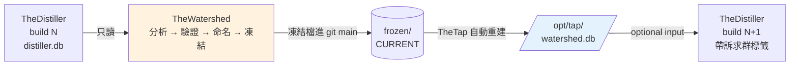

# TheWatershed - 市場地圖（訴求群分割）

---

## 📋 文檔目的

本文檔介紹 **TheWatershed**，幫助新人理解：

- 它在資料管線裡的位置：同時是 TheDistiller 的**下游與上游**
- 它交出去的東西（`watershed.db`）和交接方式（契約）
- 市場的邊界是怎麼「長」出來、怎麼驗證的
- 2026-10-15～10-18 這個 repo 從誕生到第一份正式地圖的故事，以及從中學到的工作方式

> **給你的閱讀建議**：先看「🎯 系統職責」與「🔄 在管線裡的位置」建立直覺；「📖 故事」可以當成一個 repo 怎麼長大的案例來讀。

> **完整技術文檔**：[TheWatershed repo](https://github.com/mapleelpam/LuminNexus-AlchemyMind-TheWatershed) 的 `README.md`、`CLAUDE.md`

---

## 🎯 系統職責

**TheWatershed** 是「市場要怎麼切」的單一真實來源（SSOT）。它把補充品的資料宇宙切成一群一群的**訴求群（BenefitCluster）**，例如「睡眠」「關節」「腸道」，並把這張地圖交給下游。

| 項目 | 說明 |
|------|------|
| **職責** | 決定訴求群的邊界、命名、凍結版本 |
| **輸入** | `distiller.db`（只讀）：spiderweb 的 HE / PE / QoL 分類節點、SupplementFact 成分 |
| **輸出** | `watershed.db`：`BenefitClusters` + `BenefitClusterTaxonomyNodes`（只有地圖，沒有產品歸屬） |
| **下游** | TheDistiller（選用輸入，v3.69.0 起）；TheTap 從 git main 自動重建 |
| **現況** | 凍結版 `2026-10-17.01`，契約 1.1.0；已發佈的 distiller v3.70.0 帶 `watershed_map_version = 2026-10-17.01` |

### 命名由來

名字取自**分水嶺**：雨落在山脊的哪一側，就流進哪條河。分割線不是畫出來的，是從地形長出來的。TheWatershed **只畫邊界，不裝水**：它只決定群怎麼切，不決定哪個產品屬於哪一群。

### 三種角色分工

```
功效分類（spiderweb HE/PE/QoL 節點，產品被判定屬於什麼）→ 提出群的邊界
成分（SupplementFact，罐子裡實際有什麼）                 → 驗證每條邊界
人                                                       → 命名、選粒度、批准凍結
```

---

## 🔄 在管線裡的位置



TheWatershed 讀上一版的 `distiller.db`，產出的地圖再被下一版 distiller 讀回去，所以它同時是 distiller 的下游與上游。這個迴圈不會失控，因為契約規定：

- **只出地圖，不出歸屬**：產品屬於哪一群，由 distiller 用當期分類自己算（物化）。
- **下游不得回饋上游**：distiller 不能把訴求群標籤寫回 TheWatershed 的輸入。
- **市場定義是約定，不是即時觀察**：地圖凍結後就固定，每次重跑只當作「脫節儀表板」看。

---

## 🧭 方法：邊界怎麼長出來

以下用白話說明，精確定義見 repo 的方法論文件 §8。

1. **共現提出邊界**：兩個分類節點如果常常出現在同一批產品上，就比較可能屬於同一群。關聯強度用 normalised PMI（比隨機高多少倍），不用共現次數，否則大群會吃掉小群。再用 average linkage 把節點聚成群。
2. **每個產品總權重 1**：綜合維他命這類一罐涵蓋十幾個訴求的產品，權重要攤平，不然所有群的成分輪廓會被洗成一樣。
3. **成分驗證邊界**：每一群看它的「招牌原料」（lift 加權，相對於整體特別常出現的原料），不看「最常見原料」。最常見的永遠是維 C、維 D、鋅。
4. **粒度交給人選**：程式輸出「群內混了兩個市場」與「一個市場被切成兩半」兩條曲線，由人決定切多細。目前一版地圖有三層（粒度不同，層與層之間**不是樹**）。
5. **人命名、凍結**：`names.yaml` 把每群的指紋對應到中英文名。這是 repo 裡唯一算不出來的東西，腳本只讀不寫。

---

## 📤 交接方式：watershed.db 與契約

契約文件：`docs/20261015_benefit_cluster_export_contract.md`（SSOT）。新人只需要記得這幾條：

| 規則 | 白話 |
|------|------|
| 只出地圖 | 交出去的是「群 ↔ 節點」，不是「群 ↔ 產品」 |
| 層只代表粒度 | 同一層內節點不重疊；不同層之間不保證包含關係 |
| `cluster_key` 全域唯一 | 群退役後 key 不重用 |
| `fingerprint` 釘在節點集合上 | 群的身分看「包含哪些節點」，不看排第幾 |
| 凍結檔一進 main 就不可變 | 錯了就凍一個新版本，不覆寫 |
| `is_catch_all`（1.1.0） | 「泛用標籤群」用結構欄位標記；名字字串不是訊號，兩端 DDL 都刻意不設 DEFAULT |
| distiller 三種狀態 | `loaded` / `absent`（WARN）/ `incompatible`（相關表留空、build 照過）；宣稱相容卻壞了 → build 失敗 |

---

## 📖 故事：2026-10-15 ～ 10-18

### 1. 為什麼拆出來

市場分割的邏輯原本埋在 [TheJournalism](../prismavision/thejournalism.md)（報導 repo）裡。當 distiller、TheTap、Astraline 都要讀同一張地圖，它就需要自己的 SSOT 和對外契約。**10-15 從 TheJournalism 拆出**，拆出時唯一的程式改動是把 journalism 的 DB 包裝換成直讀 sqlite3。

### 2. 方法換軌

原本的設計是用 claim sets（coalseam / amber 的訴求句集合）做共現分群。Maple 決定**改用 spiderweb 的 HE / PE / QoL 分類節點**。換軌時遵守 repo 的鐵律：**方法論文件先改，程式後改**。

### 3. 驗證要獨立

做到一半發現：TheWeaver 的分類 prompt 有些版本**看過 supplement facts**。如果再用成分去驗證這些分類，就是循環論證：分類本來就參考過成分，驗證當然會過。

解法：只在「分類時從沒看過成分表」的**獨立子集**上驗證（約 10 萬 / 14.5 萬 canonical 產品）。

### 4. 跨 agent 協商契約

TheWatershed 的 agent 和 TheDistiller 的 agent 就五個主題來回收斂，產出契約文件：多層地圖的語意、識別子（`cluster_key`、`fingerprint`）、凍結檔的不可變性、distiller 讀到不相容版本時的三種狀態，以及「下游不得回饋上游」。

### 5. 驗證者的三回合

Astraline 在 [TheWatershed#1](https://github.com/mapleelpam/LuminNexus-AlchemyMind-TheWatershed/issues/1) 用產品層面的抽查，逼出了三個版本：

| 版本 | 被抓到的問題 | 對策 |
|------|-------------|------|
| `.01` | 有些群是硬湊的 | **逐節點擬合**：只因某個節點才入群的產品，如果成分和群零交集且佔 10% 以上，就把該節點拆出去 |
| `.02` | 「Overall Wellness Support」一群吸進 929 個產品 | **泛用節點規則**：招牌原料最高 lift < 2.5 表示沒有原料身分，判為泛用，每層自成一群 |
| `.03` | 剩六個高流行度、但標籤比較鬆的真市場節點 | 收為**已知限制**，寫進方法論 §8.6 |

最後把「泛用」做成契約 1.1.0 的結構欄位 `is_catch_all`，不再靠群名判斷。

目前 `CURRENT = 2026-10-17.01`：三層的目標粒度 23 / 30 / 41，加上拆出的群後實際是 36 / 48 / 54 群，每層有 5 個泛用群；另有 14 / 21 / 18 個節點因逐節點擬合被拆成單節點群。

### 6. 工作方式的教訓

- **改方法先改文件**，再改程式。
- **可逆的參數**（門檻、grid）由 agent 自己決定並標「暫定」；Maple 只管框架對不對。
- **每一輪都 commit；push 要 Maple 說**。
- **人的判斷不給機器寫**：`names.yaml` 腳本只讀不寫。
- **凍結檔不可覆寫**，錯了就凍新版。

踩過的坑：

- YAML 把全數字的 fingerprint 讀成整數
- 日期跨日後，腳本讀到前一天的分析檔
- shell 命令沒有用 `&&` 串接，驗證失敗了卻照常 commit

---

## 🐛 常見問題

### Q1: TheWatershed 會決定每個產品屬於哪個市場嗎？

不會。它只交出「群包含哪些分類節點」，產品歸屬由 TheDistiller 用當期分類自己算。這樣分類更新時不必重凍地圖。

### Q2: 為什麼不直接用最常見的成分來定義市場？

最常見的成分（維 C、維 D、鋅）幾乎出現在每一群，沒有區分力。要看的是「這群特別多、別群比較少」的招牌原料。

### Q3: 讀不到 watershed.db，distiller 會壞嗎？

不會。它是選用輸入：缺席時記 `absent` 並 WARN，訴求群相關表留空，build 照常完成。

---

## 📚 相關文檔

### Learning Map 文檔
- [TheDistiller](thedistiller.md)：讀取 watershed.db 的下游
- [TheWeaver](theweaver.md)：產生 HE / PE / QoL 分類的上游
- [TheJournalism](../prismavision/thejournalism.md)：TheWatershed 拆出前的原生 repo
- [分類體系術語](../../general/classification-terminology.md)：taxonomy、facet 等先備概念

### TheWatershed 專案文檔
- `README.md`：怎麼跑、輸出檔說明
- `CLAUDE.md`：工作規則
- `docs/20260820_market_config_benefit_claim_sets.md`：方法論（§8 是節點版）
- `docs/20261015_benefit_cluster_export_contract.md`：交換契約
- `.claude/skills/rebuild-market-map/SKILL.md`：六步重建流程

---

## 📝 文檔維護

### 版本歷史

| 版本 | 日期 | 變更 |
|------|------|------|
| 1.0 | 2026-10-18 | 初版，依 TheWatershed agent 提供的故事與 repo 文件撰寫 |

### 系統依賴

**上游依賴**：
- TheDistiller：`distiller.db`（HE / PE / QoL 節點、SupplementFact）
- TheWeaver / SpiderWeb：分類節點的來源

**下游依賴**：
- TheDistiller：以選用輸入讀取 `watershed.db`（v3.69.0 起）
- TheTap：從 git main 自動重建 `watershed.db`

---

**文檔結束**

> **注意**：地圖版本與群數會隨重凍改變，現況以 repo 的 `data/market_map/frozen/CURRENT` 為準。
