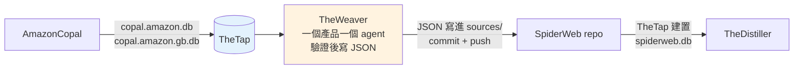
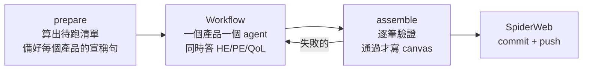

# TheWeaver - AI 判功效（產品分類生成器）

---

## 📋 文檔目的

本文檔介紹 **TheWeaver**，幫助新人理解：

- 它判斷什麼：每個產品的功效、屬性分類（10 個知識領域）
- 資料從哪來（AmazonCopal 的 copal db）、結果放哪（SpiderWeb repo）、最後交給誰（TheDistiller）
- 分類樹（taxonomy）為什麼是「題目」而不是「答案」

> **給你的閱讀建議**：先看「🎯 系統職責」與「🔄 在管線裡的位置」；想知道 AI 被怎麼約束，看「🌳 分類樹是約束，不是產物」。

> **完整技術文檔**：[TheWeaver repo](https://github.com/mapleelpam/LuminNexus-AlchemyMind-TheWeaver) 的 `CLAUDE.md` 與 `.claude/skills/weaver-realms-workflow/SKILL.md`（README 大半已過時，見 Q3）

---

## 🎯 系統職責

**TheWeaver** 讓 AI 讀產品的文字資料，回答「這個產品宣稱對什麼有幫助」「它有哪些認證、適合哪種飲食」這類問題，並把答案對到一棵事先定好的分類樹上。

| 項目 | 說明 |
|------|------|
| **職責** | 用 AI 替產品做功效與屬性分類，驗證後寫成 JSON |
| **輸入** | 現行 realms 線：TheTap 的 `copal.amazon.db`（美國站）、`copal.amazon.gb.db`（英國站）裡的宣稱句；iHerb 讀 `copal.iherb.db`，不經 TheTap（見「📥 輸入」） |
| **輸出** | `{analyzer}/{source}/{id}.json`，寫進 SpiderWeb repo 的 `sources/`；**TheWeaver 本身不產出 .db** |
| **下游** | SpiderWeb（收 JSON、建 `spiderweb.db`）→ TheDistiller；HE/PE/QoL 節點也是 TheWatershed 分群的依據 |
| **現況** | 2026-10-18：iHerb 的 copal 母體 4,764 個產品全部換成新線，待跑清單歸零 |

### 命名由來

**Weaver** 是織工。它把零散的產品文字織成一張分類網，那張網就放在 [SpiderWeb](spiderweb.md)（蜘蛛網）裡。

### 10 個知識領域（Knowledge Realms）

一個 realm 就是 AI 回答的一個問題面向，各有一棵分類樹：

| Realm | 中文 | 問的是 |
|-------|------|--------|
| **Health Effect (HE)** | 健康效果 | 對身體系統功能的改善宣稱 |
| **Performance Enhancement (PE)** | 效能提升 | 可測量的運動或認知表現 |
| **Quality of Life (QoL)** | 生活品質 | 日常體驗與幸福感（睡眠、情緒等） |
| Certification | 認證標章 | 第三方認證 |
| Dietary Adaptability | 飲食適性 | 素食、無麩質等 |
| Ingredient Purity | 成分純度 | 純度指標 |
| Formulation Technology | 配方技術 | 劑型與傳送技術 |
| Usage Context | 使用情境 | 什麼時機、場景用 |
| Usage Convenience | 使用便利性 | 服用方便程度 |
| Flavor Characteristics | 風味特徵 | 口味 |

另有兩個不掛分類樹的 analyzer（分析器）：**edible**（可不可以吃，是非題）、**dosage_form**（劑型，用平面清單而不是樹）。

---

## 🔄 在管線裡的位置

- **TheWeaver 不自己發 `.db`**：它的工作目錄裡有個 `canvas/` symlink（捷徑），指到 SpiderWeb repo 的 `sources/`。寫進 canvas 就是寫進 SpiderWeb。
- **要 commit 並 push 到 SpiderWeb 的 main 才算交出去**：TheTap 每晚從 SpiderWeb 的 main 建 `spiderweb.db`，留在自己電腦上的 JSON 不會進正式版。
- 同一個 copal db 也流向 Carboniferous，那是另一條線，見 [AmazonCopal](amazoncopal.md)。

---

## 📥 輸入：copal 的宣稱句

[AmazonCopal](amazoncopal.md) 已經用 AI 把每個 Amazon 產品頁、圖片上的宣稱句抽出來，存成 copal db。TheWeaver 的 realms 線只讀這些**純文字宣稱句**，不再看圖片，因為 copal 已經看過了。

| 市場 | 讀的檔 | 寫到 SpiderWeb 的 source |
|------|--------|-------------------------|
| 美國站 | `/opt/tap/copal.amazon.db` | `keepa` |
| 英國站 | `/opt/tap/copal.amazon.gb.db` | `keepa_gb`（同一個 ASIN 在兩站是不同商品頁，所以分開） |
| iHerb | `/opt/tap/copal.iherb.db` | `iherb` |

> iHerb 這份 `copal.iherb.db` 不經 TheTap，說明見 [AmazonCopal](amazoncopal.md)。

> 新機器設定時，把 TheTap 上的 copal db 用 symlink 接到 TheWeaver 的 `input/`，步驟在 `weaver-realms-workflow` skill 的第 0 節。

---

## ⚙️ realms 線怎麼跑（HE / PE / QoL）

這是 2026-10 起的主力流程，一次做一批（上限 1,000 個產品）：

- **一個產品一個 agent**（agent＝會自己讀資料、照規則作答的 AI 助手）。三個 realm **各自獨立判斷**，同一句宣稱可以同時進 HE 和 QoL。
- **agent 不直接寫檔**。`assemble.py` 檢查兩件事才寫：選的分類節點真的存在於樹上；引用的宣稱句**一字不差**是 copal 裡的原句。
- 失敗的產品重跑，**最多三次**。1,000 個產品大約 15 分鐘。
- **同一時間只能一個人跑**：待跑清單是從本機的 canvas 算的，兩人同時跑會抽到同一批。開跑前先 `git pull` SpiderWeb。
- 每批跑完在 TheWeaver 寫一份交接紀錄 `docs/<日期>_<批次>_realms_handover.md`。

**新舊兩條線**：新線產出的檔案會標記來源是 copal；沒有這個標記的，是早期整批跑出來的舊線結果。風味（Flavor）另走一條**查表線**：用對照表把 copal 的口味句對到分類樹，不經 AI agent。

---

## 🌳 分類樹是約束，不是產物

- 每個 realm 的分類樹（taxonomy）是**人工維護、跟程式碼一起版控的 JSON**，不是 AI 生成的。
- 格式是純巢狀：鍵是節點名稱，值是子節點，空的 `{}` 代表葉節點。
- 分析前，整棵樹會被放進 prompt（給 AI 的指示文字），**AI 只能從既有的葉節點挑**，不能自創。輸出帶一條 `taxonomy_path`，例如 `Quality of Life → Mental & Psychological Health → Sleep Improvement`。
- 樹的正本在 TheWeaver（`src/weaver/products/knowledge_realms/{realm}/taxonomy/`），SpiderWeb 保留一份副本並替每個節點配固定編號。改樹時兩邊都要同步，見 [SpiderWeb](spiderweb.md)。

---

## 📤 交接方式：寫進 SpiderWeb

| 項目 | 說明 |
|------|------|
| 位置 | SpiderWeb repo `sources/{analyzer}/{source}/{id}.json` |
| 內容 | 分類結果 + `_meta`（prompt 版本、模型、產生時間、成本、`origin` 是 batch 或 agent） |
| 規則 | 一個產品一個 realm 只留**一份目前最好的結果**，新的直接覆蓋，舊版靠 git 歷史追 |
| 寫入方式 | 驗證通過才寫；每 1,000 個產品 commit 一次，push 到 main |
| 之後 | TheTap 從 SpiderWeb main 建 `spiderweb.db`，通過檢查才上架，TheDistiller 讀它 |

---

## 📖 故事

| 時間 | 事件 |
|------|------|
| 2026-10-02 | 改成「一個產品一個 agent、讀 copal 宣稱句」產生 HE/PE/QoL；同時立下引文必須一字不差的規則 |
| 2026-10-08 | 加入英國站（`keepa_gb`） |
| 2026-10-12 | 分類樹改為封閉集合：對不上樹的路徑，SpiderWeb 建置時直接丟掉 |
| 2026-10-14～16 | Flavor 改用 copal 查表線，取代舊線結果 |
| 2026-10-17～18 | maple 裁示清掉 iHerb 舊線；iHerb copal 母體 4,764 個產品全換新線 |

> **待決**：美國站還有約 2.7 萬個產品停在舊線，要不要換由 maple 決定（見 2026-10-18 交接紀錄）。

---

## 🐛 常見問題

### Q1: 我在 TheWeaver 跑完了，distiller.db 怎麼還沒變？

確認三件事：SpiderWeb 有沒有 commit 並 push 到 main；TheTap 當晚有沒有建出新的 `spiderweb.db`（看 http://maple-msi.local/spiderweb/daily/manifest.json 的 `inputs.sources` 是不是你的 commit）；TheDistiller 有沒有重建。

### Q2: AI 判錯了，可以直接改 JSON 嗎？

不建議手改。單一產品可以用 `/weaver-{analyzer} {source} {id}` 這類 skill 重跑，它會經過同一套驗證。分類樹有缺口時不要自己開節點，回報 maple。

### Q3: README 寫的 TheRefinery、Vault、`dsld_enriched.db` 呢？

那是早期架構，已不再使用。現行輸入是 copal db，輸出是 SpiderWeb 的 JSON，以 `CLAUDE.md` 與 skill 文件為準。

---

## 📚 相關文檔

### Learning Map 文檔
- [AmazonCopal](amazoncopal.md)：copal db 的生產者（上游）
- [SpiderWeb](spiderweb.md)：收下 JSON、建成 `spiderweb.db`（下游）
- [TheTap](thetap.md)：copal db 與 `spiderweb.db` 的發佈
- [TheDistiller](thedistiller.md)：`spiderweb.db` 的使用者（該篇部分內容過時，以 TheTap／本篇為準）
- [TheWatershed](thewatershed.md)：用 HE/PE/QoL 節點切訴求群

### TheWeaver 專案文檔
- `CLAUDE.md`：Skills 索引、目錄與版控規則
- `.claude/skills/weaver-realms-workflow/SKILL.md`：realms 線操作手冊
- `docs/*_realms_handover.md`：每批的交接紀錄
- `src/weaver/products/knowledge_realms/health_effect/curation_log.md`：HE 分類樹每次改了什麼

---

## 📝 文檔維護

### 版本歷史

| 版本 | 日期 | 作者 | 變更說明 |
|------|------|------|----------|
| 1.0 | 2025-12-09 | AlchemyMind Team | 初版建立 (簡潔版) |
| 1.1 | 2026-07-29 | Dustin | 據 repo 現況修正三項與 taxonomy 概念直接相關的敘述：① Taxonomy 改為人工維護的版控輸入、角色是約束 LLM 只能選既有葉節點，非「LLM 生成並人工審核」；② Knowledge Realm 清單補上 dietary_adaptability、移除 edible（它與 knowledge_realms 平行且不掛 taxonomy），並註明 4 個 dosage facet 用平面清單而非階層樹；③ Taxonomy JSON 範例改為實際格式（純巢狀、空 {} 為葉、無 ID 無版本欄位）與正確位置，補上 taxonomy_path 的路徑字串形式 |
| 1.2 | 2026-10-19 | weiling | 依現況重整：輸入改為 TheTap 的 copal db、輸出改為寫進 SpiderWeb `sources/`、下游改為 SpiderWeb → TheDistiller；新增 realms 線流程、交接方式、故事；刪除 TheRefinery／Vault／TheForge 循環架構、Batch API 指令與成本估算、request/response 範例；補註 iHerb 的 `copal.iherb.db` 不經 TheTap |

### 系統依賴

**上游依賴**：
- AmazonCopal：`copal.amazon.db`、`copal.amazon.gb.db`（經 TheTap）

**下游依賴**：
- SpiderWeb：收 JSON、建 `spiderweb.db`
- TheDistiller、TheWatershed：經 `spiderweb.db` 間接使用

---

**文檔結束**

> **注意**：待跑數量與覆蓋率每批都會變，現況以 TheWeaver `docs/` 最新一份交接紀錄為準。
