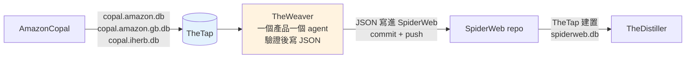
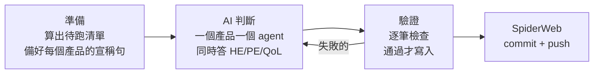

# TheWeaver - AI 分類（產品分類生成器）

---

## 📋 文檔目的

本文檔介紹 **TheWeaver**，幫助新人理解：

- 它判斷什麼：每個產品的功效、屬性分類（10 個知識領域）
- 資料從哪來（AmazonCopal 的 copal db）、結果放哪（SpiderWeb repo）、最後交給誰（TheDistiller）
- 分類樹（taxonomy）為什麼是「題目」而不是「答案」

> **給你的閱讀建議**：先看「🎯 系統職責」與「🔄 在管線裡的位置」；想知道 AI 被怎麼約束，看「🌳 分類樹是約束，不是產物」。

> **完整技術文檔**：[TheWeaver repo](https://github.com/mapleelpam/LuminNexus-AlchemyMind-TheWeaver)

---

## 🎯 系統職責

**TheWeaver** 讓 AI 讀產品的文字資料，回答「這個產品宣稱對什麼有幫助」「它有哪些認證、適合哪種飲食」這類問題，並把答案對到一棵事先定好的分類樹上。

TheWeaver → SpiderWeb 這條線叫**功效分類線**，產出十個知識領域的 AI 分類；其中健康效果、效能提升、生活品質（HE／PE／QoL）三個領域的結果叫**功效分類**，是 TheWatershed 用來切訴求群的那部分。

| 項目 | 說明 |
|------|------|
| **職責** | 用 AI 替產品做功效與屬性分類，驗證後寫成 JSON |
| **輸入** | 宣稱句（AmazonCopal 從產品頁逐字抄下來的原句），經 TheTap 發佈：`copal.amazon.db`（Amazon 美國站）、`copal.amazon.gb.db`（Amazon 英國站）、`copal.iherb.db`（iHerb） |
| **輸出** | 每個產品、每個知識領域一份 JSON，寫進 SpiderWeb repo；**TheWeaver 本身不產出 .db** |
| **下游** | SpiderWeb（收 JSON、建 `spiderweb.db`）→ TheDistiller；HE/PE/QoL 的功效分類也是 TheWatershed 切訴求群（市場被切成的一群一群，例如睡眠、關節）的依據 |
| **現況** | iHerb 有宣稱句的 4,764 個產品已全部換成新線（2026-10-18）；部分美國站產品仍用舊線結果（舊線是 AI 直接讀整份產品頁文字，不是讀宣稱句） |

### 命名由來

**Weaver** 是織工。它把零散的產品文字織成一張分類網，那張網就放在 [SpiderWeb](spiderweb.md)（蜘蛛網）裡。

### 10 個知識領域（Knowledge Realms）

一個 realm 就是 AI 回答的一個問題面向，各有一棵分類樹：

| Realm | 中文 | 問的是 |
|-------|------|--------|
| **Health Effect (HE)** | 健康效果 | 對身體系統功能的改善宣稱 |
| **Performance Enhancement (PE)** | 效能提升 | 可測量的運動或認知表現 |
| **Quality of Life (QoL)** | 生活品質 | 日常體驗與幸福感（睡眠、情緒等） |
| Certification | 認證標章 | 第三方認證 |
| Dietary Adaptability | 飲食適性 | 素食、無麩質等 |
| Ingredient Purity | 成分純度 | 純度指標 |
| Formulation Technology | 配方技術 | 劑型與傳送技術 |
| Usage Context | 使用情境 | 什麼時機、場景用 |
| Usage Convenience | 使用便利性 | 服用方便程度 |
| Flavor Characteristics | 風味特徵 | 口味 |

另有兩項不掛分類樹的判斷：**可不可以吃**（是非題）、**劑型**（從一份固定清單裡挑，不是樹）。

---

## 🔄 在管線裡的位置

- **TheWeaver 不自己發 `.db`**：它把結果直接寫進 SpiderWeb repo。
- **要 commit 並 push 到 SpiderWeb 的 main 才算交出去**：TheTap 每晚從 SpiderWeb 的 main 建 `spiderweb.db`，留在自己電腦上的 JSON 不會進正式版。
- 同一個 copal db 也流向 Carboniferous，那是另一條線，見 [AmazonCopal](amazoncopal.md)。

---

## 📥 輸入：copal 的宣稱句

[AmazonCopal](amazoncopal.md) 已經用 AI 把每個產品頁、圖片上的宣稱句逐字抄出來，存成 copal db。TheWeaver 的功效分類線只讀這些**純文字宣稱句**，不再看圖片，因為 copal 已經看過了。

| 市場 | 讀的檔 |
|------|--------|
| 美國站 | `copal.amazon.db` |
| 英國站 | `copal.amazon.gb.db` |
| iHerb | `copal.iherb.db` |

三份都由 TheTap 發佈。

同一個 ASIN（Amazon 給每個產品的編號）在美國站和英國站是不同的商品頁，所以兩站的結果分開存。

---

## ⚙️ 功效分類線怎麼跑（HE / PE / QoL）

這是 2026-10 起的主力流程，一批一批跑：

- **一個產品一個 agent**（agent＝會自己讀資料、照規則作答的 AI 助手）。三個 realm **各自獨立判斷**，同一句宣稱可以同時進 HE 和 QoL。
- **agent 不直接寫檔**。驗證程式檢查兩件事才寫：選的分類節點真的存在於樹上；引用的宣稱句**一字不差**是 copal 裡的原句。
- 驗證沒過的產品會重跑。
- 每批跑完在 TheWeaver 寫一份交接紀錄。

**新舊兩條線**：新線產出的檔案會標記來源是 copal；沒有這個標記的是舊線結果：那時 AI 直接讀整份產品頁文字（標題、描述、賣點條列），不是讀 AmazonCopal 抄好的宣稱句。風味（Flavor）另走一條**查表線**：用對照表把 copal 的口味句對到分類樹，不經 AI agent。

其他六個知識領域（認證標章、飲食適性、成分純度、配方技術、使用情境、使用便利性）以及可食用、劑型，還沒有改讀宣稱句：現有結果都是舊線產生的，最近一次新增在 2026-04。

---

## 🌳 分類樹是約束，不是產物

- 每個 realm 的分類樹（taxonomy）是**人工維護、跟程式碼一起版控的 JSON**，不是 AI 生成的。
- 格式是純巢狀：每一層是節點名稱，最底層的是葉節點。
- 分析前，整棵樹會被放進 prompt（給 AI 的指示文字），**AI 只能從既有的葉節點挑**，不能自創。每筆結果帶一條分類路徑，例如 `Quality of Life → Mental & Psychological Health → Sleep Improvement`。
- 樹的正本在 TheWeaver，SpiderWeb 保留一份副本並替每個節點配固定編號。改樹時兩邊都要同步，見 [SpiderWeb](spiderweb.md)。

---

## 📤 交接方式：寫進 SpiderWeb

| 項目 | 說明 |
|------|------|
| 位置 | SpiderWeb repo，每個產品、每個知識領域一份 JSON |
| 內容 | 分類結果（每筆附引用的原句、信心分數、一句判斷理由）＋這份結果怎麼產生的紀錄（用哪一版指示、哪個模型、何時產生） |
| 規則 | 一個產品一個 realm 只留**一份目前最好的結果**，新的直接覆蓋，舊版靠 git 歷史追 |
| 寫入方式 | 驗證通過才寫；分批 commit，push 到 main |
| 之後 | TheTap 從 SpiderWeb main 建 `spiderweb.db`，通過檢查才上架，TheDistiller 讀它 |

---

## 📖 故事

| 時間 | 事件 |
|------|------|
| 2026-10-02 | 改成「一個產品一個 agent、讀 copal 宣稱句」產生 HE/PE/QoL；同時立下引文必須一字不差的規則 |
| 2026-10-08 | TheWeaver 開始跑英國站 |
| 2026-10-12 | 分類樹改為封閉集合：對不上樹的路徑，SpiderWeb 建置時直接丟掉 |
| 2026-10-14～16 | Flavor 改用 copal 查表線，取代舊線結果 |
| 2026-10-17～18 | 清掉 iHerb 舊線；iHerb 有宣稱句的 4,764 個產品全換新線 |

---

## 🐛 常見問題

### Q1: 我在 TheWeaver 跑完了，distiller.db 怎麼還沒變？

確認三件事：SpiderWeb 有沒有 commit 並 push 到 main；TheTap 當晚有沒有建出新的 `spiderweb.db`，而且用的是包含你那次 commit 的版本（可在 http://maple-msi.local/ 查）；TheDistiller 有沒有重建。

### Q2: AI 判錯了，可以直接改 JSON 嗎？

不建議手改。單一產品可以用 TheWeaver 的重跑工具重新判斷，它會經過同一套驗證。分類樹有缺口時不要自己開節點，回報 maple（AlchemyMind 負責人）。

---

## 📚 相關文檔

### Learning Map 文檔
- [AmazonCopal](amazoncopal.md)：copal db 的生產者（上游）
- [SpiderWeb](spiderweb.md)：收下 JSON、建成 `spiderweb.db`（下游）
- [TheTap](thetap.md)：copal db 與 `spiderweb.db` 的發佈
- [TheDistiller](thedistiller.md)：`spiderweb.db` 的使用者
- [TheWatershed](thewatershed.md)：用 HE/PE/QoL 的功效分類切訴求群

### TheWeaver 專案文檔
[TheWeaver repo](https://github.com/mapleelpam/LuminNexus-AlchemyMind-TheWeaver) 裡有專案總覽（CLAUDE.md）、功效分類線操作手冊、每批的交接紀錄，以及 HE 分類樹每次改了什麼的紀錄。

---

## 📝 文檔維護

### 版本歷史

| 版本 | 日期 | 作者 | 變更說明 |
|------|------|------|----------|
| 1.0 | 2025-12-09 | AlchemyMind Team | 初版建立 (簡潔版) |
| 1.1 | 2026-07-29 | Dustin | 據 repo 現況修正三項與 taxonomy 概念直接相關的敘述：① Taxonomy 改為人工維護的版控輸入、角色是約束 LLM 只能選既有葉節點，非「LLM 生成並人工審核」；② Knowledge Realm 清單補上 dietary_adaptability、移除 edible（它與 knowledge_realms 平行且不掛 taxonomy），並註明 4 個 dosage facet 用平面清單而非階層樹；③ Taxonomy JSON 範例改為實際格式（純巢狀、空 {} 為葉、無 ID 無版本欄位）與正確位置，補上 taxonomy_path 的路徑字串形式 |
| 1.2 | 2026-10-20 | weiling | 依現況重整：輸入改為 AmazonCopal 的 copal db、輸出改為寫進 SpiderWeb、下游改為 SpiderWeb → TheDistiller；新增 realms 線流程、交接方式、故事；刪除 TheRefinery／Vault／TheForge 循環架構、Batch API 指令與成本估算、request/response 範例 |
| 1.3 | 2026-10-21 | weiling | 依 review 修正：刪除操作細節（路徑、指令、程式檔名、欄位值）、待決事項與 repo 文件過時的問答；TheDistiller 改為一般連結；交接內容補上每筆附判斷理由；copal.iherb.db 改為經 TheTap；名詞依統一對照（線名統一為「功效分類線」）；ASIN、HE/PE/QoL 加白話，補舊線的輸入；定義功效分類線與功效分類，補其他六個領域的現況 |

### 系統依賴

**上游依賴**：
- AmazonCopal：`copal.amazon.db`、`copal.amazon.gb.db`、`copal.iherb.db`（都經 TheTap）

**下游依賴**：
- SpiderWeb：收 JSON、建 `spiderweb.db`
- TheDistiller：讀 `spiderweb.db`
- TheWatershed：讀 `distiller.db` 裡的 HE/PE/QoL 分類

---

**文檔結束**
